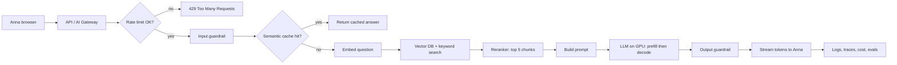

# The Story of One Request

> [!abstract] Why read this
> Interviewers often say *"Walk me through what happens when a user sends a message."* `[JAM]`
> This story connects **every** building block in this wiki. Learn it like a movie.

**Setup**: Anna uses the support chatbot of a SaaS company. She types: *"How do I get a refund for my last invoice?"*



## Scene 1 — The front door (Gateway)
Anna's message hits the **API / AI Gateway**. It checks **who she is** (auth), and which model/service should handle it. Every LLM call in the company passes this one door, so we can track cost and switch providers easily `[OS]` `[JAM]`.
→ [[API Gateway and AI Gateway]]

## Scene 2 — The bouncer (Rate limiting)
Has Anna sent too many messages or tokens this minute? If yes → reject. This protects our **money** (denial-of-wallet) and other users' GPU time `[JAM]`.
→ [[Rate Limiting]]

## Scene 3 — The security check (Input guardrail)
Is there a credit card number (PII)? Is she trying "ignore all previous instructions…" (prompt injection)? Block or clean it `[OS]`.
→ [[Guardrails]], [[Prompt Injection]]

## Scene 4 — "Have we answered this before?" (Semantic cache)
Someone asked *"How can I get my money back for an invoice?"* yesterday. Different words, same meaning. The **semantic cache** finds it and returns the answer in milliseconds — no LLM call, no cost `[OS]`.
(But never share cached answers that contain one user's private data! `[OS]`)
→ [[Semantic Cache]]

## Scene 5 — Finding the right documents (RAG retrieval)
Cache miss. The model doesn't know this company's refund policy, so we look it up `[OS]`:
1. Turn the question into an **embedding** (numbers that mean "refund for invoice").
2. Search the **vector database** (by meaning) **and** keyword search (by exact words like "invoice") → **hybrid search**.
3. Take the top 50 pieces ("chunks"), let a **reranker** pick the best 5.
→ [[RAG Fundamentals]], [[Hybrid Search, HyDE, Reranking, ColBERT]]

## Scene 6 — Packing the bag (Build the prompt / context)
```
[System prompt: rules, "only use context, else say I don't know"]   <- same for everyone (cacheable)
[5 chunks about refunds]
[Anna's question]
```
Fixed parts first so the **prompt cache** can reuse them; important facts near the question `[OS]`.
→ [[Context Engineering]], [[Prompt Cache]]

## Scene 7 — Which brain? (Routing)
Easy question → small, cheap, fast model. Hard question → big model. Saves 50–70% cost `[OS]`.
→ [[LLM Routing]]

## Scene 8 — The GPU does the work (Prefill + Decode)
The **inference server** (e.g. vLLM) on a GPU:
- **Prefill**: reads the whole prompt at once → produces the first token. This sets **TTFT** (time to first token).
- **Decode**: writes the answer one token at a time, using the **KV cache** so it doesn't re-read everything. This sets speed per token (**TPOT**).
Many users share the GPU thanks to **continuous batching** `[OS]`.
→ [[Prefill vs Decode]], [[KV Cache]], [[Continuous Batching]]

## Scene 9 — The exit check (Output guardrail)
Did the answer leak private info? Go off-topic? Make something up? Block, retry, or clean `[OS]`.

## Scene 10 — Words appear on screen (Streaming)
Tokens are sent to Anna as they are generated via **SSE**. She sees the first word in < 1 s even if the full answer takes 8 s `[OS]`.
→ [[Streaming Responses]]

## Scene 11 — Behind the curtain (Observability, cost, evals)
We log: latency, tokens, cost, which chunks were used, thumbs up/down. Some conversations are graded later by an **LLM judge** to check the answer was **faithful** to the documents `[OS]`.
→ [[Observability]], [[Evaluation - LLM and Agent]]

## What if something breaks?
| Problem | What the system does |
|---|---|
| OpenAI is down | Gateway switches to a fallback model `[OS]` |
| Vector DB times out | **Circuit breaker** opens; answer with a safe fallback ("Let me connect you to a human") `[JAM]` |
| Traffic spikes at 9am | **Auto scaling** + warm GPU pool `[OS]` `[JAM]` |
| Model returns broken JSON | Validate and retry `[OS]` |
| Bot isn't confident | Escalate to human support `[OS]` |
→ [[Fault Tolerance and Circuit Breakers]]

> [!tip] Practice
> Close this note. Draw the diagram on paper from memory and narrate each scene in **2 sentences**. If you can do it in 3 minutes, you already beat many candidates.
