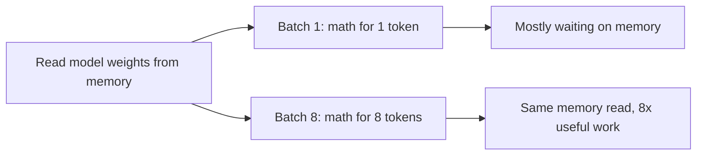

# AI Hardware — GPU, TPU, LPU

> [!success] 🟢 Junior Explanation
> **In plain words:** GPUs do thousands of math operations at once, so they run AI. But when a model writes an answer, the slow part is reading the model from memory, not the math.
>
> **Analogy:** GPU memory (HBM) is a warehouse next door; an LPU keeps everything on your desk (SRAM). Walking to the warehouse for every word is what slows you down.
>
> **Why interviewers ask:** To see if you understand the real bottleneck — memory speed during generation.
>
> **Say it in one sentence:** "Text generation is memory-bound, so chips that move data faster (or optimizations that move less data) make answers faster."
>
> 🎯 **Junior must know:** GPUs are needed and expensive (~$2–4/hour for an H100). · **Middle adds:** HBM vs SRAM, GPU vs TPU vs LPU, and when each fits.

## The chips `[OS]`
- **CPU** — general worker; few things at a time.
- **GPU** — huge team of workers; built for graphics, great at parallel ML math. NVIDIA powers almost all modern AI.
- **TPU (Tensor Processing Unit)** — Google's chip specialized for ML math (tensor = grid of numbers).
- **LPU (Language Processing Unit)** — Groq's chip for one job: running an already-trained LLM and producing text as fast as possible.

## The most important lesson `[OS]`
> [!important] While an LLM *writes* the answer, the bottleneck is **memory, not math**.
> To produce every token, the chip must read the full model weights from memory.
- GPU keeps weights in **HBM** (High Bandwidth Memory) next to the chip.
- LPU keeps weights in **SRAM** inside the chip → data doesn't travel.

## GPU vs LPU `[OS]`
| | GPU | LPU |
|---|---|---|
| Built for | Any parallel math; training + inference | Running a trained LM |
| Weights live | HBM, next to chip | SRAM, inside chip |
| Memory speed | ~3 TB/s | ~80 TB/s |
| Memory per chip | Tens of GB | ~230 MB |
| Chips for large model | A few | Hundreds |
| Single-user speed | Moderate | Very high |
| Batching | Needed for good total output | Not needed for good speed |
| Training | Yes | No |
| Flexibility | Very high | Low (planned ahead of time) |

## When to use which `[OS]`
- **GPU** — training, frequent experiments, many model types, big batch jobs nobody waits on. **Default.**
- **TPU** — on Google Cloud, large training/inference fitting TPU stack.
- **LPU** — model fixed & trained, answer speed is what users feel: chat, voice, agents, reasoning models.

> [!tip] Bigger lesson `[OS]`
> Once a workload is **memory bound**, the win comes from **moving data less**, not computing more. Same idea reappears in [[Prefill vs Decode]], [[KV Cache]], [[Flash Attention]].

## 🌐 Deeper Context `[WEB]`

**The roofline model in plain words.** Every chip has two speeds: how fast it does math (FLOPs/second) and how fast it reads memory (bytes/second). Divide them and you get the **ridge point** — how many math operations the chip must do *per byte read* to keep its math units busy.

| Finding | Why it matters |
|---|---|
| Decode at batch size 1 does about **1 FLOP per byte** read (BF16) | Far below the ridge point → math units sit idle, waiting for memory |
| An H100's ridge point is in the **hundreds of FLOPs per byte** (estimates ~280–590 depending on precision and assumptions) | You'd need a batch of hundreds of tokens per step to become compute-bound |
| Batching makes intensity grow roughly **with batch size**: one weight read serves many users | This is *why* batching is the #1 throughput lever |
| In practice the **KV cache** becomes the next memory bottleneck before decode turns compute-bound | Why KV cache compression / GQA matter |

**Sources:** [Arithmetic intensity explainer](https://www.zeroentropy.dev/concepts/arithmetic-intensity/) · [Roofline for LLM inference](https://www.spheron.network/blog/the-roofline-model-for-llm-inference-are-you-compute-bound-o/) · [Why decode is memory-bound](https://dev.to/ji_ai/why-llm-decoding-is-memory-bound-prefill-vs-decode-roofline-223f)

> [!question] Recall
> 1. Why is decode memory-bound? What does the LPU do differently?
> 2. Pick hardware for: voice agent with fixed model; nightly fine-tuning; Google Cloud training.

Related: [[Inference Server and Engines]] · [[Prefill vs Decode]]

➡️ **Go deeper:** [[GPU Architecture for Inference Engineers]] · [[Roofline and Performance Modeling]]
