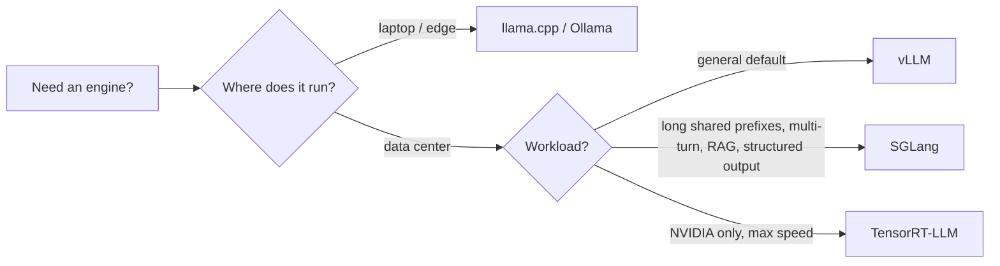

# Inference Server and Engines

> [!success] 🟢 Junior Explanation
> **In plain words:** An inference server is the program that keeps the model loaded on a GPU and answers requests. If you use OpenAI or Anthropic, you are using *their* inference server.
>
> **Analogy:** A kitchen with one very expensive chef (the GPU) — your job is to never let him stand idle.
>
> **Why interviewers ask:** To see if you know when to call an API vs host your own model, and which engine to pick.
>
> **Say it in one sentence:** "If we self-host we run an inference server like vLLM on GPUs; otherwise we call a provider's server through an API."
>
> 🎯 **Junior must know:** API vs self-hosting; vLLM is the default engine. · **Middle adds:** when to choose SGLang, TensorRT-LLM, llama.cpp, and that vLLM wins with PagedAttention + continuous batching.

## What it is `[OS]`
An **inference server** loads the LLM into **GPU memory** and serves prediction requests. It is the **heaviest component** of an AI system.

```
Client -> Backend Server -> Inference Server (with GPU) -> LLM
```
- Using OpenAI/Anthropic API → you call *their* inference server over the internet.
- Running Llama/Mistral yourself → you run vLLM/TGI on a GPU machine; backend calls it.

**Cost reference** `[OS]`: one H100 ≈ **$25k–$40k** to buy, or **~$2–$4/hour** to rent.

> [!example] Analogy `[OS]`
> Regular server = kitchen with a few cooks. Inference server = kitchen with **one very expensive chef (the GPU)**. Never let the chef sit idle.

So AISD invests heavily in: keeping GPU at full capacity, [[Caching in AI - Overview|caching]] to avoid GPU calls, [[LLM Routing|routing]] cheap requests to cheap models.

## Engine comparison `[OS]`
| Engine | Sweet spot | Notes |
|---|---|---|
| **vLLM** | **Default choice** | Most adopted; broadest hardware (NVIDIA, AMD, Intel, AWS Trainium). Famous for **PagedAttention** + **continuous batching**. Up to **24×** throughput over naive deployment. |
| **SGLang** | Multi-turn chat, structured output, RAG (high prefix overlap) | Reuses KV cache of shared prefixes. Often higher throughput than vLLM on 7–8B on H100; gap narrows at 70B+. Supports prefill-decode disaggregation. |
| **TensorRT-LLM** | NVIDIA-only, max speed / lowest latency | Compiles model ahead-of-time for exact GPU. Lock-in to NVIDIA. |
| **TGI** | (legacy) | Hugging Face moved to **maintenance mode Dec 2025**; points new deployments to vLLM/SGLang. |
| **llama.cpp** | Laptop / desktop / edge | Quantization + CPU/GPU split; **GGUF** single-file format. **Ollama** built on it. |

## Rule of thumb `[OS]`
1. Default → **vLLM**.
2. Multi-turn / structured output / RAG → **SGLang**.
3. NVIDIA-only & speed worth lock-in → **TensorRT-LLM**.
4. Local / single machine / edge → **llama.cpp**.

## 🌐 Deeper Context `[WEB]`

What official docs and papers add:

| Finding | Why it matters for your design |
|---|---|
| Hugging Face's TGI docs say TGI is **in maintenance mode** (minor fixes only) and recommend **vLLM, SGLang**, or local engines **llama.cpp / MLX** | Confirms `[OS]`: don't pick TGI for a new deployment |
| vLLM's peer-reviewed paper reports **2–4× throughput** vs strong baselines (FasterTransformer, Orca) at the same latency; its launch blog reports much bigger multiples vs plain Hugging Face Transformers | The `[OS]` "up to 24×" is vs **naive** serving. In interviews say: *"2–4× vs strong systems, much more vs naive"* |
| SGLang's **RadixAttention** keeps the KV cache of prompts *and* generated outputs in a **radix tree** (prefix tree), with LRU eviction and cache-aware scheduling | This is *why* SGLang shines for multi-turn chat, RAG and agents that reuse long prefixes |
| Continuous batching comes from **Orca (OSDI 2022)** "iteration-level scheduling" | Shows you know where the idea came from → [[Continuous Batching]] |



**Sources:** [TGI docs](https://huggingface.co/docs/text-generation-inference/index) · [vLLM paper (arXiv 2309.06180)](https://arxiv.org/abs/2309.06180) · [vLLM blog](https://vllm.ai/blog/vllm) · [SGLang / RadixAttention (LMSYS)](https://lmsys.org/blog/2024-01-17-sglang) · [SGLang paper](https://arxiv.org/pdf/2312.07104)


> [!question] Recall
> 1. Why is the GPU "the expensive chef", and what 3 things do we do about it?
> 2. Pick an engine for: (a) RAG chatbot w/ long shared system prompt, (b) on-laptop assistant, (c) generic default.
> 3. What two tricks made vLLM famous?

Related: [[AI Hardware - GPU TPU LPU]] · [[KV Cache]] · [[Continuous Batching]] · [[Prefill vs Decode]]

➡️ **Go deeper:** [[Inference Engine Internals]] · [[Benchmarking and Profiling Methodology]]
