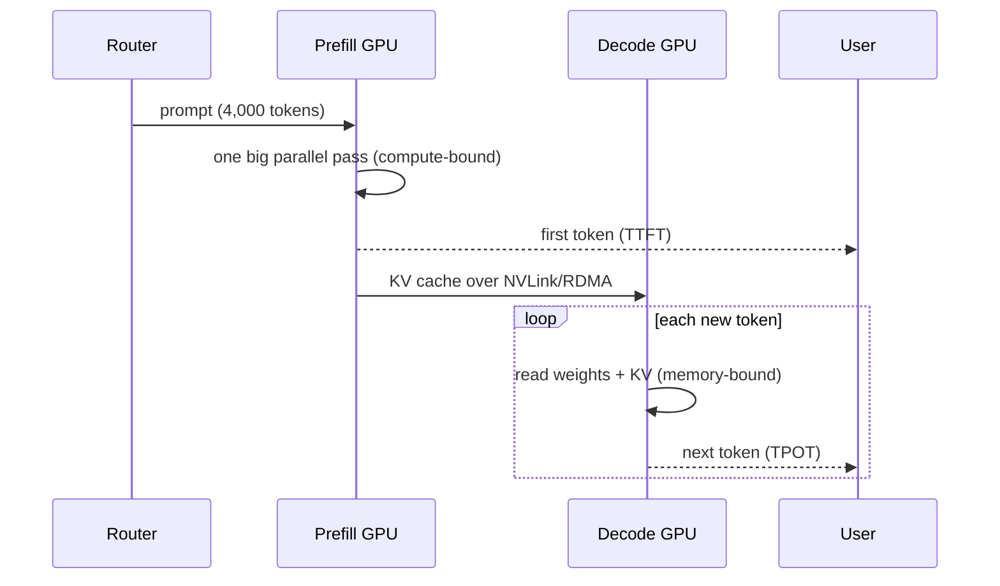

# Prefill vs Decode

> [!success] 🟢 Junior Explanation
> **In plain words:** Every request has two phases: prefill reads your whole prompt at once, decode writes the answer one token at a time.
>
> **Analogy:** An exam: first you quickly read the whole question paper (prefill), then you slowly write the answer word by word (decode).
>
> **Why interviewers ask:** It explains TTFT vs TPOT, why output costs more, and why most optimizations target decode.
>
> **Say it in one sentence:** "Prefill is compute-bound and sets TTFT; decode is memory-bound and sets time per token."
>
> 🎯 **Junior must know:** the two phases and which metric each controls. · **Middle adds:** chunked prefill and prefill-decode disaggregation and when to use them.

Every request goes through two phases, same model + same weights, very different behavior `[OS]`.
- **Prefill** = model *reading* the question.
- **Decode** = model *writing* the answer.

## Prefill `[OS]`
- Processes the **entire prompt in one pass**, produces **first output token**.
- All prompt tokens known up front → processed **in parallel**.
- Computes and stores K and V of every input token → builds the [[KV Cache]].
- **Compute-bound** (big matrix × big matrix). GPU math units often **~90%+** busy on large prompts.
- Longer prompt → longer prefill → higher **TTFT**.
- Analogy: student silently reads whole exam paper.

## Decode `[OS]`
- Generates tokens **one at a time**, reusing KV cache.
- Tiny math per step, but GPU must still read **full weights + growing KV cache** from memory each step.
- **Memory-bandwidth-bound**; math units ~**20–40%** busy for a single request.
- Determines **TPOT**. Prefill takes a fraction of a second; decode can run several seconds.
- Analogy: chef walking to a giant pantry for **one ingredient per trip** — walking (data movement) ≫ chopping (math).

## Comparison `[OS]`
| Aspect | Prefill | Decode |
|---|---|---|
| Does | Process whole prompt | Generate tokens one by one |
| Parallelism | Parallel | Sequential |
| Steps | One big | Many small |
| Bottleneck | Compute | Memory bandwidth |
| GPU util | High (~90%+) | Low (~20–40%) |
| KV cache | Writes | Reads & extends |
| Metric | TTFT | TPOT |
| Cost driver | Prompt length | Streams weights + KV every step |

> [!important] Explains a lot `[OS]`
> Why input tokens are cheaper than output · why long prompts slow first token · why most optimizations target decode.

## Chunked Prefill `[OS]`
Problem: on a shared GPU, one giant prefill **freezes other users' decode** → stuttering streams.
Fix: split long prefill into chunks; slip decode steps between them.
```
WITHOUT: [====== ONE BIG PREFILL ======]   others: tok ...frozen... tok
WITH:    [c1][c2][c3][c4][c5]              others: tok tok tok tok tok
```
> [!note] Protects ongoing answers from stalling. Does **not** make prefill itself faster.

## Prefill-Decode Disaggregation `[OS]`
Run prefill and decode on **separate GPU pools** so they never fight.
Parts: **Router** → **Prefill workers** (compute-tuned; build KV cache, first token) → **KV cache transfer** (NVLink / InfiniBand / RDMA) → **Decode workers** (memory-tuned).

Worked example: 4,000-token prompt, 200-token answer → prefill ~400 ms (TTFT ≈ 400 ms), 2 GB KV cache copied in 20–50 ms, decode 200 × 20 ms ≈ 4 s. Prefill worker already serving next user.

| | Co-located | Disaggregated |
|---|---|---|
| Interference | Yes | No |
| TTFT vs TPOT | Trade-off | Tuned separately |
| Scaling | Together | Independently |
| KV transfer | Not needed | Every request |
| Network | None | Fast interconnect required |
| Complexity | Low | High |
| Best for | Small scale, short prompts | Large scale, long prompts |

Small setup → chunked prefill. Large setup → disaggregation (SGLang supports it out of the box).

## 🌐 Deeper Context `[WEB]`

| Finding | Why it matters |
|---|---|
| **Prefill** is one big matrix multiplication over all prompt tokens → hundreds/thousands of FLOPs per byte → **compute-bound** | Long prompts cost GPU *math* → TTFT grows with prompt length |
| **Decode** at batch 1 ≈ **1 FLOP per byte** → **memory-bound** | Explains `[OS]`'s "chef walking to the pantry" analogy in numbers |
| **Sarathi-Serve (OSDI '24)** is the research system behind **chunked prefill**: slice the prompt into chunks and piggyback decode steps alongside each chunk | Academic name to drop when you mention chunked prefill |
| **DistServe (OSDI '24)** disaggregates prefill and decode onto different GPUs; reports up to **7.4× more requests** or **12.6× tighter SLOs** vs state-of-the-art systems, measured as **goodput** | Evidence that disaggregation pays off at scale |
| Trade-off: chunked prefill keeps one GPU busy but still has some phase interference; disaggregation removes interference but costs more hardware + KV transfer | Exactly the `[OS]` co-located vs disaggregated table — now with sources |



**Sources:** [DistServe (OSDI '24)](https://www.usenix.org/conference/osdi24/presentation/zhong-yinmin) · [DistServe arXiv](https://arxiv.org/pdf/2401.09670) · [Prefill-decode disaggregation explainer](https://mohakchugh.is-a.dev/blog/prefill-decode-disaggregation-llm-serving) · [UW serving-systems lecture](https://courses.cs.washington.edu/courses/cse599k/24au/content/05-Serving-Systems.pdf)


> [!question] Recall
> 1. Why is prefill compute-bound and decode memory-bound?
> 2. A user complains streams stutter when someone pastes a huge doc. Fix?
> 3. Draw the disaggregated architecture and name what crosses the network.

Related: [[KV Cache]] · [[Latency and Cost Metrics]] · [[Inference Optimization - Overview]] · [[Speculative Decoding]]

➡️ **Go deeper:** [[Roofline and Performance Modeling]] · [[Inference Engine Internals]]
