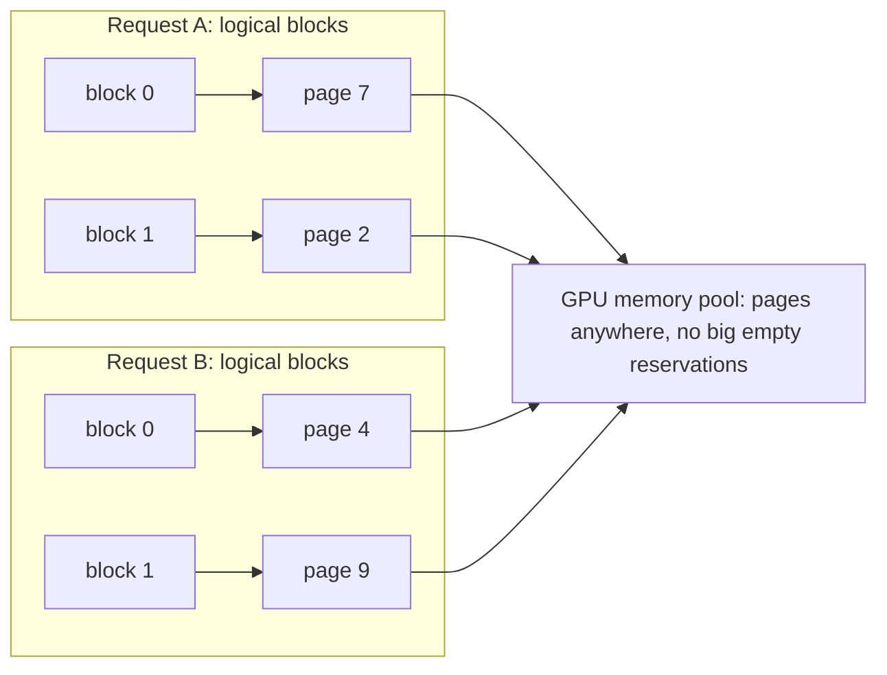

# 02 · KV Cache

> [!success] 🟢 Junior Explanation
> **In plain words:** While writing each new word, the model needs information about all previous words. The KV cache saves it once so it isn't recomputed every step. It costs GPU memory.
>
> **Analogy:** Taking notes in a meeting so you don't ask everyone to repeat themselves each time a new person speaks.
>
> **Why interviewers ask:** It's behind GPU memory limits, long-context cost, and many optimizations.
>
> **Say it in one sentence:** "The KV cache stores Keys and Values of past tokens so decode doesn't recompute them; it trades GPU memory for speed."
>
> 🎯 **Junior must know:** what it stores and why (≈50× fewer computations at 100 tokens). · **Middle adds:** memory math (0.5 MB/token example), PagedAttention, KV compression and GQA.

> Core track #02 — Reusing Keys and Values to speed up inference, the GPU memory it costs, PagedAttention, GQA and MQA.

## The problem `[OS]`
In [[Attention]], each token → Q, K, V. The current token's **Query** compares against **Keys of all previous tokens**, then collects their **Values**. Without caching, each step **recomputes K and V for every previous token**:
```
Step 1: "I love"            compute K,V,Q for I, love        -> "teaching"
Step 2: "I love teaching"   RECOMPUTE K,V for I, love + new  -> "AI"
Step 3: ...                 RECOMPUTE K,V for I, love, teaching ...
```

## The idea `[OS]`
Compute K and V **once per token, store, reuse** every future step. That store = **KV Cache**.
Analogy: meeting notes — don't ask every previous speaker to repeat; read notes, listen only to the new speaker.

### Savings (100 tokens) `[OS]`
- Without: 2 + 3 + … + 100 = **5,049** K/V computations.
- With: 2 + 1 + … + 1 = **101** → **~50× fewer**; grows with length.

### Why not cache Q? `[OS]`
Query is only needed for the **current** token. Past K and V are needed at **every** future step.

## The cost: GPU memory `[OS]`
Cache lives in memory the whole time the conversation is active. Llama-2-like model (32 layers, 32 heads, head_dim 128, 2 bytes):
```python
per_token = 2 * 32 * 32 * 128 * 2   # K and V
# = 0.5 MB per token
```
- 4,000 tokens → **2 GB**; 100,000 tokens → **50 GB** — for **one user**.
- GPU has 24–80 GB, much taken by weights. KV cache grows with **length × users** → limits concurrent long conversations.

## PagedAttention `[OS]`
OS-style memory paging. Instead of reserving one big block per request upfront (wasteful — output length unknown), allocate **small fixed-size pages** as the response grows; a **page table** tracks ownership.
Hotel analogy: don't reserve 30 consecutive rooms per guest; give one room at a time wherever free. → many more users per GPU. Core vLLM trick.

## KV Cache Compression `[OS]`
| | Quantization | Token Eviction | Sharing across Heads | Low-Rank |
|---|---|---|---|---|
| How | Fewer bits/number | Fewer tokens stored | Fewer K/V per layer | Smaller vector/token |
| Retrain? | No | No | **Yes** | **Yes** |
| Drops tokens? | No | **Yes** | No | No |
| Saving | 2–4× | Fixed cache size | 4–8× | 10×+ |
| Quality loss | Very little | Task-dependent | Very little | ~None |
| Example | KIVI | H2O, StreamingLLM | **GQA, MQA** | **MLA** (DeepSeek) |

Choose `[OS]`:
- Existing model, quick win → **quantize the cache**.
- Very long / endless stream → **token eviction with attention sinks**.
- Need exact recall of long docs → **don't** evict.
- Training a new model → **GQA or MLA** from day one.

GQA/MQA: many heads **share** K and V; MLA stores a small compressed vector per token. → [[Grouped Query Attention]]

Smaller KV cache ⇒ more users per GPU, longer contexts, faster decode — without bigger GPU `[OS]`.

## Related caches
- [[Prompt Cache]] = KV cache of a shared **prefix**, reused across requests.
- [[Load Balancing for LLMs|Prefix-aware routing]] / sticky sessions keep caches warm.
- Disaggregation ships KV cache between GPUs → [[Prefill vs Decode]].

## 🌐 Deeper Context `[WEB]`

| Finding | Why it matters |
|---|---|
| Before PagedAttention, serving systems **wasted 60–80% of KV-cache memory** to fragmentation and over-reservation; vLLM cut waste to **under 4%** (only inside each sequence's last block) — vLLM blog | Less waste ⇒ bigger batches ⇒ more users per GPU |
| PagedAttention paper (Kwon et al.): **2–4× throughput** vs FasterTransformer and Orca at the same latency; gains grow with **longer sequences, bigger models, complex decoding** (e.g. beam search) | Use this number when comparing against strong baselines |
| **GQA** paper (Ainslie et al., EMNLP 2023): convert an existing multi-head checkpoint to GQA by "uptraining" with **~5% of the original pre-training compute**; quality close to MHA at speed close to MQA | GQA is cheap to retrofit, but not free — it still needs some training |
| SGLang **RadixAttention** keeps KV caches in a prefix tree and reuses them across requests automatically | KV cache can be shared **across** requests, not just inside one |



**Sources:** [vLLM blog](https://vllm.ai/blog/2023-06-20-vllm) · [PagedAttention paper (arXiv 2309.06180)](https://arxiv.org/abs/2309.06180) · [GQA paper (arXiv 2305.13245)](https://arxiv.org/abs/2305.13245v2) · [SGLang blog](https://lmsys.org/blog/2024-01-17-sglang)


> [!question] Recall
> 1. Why cache K and V but not Q?
> 2. Compute KV memory for 8,000 tokens on the example model. (→ 4 GB)
> 3. What problem does PagedAttention solve? Explain with the hotel analogy.
> 4. You need 128k-context legal QA with exact recall — which compression options are allowed?

Related: [[Attention]] · [[Prefill vs Decode]] · [[Inference Optimization - Overview]]

➡️ **Go deeper:** [[Long Context and KV Cache Engineering]] · [[Transformer Architecture Deep Dive]] · [[Inference Engine Internals]]
