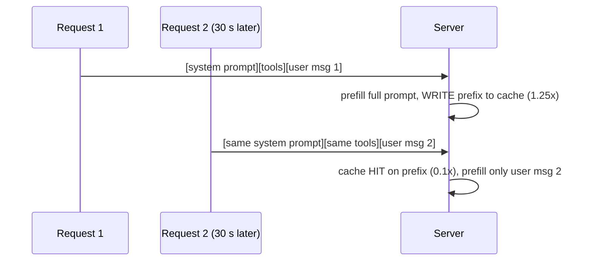

# Prompt Cache (Prefix Caching)

> [!success] 🟢 Junior Explanation
> **In plain words:** If many requests start with the same long text (system prompt, tool list), process it once and reuse the result.
>
> **Analogy:** A teacher photographs the instructions on the board instead of rewriting them every class.
>
> **Why interviewers ask:** Huge cost and TTFT win (up to 90% cheaper input) with one design rule.
>
> **Say it in one sentence:** "Prompt caching reuses the KV cache of a shared prompt prefix, so put fixed content first and the user message last."
>
> 🎯 **Junior must know:** the 'fixed parts first' rule. · **Middle adds:** it's prefix KV reuse; prefix-aware routing keeps it warm.

## Problem `[OS]`
Apps send the same long system prompt with every request (support bot: 3,000-token rules prompt + each user message). Without caching the server re-processes those 3,000 tokens every time.

## Solution `[OS]`
Process the shared prefix once, store its **KV cache**, reuse it; only process the new part. Hence **prefix caching**. Cuts **prefill work and TTFT**.
Analogy: teacher photographs the instructions on the board instead of rewriting them every class.

> [!important] Prompt ordering rule `[OS]`
> Only helps when requests share the **exact same beginning**. Put fixed parts (**system prompt, tool definitions, long documents**) at the **start**; changing parts (user message) at the **end**.

## Impact `[OS]`
OpenAI and Anthropic support it. Cuts **input cost by up to 90%** and reduces TTFT massively.

Infra helpers: [[Load Balancing for LLMs|prefix-aware routing]]; SGLang excels at prefix reuse ([[Inference Server and Engines]]).

## 🌐 Deeper Context `[WEB]`

**How providers price it (check current pricing pages before quoting):**

| Provider | How it works | Price effect |
|---|---|---|
| **Anthropic** | You mark cache breakpoints. Default lifetime **5 minutes**, refreshed for free on every hit; optional **1-hour** cache | Cache **read = 0.1×** base input price · 5-min cache **write = 1.25×** · 1-hour write = 2× |
| **OpenAI** | **Automatic** once the prompt passes ~1,024 tokens — no code changes | Discounted cache reads (exact discount varies by model) |
| **Self-hosted** | vLLM automatic prefix caching, SGLang RadixAttention | Saves GPU prefill work instead of $ on a bill |

> [!example] Worked example (Anthropic-style multipliers, illustrative $3/M input)
> 3,000-token system prompt × 100,000 requests/day = 300M prefix tokens/day.
> - No cache: 300M × $3/M = **$900/day**
> - Cached reads at 0.1×: ≈ **$90/day** (+ small cost for re-writes at 1.25× whenever the cache expires)
> → Caching only pays off if the **same prefix is reused within the TTL**. Low traffic + 5-min TTL = many expensive writes.

**Sources:** [Claude prompt caching docs](https://docs.claude.com/en/docs/build-with-claude/prompt-caching) · [Helicone prompt caching overview](https://docs.helicone.ai/gateway/concepts/prompt-caching) · [Anthropic pricing guide](https://www.eesel.ai/blog/anthropic-api-pricing) · [SGLang RadixAttention](https://lmsys.org/blog/2024-01-17-sglang)

> [!question] Recall
> 1. What's actually stored in a prompt cache?
> 2. Your prompt puts the user's name at the top of the system prompt. What breaks?

Related: [[KV Cache]] · [[Caching in AI - Overview]] · [[Cost Optimization]]
