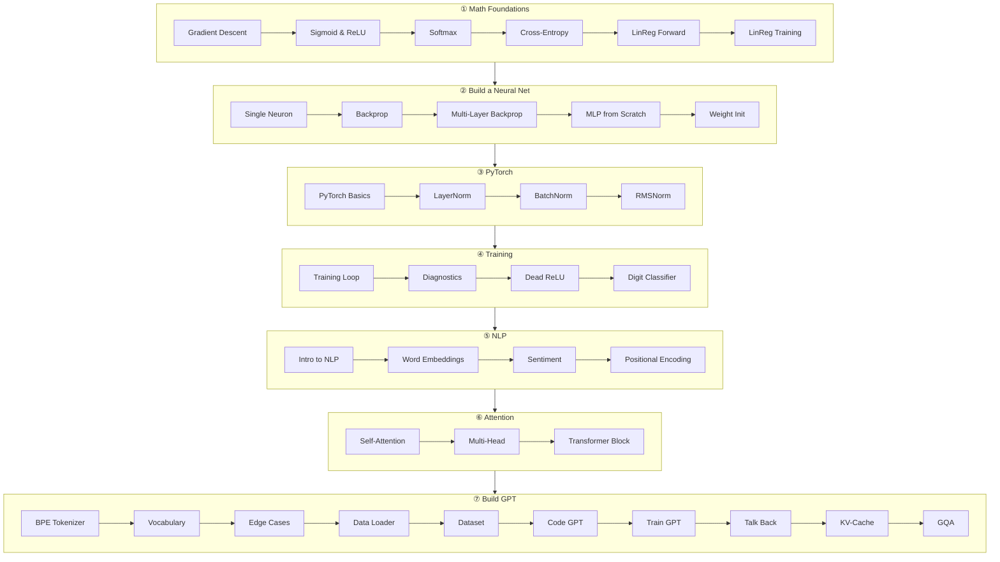

# 🧱 ML From Scratch: Roadmap

> [!success] 🟢 What this is
> 36 small lessons that take you from **"what is a gradient?"** to **a GPT you trained yourself**.
> Each lesson is short and visual, and it ends with code you can run (NumPy first, PyTorch later).
> No prior ML is needed. You only need high-school math and basic Python.

> [!tip] How each lesson is built
> 🟢 **In one sentence** → 🧠 **Analogy** → 👀 **Picture** → 🧮 **Tiny math** → 🔢 **By hand** → 💻 **Code** → ⚠️ **Mistakes** → 🏋️ **Try it**
> Do the "By hand" part with pen and paper before you run the code. That's where it sticks.

## 🗺️ The whole journey on one page



## ✅ Checklist

### ① Math Foundations: *how a machine "learns" a number*
- [ ] [[L01 Gradient Descent]] 🟢 easy
- [ ] [[L02 Sigmoid and ReLU]] 🟢 easy
- [ ] [[L03 Softmax]] 🟢 easy
- [ ] [[L04 Cross-Entropy Loss]] 🟡 medium
- [ ] [[L05 Linear Regression - Forward]] 🟢 easy
- [ ] [[L06 Linear Regression - Training]] 🟡 medium

### ② Build a Neural Net: *stack neurons, learn with the chain rule*
- [ ] [[L07 Single Neuron]] 🟢 easy
- [ ] [[L08 Backpropagation]] 🟡 medium
- [ ] [[L09 Multi-Layer Backpropagation]] 🔴 hard
- [ ] [[L10 MLP from Scratch]] 🔴 hard
- [ ] [[L11 Weight Initialization]] 🟡 medium

### ③ PyTorch: *let the library do the calculus*
- [ ] [[L12 PyTorch Basics]] 🟢 easy
- [ ] [[L13 Layer Normalization]] 🟡 medium
- [ ] [[L14 Batch Normalization]] 🟡 medium
- [ ] [[L15 RMS Normalization]] 🟢 easy

### ④ Training: *make it learn, and know when it isn't*
- [ ] [[L16 Training Loop]] 🟢 easy
- [ ] [[L17 Training Diagnostics]] 🟡 medium
- [ ] [[L18 Dead ReLU Detector]] 🟡 medium
- [ ] [[L19 Digit Classifier]] 🟡 medium

### ⑤ NLP: *turn words into numbers*
- [ ] [[L20 Intro to NLP]] 🟢 easy
- [ ] [[L21 Word Embeddings]] 🟡 medium
- [ ] [[L22 Sentiment Analysis]] 🟡 medium
- [ ] [[L23 Positional Encoding]] 🟡 medium

### ⑥ Attention & Transformers: *words looking at each other*
- [ ] [[L24 Self-Attention]] 🟡 medium
- [ ] [[L25 Multi-Head Self-Attention]] 🔴 hard
- [ ] [[L26 Transformer Block]] 🔴 hard

### ⑦ Build GPT: *the whole thing, end to end*
- [ ] [[L27 Tokenizer - Byte Pair Encoding]] 🟡 medium
- [ ] [[L28 Build Vocabulary]] 🟢 easy
- [ ] [[L29 Tokenization Edge Cases]] 🟡 medium
- [ ] [[L30 GPT Data Loader]] 🟢 easy
- [ ] [[L31 GPT Dataset]] 🟡 medium
- [ ] [[L32 Code GPT]] 🔴 hard
- [ ] [[L33 Train Your GPT]] 🟡 medium
- [ ] [[L34 Make GPT Talk Back]] 🟡 medium
- [ ] [[L35 KV-Cache]] 🔴 hard
- [ ] [[L36 Grouped Query Attention]] 🔴 hard

## 🧰 Setup (2 minutes)

```bash
python -m venv .venv && source .venv/bin/activate
pip install numpy torch scikit-learn
```

The full working GPT from module ⑦ lives in [`code/mini_gpt.py`](code/mini_gpt.py). Run `python code/mini_gpt.py` and it trains in about a minute on a laptop CPU.

## 🧭 After this
You'll be ready for the deeper notes: [[Transformer Architecture Deep Dive]] · [[Training Fundamentals - Loss, Gradients, Optimizers]] · [[Attention]] · [[KV Cache]] · [[Grouped Query Attention]].
