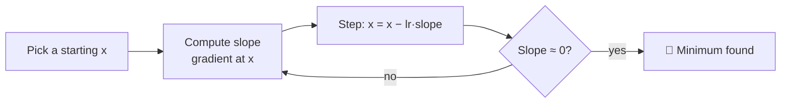

# L01 · Gradient Descent

> [!success] 🟢 In one sentence
> **Gradient descent finds the lowest point of a function by repeatedly taking a small step downhill.**

> [!example] 🧠 Analogy: lost on a foggy mountain
> You can't see the valley. You **can** feel which way the ground slopes under your feet.
> So you take one step in the steepest downhill direction, feel again, and step again. Eventually you reach the bottom.
> - **Slope under your feet** = the *gradient*
> - **Size of your step** = the *learning rate*

## 👀 Picture it

```
 loss
  │ ●  start
  │  ╲
  │   ●        each ● is one step:
  │    ╲       x_new = x_old − lr × slope
  │     ●
  │      ╲__●__●●  ← steps get smaller because the slope gets flatter
  └─────────────────── x
              ▲ minimum (slope = 0)
```



## 🧮 Tiny math

Take the function $f(x) = (x-3)^2$. Its lowest point is at $x = 3$.

- **Slope (derivative):** $f'(x) = 2(x-3)$
- **Update rule:** $x \leftarrow x - \eta \cdot f'(x)$, where $\eta$ (eta) is the learning rate

| Where you are | Slope sign | Step moves x… |
|---|---|---|
| $x < 3$ | negative | **right** ➡️ |
| $x > 3$ | positive | **left** ⬅️ |
| $x = 3$ | zero | stays put ✅ |

The minus sign in the update makes you always walk *against* the slope, which means downhill.

## 🔢 By hand (do this on paper!)

Start at $x=0$ with learning rate $\eta = 0.1$:

| Step | x | slope = 2(x−3) | new x = x − 0.1·slope |
|---|---|---|---|
| 0 | 0.00 | −6.00 | 0.60 |
| 1 | 0.60 | −4.80 | 1.08 |
| 2 | 1.08 | −3.84 | 1.464 |
| 3 | 1.464 | −3.07 | 1.771 |
| … | … | … | → 3.0 |

Each step closes 20% of the remaining gap to 3, so x keeps getting closer.

## 💻 Code from scratch

```python
def f(x):     return (x - 3) ** 2
def grad(x):  return 2 * (x - 3)

x, lr = 0.0, 0.1
for step in range(25):
    x = x - lr * grad(x)
    if step % 5 == 0:
        print(f"step {step:2d}  x={x:.4f}  loss={f(x):.6f}")
print("final x:", round(x, 4))   # → ~3.0
```

### The learning rate matters a lot

```python
def run(lr, steps=10):
    x = 0.0
    for _ in range(steps):
        x -= lr * 2 * (x - 3)
    return x

for lr in [0.01, 0.1, 0.9, 1.1]:
    print(f"lr={lr:<5} → x after 10 steps = {run(lr):.3f}")
```

```
lr too small (0.01)   ●●●●●●●●●●  → crawls, not there yet
lr good (0.1)         ●  ●  ● ●●● → reaches 3
lr big (0.9)          ●       ●  ●●  → zig-zags over the bottom but still lands
lr too big (1.1)      ●     ●         ●   💥 diverges
```

## ⚠️ Common mistakes
- **Plus instead of minus.** `x + lr*grad` walks *uphill*.
- **Learning rate too high.** The loss explodes or turns into NaN.
- **Learning rate too low.** It looks like nothing is happening.
- **Local minimum.** On bumpy functions you can get stuck in a small valley. Real neural nets cope with this better than you'd expect.

## 🏋️ Try it
1. Minimize $f(x) = x^2 + 4x$. Where's the minimum? (Hint: set $f'(x)=0$ first, then confirm with code.)
2. Two variables: minimize $f(x,y) = x^2 + 10y^2$ from $(5,5)$. Why does $y$ converge faster than $x$?
3. Find the largest learning rate that still converges for $(x-3)^2$. (Answer: anything below 1.0.)

---
**Next →** [[L02 Sigmoid and ReLU]] · Back to [[00 ML From Scratch - Roadmap]]
