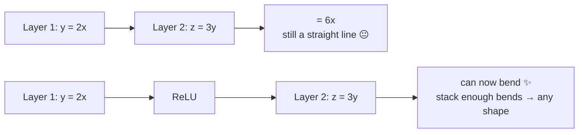

# L02 · Sigmoid & ReLU (Activation Functions)

> [!success] 🟢 In one sentence
> **An activation function is a small bend applied after each neuron. Without bends, a stack of 100 layers is no more powerful than a single straight line.**

> [!example] 🧠 Analogy
> - **Sigmoid** is a **dimmer switch**. Any input becomes a brightness between 0 and 1.
> - **ReLU** is a **one-way valve**. Negative input is blocked to 0, and positive input flows through unchanged.

## 👀 Picture it

```
 Sigmoid σ(x) = 1/(1+e^−x)          ReLU(x) = max(0, x)

 1 ┤            ●●●●●●              4 ┤                ●
   │         ●●                      │              ●
0.5┤ - - - -●- - - - -               │            ●
   │      ●●                         │          ●
 0 ┤●●●●●●                         0 ┤●●●●●●●●●●
   └──────┼──────── x                └─────────┼────── x
         0                                     0
 squashes everything into (0,1)      kills negatives, keeps positives
```

## 🤔 Why do we need a bend at all?



Two linear layers in a row multiply into one linear layer. You need a non-linear step between them to fit curves.

## 🧮 Tiny math

| | Formula | Output range | Slope (derivative) |
|---|---|---|---|
| **Sigmoid** | $\sigma(x) = \frac{1}{1+e^{-x}}$ | (0, 1) | $\sigma(x)\,(1-\sigma(x))$, at most 0.25 |
| **ReLU** | $\max(0, x)$ | [0, ∞) | 1 if $x>0$, else 0 |

> [!info] Why ReLU won
> Sigmoid's slope is at most **0.25**. Multiply 10 layers of slopes like that and you get $0.25^{10} \approx 0.000001$, so the gradient **vanishes** and the early layers stop learning.
> ReLU's slope is exactly **1** for positive inputs, so gradients flow through unchanged.

## 🔢 By hand

| x | σ(x) | ReLU(x) |
|---|---|---|
| −2 | 1/(1+e²) ≈ **0.12** | **0** |
| 0 | 1/(1+1) = **0.50** | **0** |
| 2 | 1/(1+e⁻²) ≈ **0.88** | **2** |

Notice that σ(−x) = 1 − σ(x). Sigmoid is symmetric around 0.5.

## 💻 Code from scratch

```python
import numpy as np

def sigmoid(x):       return 1 / (1 + np.exp(-x))
def sigmoid_grad(x):  s = sigmoid(x); return s * (1 - s)
def relu(x):          return np.maximum(0, x)
def relu_grad(x):     return (x > 0).astype(float)

x = np.array([-2.0, 0.0, 2.0])
print("sigmoid:", sigmoid(x).round(2))       # [0.12 0.5  0.88]
print("relu:   ", relu(x))                   # [0. 0. 2.]
print("σ' :    ", sigmoid_grad(x).round(3))  # max 0.25 at x=0
print("relu':  ", relu_grad(x))              # [0. 0. 1.]

# vanishing gradient demo: multiply slopes through 10 layers
print("10 sigmoid layers:", 0.25 ** 10)
print("10 relu layers:   ", 1.0 ** 10)
```

## 🧪 Cousins you'll meet later

| Name | Formula | Used in |
|---|---|---|
| **Tanh** | $\tanh(x)$, range (−1, 1) | old RNNs |
| **Leaky ReLU** | $\max(0.01x, x)$ | avoids "dead" neurons → [[L18 Dead ReLU Detector]] |
| **GELU** | $x \cdot \Phi(x)$, a smooth ReLU | GPT, BERT |
| **SiLU / Swish** | $x \cdot \sigma(x)$ | LLaMA (as SwiGLU) |

## ⚠️ Common mistakes
- **Sigmoid in hidden layers of deep nets.** Gradients vanish. Use ReLU or GELU.
- **`np.exp(-x)` overflow** for very negative x. Libraries use numerically stable versions.
- **Forgetting activations entirely.** Your "deep" net then behaves like linear regression.

## 🏋️ Try it
1. Prove σ'(x) = σ(x)(1 − σ(x)). (Differentiate 1/(1+e^(−x)) using the chain rule.)
2. Implement Leaky ReLU and its gradient.
3. Plot sigmoid, tanh and ReLU with matplotlib on x ∈ [−5, 5].

---
**Prev ←** [[L01 Gradient Descent]] · **Next →** [[L03 Softmax]]
