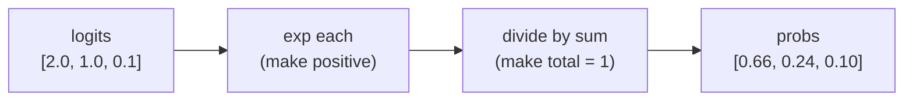

# L03 · Softmax

> [!success] 🟢 In one sentence
> **Softmax turns a list of arbitrary scores into probabilities. They are all positive and they sum to 1.**

> [!example] 🧠 Analogy: splitting a pizza by votes
> Three friends shout scores for toppings: 🍕 cheese = 2, 🍄 mushroom = 1, 🍍 pineapple = 0.1.
> Softmax splits **one whole pizza** between them in proportion to $e^{\text{score}}$. The loudest topping gets the biggest slice, and every topping gets *some* slice.

## 👀 Picture it

```
 raw scores (logits)        e^score            ÷ sum = probabilities
 cheese     2.0   ──►   7.39  ███████▍   ──►   0.66  ██████▋
 mushroom   1.0   ──►   2.72  ██▋        ──►   0.24  ██▍
 pineapple  0.1   ──►   1.11  █          ──►   0.10  █
                       sum = 11.21                  sum = 1.00 ✅
```



## 🧮 Tiny math

$$
\text{softmax}(z)_i = \frac{e^{z_i}}{\sum_j e^{z_j}}
$$

- **Why `exp`?** It makes everything positive and **exaggerates gaps**: a score 1 higher means about 2.7× more probability.
- **"Soft" max:** a hard max picks one winner (100/0/0). Softmax gives the winner the most while keeping the others alive.

### 🌡️ Temperature: one knob that controls confidence
Divide the logits by $T$ before softmax:

| T | Probabilities for [2, 1, 0.1] | Feel |
|---|---|---|
| 0.5 | [0.86, 0.12, 0.02] | sharp, confident |
| 1.0 | [0.66, 0.24, 0.10] | normal |
| 5.0 | [0.40, 0.33, 0.27] | flat, random |

This is the same "temperature" setting you see in ChatGPT and other LLM tools. You'll use it in [[L34 Make GPT Talk Back]].

## 🔢 By hand
Logits [1, 1]. Then e¹ = 2.72 for both, the sum is 5.44, and the probabilities are **[0.5, 0.5]**. Equal scores mean equal chances.
Logits [0, ln 3]. Then e⁰ = 1 and e^(ln 3) = 3, the sum is 4, and the probabilities are **[0.25, 0.75]**.

## 💻 Code from scratch (with the stability trick)

```python
import numpy as np

def softmax(z, T=1.0):
    z = np.asarray(z, dtype=float) / T
    z = z - z.max()          # 🛡️ stability trick: doesn't change the answer
    e = np.exp(z)
    return e / e.sum()

print(softmax([2.0, 1.0, 0.1]).round(2))        # [0.66 0.24 0.1 ]
print(softmax([1000, 1001, 1002]).round(2))     # works! naive version → nan
for T in [0.5, 1, 5]:
    print(f"T={T}:", softmax([2, 1, 0.1], T).round(2))
```

> [!warning] Why subtract the max?
> $e^{1000}$ overflows to `inf`, and `inf/inf` is `nan`.
> Subtracting the same constant from every logit gives the **same** probabilities, because the factor $e^{-c}$ cancels in the fraction. After subtracting the max, the biggest exponent is $e^0 = 1$, which is safe.

## ⚠️ Common mistakes
- **No max-subtraction.** You get NaNs with large logits.
- **Softmax over the wrong axis.** For a batch of shape `(batch, classes)`, use `axis=-1`.
- **Applying softmax and then `CrossEntropyLoss` in PyTorch.** That loss already includes softmax, so you'd apply it twice (see [[L04 Cross-Entropy Loss]]).

## 🏋️ Try it
1. Write a batched `softmax(Z)` for `Z.shape == (N, C)` with `keepdims=True`.
2. Show that `softmax(z) == softmax(z + 100)` numerically.
3. What happens as T → 0? And as T → ∞?

---
**Prev ←** [[L02 Sigmoid and ReLU]] · **Next →** [[L04 Cross-Entropy Loss]]
