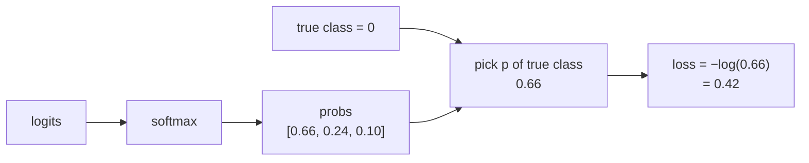

# L04 · Cross-Entropy Loss

> [!success] 🟢 In one sentence
> **Cross-entropy measures how surprised the model is by the correct answer. A confident correct guess gives near-zero loss, and a confident wrong guess gives a huge loss.**

> [!example] 🧠 Analogy: a weather forecaster
> The forecaster says "90% rain" and it rains: barely surprised, so a small penalty.
> The forecaster says "1% rain" and it pours: shocked, so a huge penalty.
> Cross-entropy is the **penalty for being confidently wrong**.

## 👀 Picture it

```
 loss = −log(p_correct)

 loss
  5 ┤●
  4 ┤ ●
  3 ┤  ●                       p=0.01 → loss 4.6  😱
  2 ┤    ●
  1 ┤       ●●                 p=0.5  → loss 0.69 😐
  0 ┤           ●●●●●●●●●●     p=0.99 → loss 0.01 😎
    └──────────────────────── p (probability given to the true class)
    0          0.5          1
```

The curve shoots up near 0. Being **confidently wrong** is punished far more than being unsure.



## 🧮 Tiny math

For one example with true class $y$:
$$
L = -\log(p_y)
$$
The general form uses a one-hot target $t$: $L = -\sum_i t_i \log p_i$. Every term is zero except the true class.

> [!tip] ✨ The magic gradient
> When you combine softmax and cross-entropy, the gradient with respect to the logits is simply:
> $$\frac{\partial L}{\partial z} = p - t$$
> **Predicted minus target.** That's why the two are always used together.

## 🔢 By hand
Probabilities [0.66, 0.24, 0.10], true class 0:
- loss = −ln(0.66) ≈ **0.42**
- gradient = p − t = [0.66−1, 0.24−0, 0.10−0] = **[−0.34, 0.24, 0.10]**
  - Negative for the true class means "push this logit **up**".
  - Positive for the wrong classes means "push these **down**".

A random guess over C classes gives loss ≈ ln C. With 10 classes that's **2.30**. Remember this number: it's the loss your model should start near (see [[L17 Training Diagnostics]]).

## 💻 Code from scratch

```python
import numpy as np

def softmax(z):
    z = z - z.max(axis=-1, keepdims=True)
    e = np.exp(z)
    return e / e.sum(axis=-1, keepdims=True)

def cross_entropy(logits, y):
    """logits: (N, C), y: (N,) integer labels"""
    p = softmax(logits)
    N = len(y)
    loss = -np.log(p[np.arange(N), y] + 1e-12).mean()
    grad = p.copy()
    grad[np.arange(N), y] -= 1          # p − t
    return loss, grad / N

logits = np.array([[2.0, 1.0, 0.1]])
loss, g = cross_entropy(logits, np.array([0]))
print("loss:", round(loss, 2))   # 0.42
print("grad:", g.round(2))       # [[-0.34  0.24  0.1 ]]

# random-guess baseline
print("10-class random:", round(-np.log(1/10), 2))   # 2.3
```

### Check against PyTorch

```python
import torch, torch.nn.functional as F
logits = torch.tensor([[2.0, 1.0, 0.1]], requires_grad=True)
loss = F.cross_entropy(logits, torch.tensor([0]))   # takes RAW logits!
loss.backward()
print(loss.item(), logits.grad)   # same numbers ✅
```

## ⚠️ Common mistakes
- **Passing probabilities to `F.cross_entropy`.** It expects **raw logits** and applies softmax itself.
- **`log(0)` = −inf.** Add a tiny epsilon, or use log-softmax.
- **Using MSE for classification.** It works, but gradients are weak when the model is confidently wrong.

## 🏋️ Try it
1. Compute the loss for p_correct = 0.9, 0.5, 0.1 and sketch the curve.
2. Implement binary cross-entropy: $-[y\log p + (1-y)\log(1-p)]$.
3. Verify $\partial L/\partial z = p - t$ numerically with finite differences.

---
**Prev ←** [[L03 Softmax]] · **Next →** [[L05 Linear Regression - Forward]]
