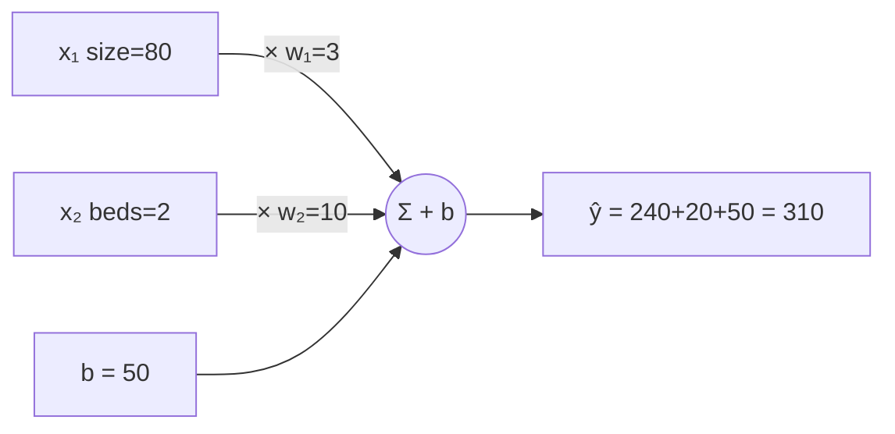

# L05 · Linear Regression: Forward Pass

> [!success] 🟢 In one sentence
> **Linear regression predicts a number by multiplying each input by a weight, adding them up, and adding a bias: `y = w·x + b`.**

> [!example] 🧠 Analogy: pricing a house
> Price = **$3,000 × square meters** + **$10,000 × bedrooms** + **$50,000 base**.
> The weights say how much each feature matters, and the bias is the starting price.
> "Forward pass" just means computing the prediction.

## 👀 Picture it

```
 price ($k)
 400 ┤                    ●  ╱
 300 ┤             ●   ╱ ●
 200 ┤       ●  ╱  ●
 100 ┤   ● ╱ ●             ╱ = the line y = w·x + b
     │  ╱                    w = slope (how steep)
  b ─┤╱                      b = where it crosses the y-axis
     └──────────────────── size (m²)
```



## 🧮 Tiny math

**One example, many features:** $\hat{y} = w_1x_1 + w_2x_2 + \dots + b = \mathbf{w}\cdot\mathbf{x} + b$

**A whole batch at once (matrix form):**
$$
\underbrace{\hat{\mathbf{y}}}_{(N,)} = \underbrace{X}_{(N, D)}\ \underbrace{\mathbf{w}}_{(D,)} + b
$$

```
      X (N×D)          w (D)     ŷ (N)
 ┌ 80  2 ┐            ┌ 3  ┐    ┌ 310 ┐
 │ 120 3 │     @      └ 10 ┘ =  │ 440 │  (+ b = 50 added to each)
 └ 50  1 ┘                      └ 210 ┘
```

**Shape rule:** (N, **D**) @ (**D**,) → (N,). The inner dimensions must match.

## 🔢 By hand
w = [3, 10], b = 50:
- House A (80 m², 2 beds): 3·80 + 10·2 + 50 = **310**
- House B (120 m², 3 beds): 360 + 30 + 50 = **440**

## 💻 Code from scratch

```python
import numpy as np

X = np.array([[80, 2],
              [120, 3],
              [50, 1]], dtype=float)
w = np.array([3.0, 10.0])
b = 50.0

def predict(X, w, b):
    return X @ w + b

y_hat = predict(X, w, b)
print(y_hat)   # [310. 440. 210.]

# how wrong are we? Mean Squared Error
y_true = np.array([300.0, 450.0, 200.0])
mse = ((y_hat - y_true) ** 2).mean()
print("MSE:", round(mse, 2))   # (10² + 10² + 10²)/3 = 100
```

## 📏 Measuring error: MSE

$$
\text{MSE} = \frac{1}{N}\sum (\hat y_i - y_i)^2
$$

```
 errors:  +10   −10   +10
 squared: 100   100   100   → mean = 100
```
Squaring makes all errors positive and **punishes big misses more**: an error of 20 counts 4× as much as an error of 10.

## ⚠️ Common mistakes
- **Shape mismatch.** `X @ w` needs `X.shape[1] == w.shape[0]`.
- **Unscaled features.** Square meters (~100) and bedrooms (~3) live on very different scales, which slows training. Normalize them.
- **Forgetting the bias.** Then the line is forced through the origin.

## 🏋️ Try it
1. Add a third feature (age of house, w = −2) and predict again.
2. Write `predict` with a loop instead of `@`. Compare speed for N = 1,000,000.
3. What's the MSE if you predict the mean of y_true for everyone?

---
**Prev ←** [[L04 Cross-Entropy Loss]] · **Next →** [[L06 Linear Regression - Training]]
