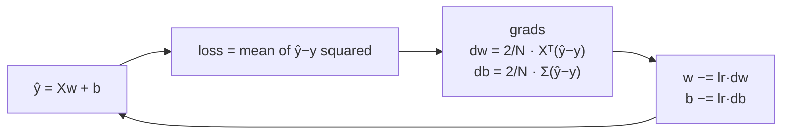

# L06 · Linear Regression: Training

> [!success] 🟢 In one sentence
> **Training means using gradient descent to nudge `w` and `b` until the line fits the data, so the MSE is as small as possible.**

> [!example] 🧠 Analogy: tuning a guitar string
> You pluck (predict), hear how far off the note is (loss), and turn the peg a little in the right direction (gradient step). Repeat until it sounds right.

## 👀 Picture it: the line wiggles into place

```
 epoch 0             epoch 500           epoch 2000
  │    ● ●  ●          │    ● ●╱ ●         │    ●╱●  ●
  │  ●  ●              │  ● ╱●             │  ●╱ ●
  │●  ●     ___        │●╱ ●               │●╱ ●
  │___----             │╱                  ╱
  └──────────          └──────────         └──────────
  loss = 629          loss = 1.04         loss = 0.94 ✅ (≈ noise level)
```



## 🧮 Tiny math (where the gradients come from)

Loss: $L = \frac{1}{N}\sum(\hat y_i - y_i)^2$ with $\hat y = Xw + b$.

Chain rule, piece by piece:
| Piece | Derivative |
|---|---|
| $\partial L / \partial \hat y_i$ | $\frac{2}{N}(\hat y_i - y_i)$, the **error signal** |
| $\partial \hat y_i / \partial w$ | $x_i$ |
| $\partial \hat y_i / \partial b$ | $1$ |

Multiply the pieces together:
$$
\frac{\partial L}{\partial w} = \frac{2}{N} X^\top(\hat y - y) \qquad \frac{\partial L}{\partial b} = \frac{2}{N}\sum(\hat y - y)
$$

> [!tip] Intuition
> If predictions are **too high** ($\hat y - y > 0$), the gradient is positive, so we **decrease** w. Inputs with big x get blamed more, because they had more influence on the prediction.

## 🔢 By hand (one step)
Data: x = [1, 2], y = [2, 4] (the true line is y = 2x). Start w = 0, b = 0, lr = 0.1.
- ŷ = [0, 0], error = ŷ − y = [−2, −4]
- dw = 2/2 · (1·(−2) + 2·(−4)) = **−10**
- db = 2/2 · (−2 − 4) = **−6**
- w = 0 − 0.1·(−10) = **1.0**, b = 0 − 0.1·(−6) = **0.6** ✅ moving toward w = 2

## 💻 Code from scratch

```python
import numpy as np
rng = np.random.default_rng(0)

# fake data: y = 3x + 7 + noise
X = rng.uniform(0, 10, size=(100, 1))
y = 3 * X[:, 0] + 7 + rng.normal(0, 1, 100)

w, b, lr = np.zeros(1), 0.0, 0.01
N = len(y)

for epoch in range(2001):
    y_hat = X @ w + b
    err = y_hat - y
    loss = (err ** 2).mean()
    dw = 2 / N * X.T @ err
    db = 2 / N * err.sum()
    w -= lr * dw
    b -= lr * db
    if epoch % 500 == 0:
        print(f"epoch {epoch:4d}  loss={loss:7.3f}  w={w[0]:.3f}  b={b:.3f}")
# → w ≈ 3, b ≈ 7  🎯
```

### Sanity check with the closed-form answer
Linear regression has an exact solution (the "normal equation"). Gradient descent should agree with it:

```python
import numpy as np
rng = np.random.default_rng(0)
X = rng.uniform(0, 10, size=(100, 1)); y = 3 * X[:, 0] + 7 + rng.normal(0, 1, 100)
Xb = np.c_[X, np.ones(len(X))]                 # add a column of 1s for the bias
w_exact = np.linalg.lstsq(Xb, y, rcond=None)[0]
print("exact w, b:", w_exact.round(3))
```

> [!info] Then why bother with gradient descent?
> The exact formula doesn't exist for neural networks. Gradient descent works for **any** differentiable model. This lesson is the full training recipe in miniature, and everything after it scales the same loop up.

## ⚠️ Common mistakes
- **Learning rate too large for unscaled X.** The loss explodes. Standardize X: `(X - X.mean()) / X.std()`.
- **Wrong sign of the error** (`y - y_hat`). That flips the gradient and you climb uphill.
- **Not averaging by N.** The effective learning rate then depends on dataset size.

## 🏋️ Try it
1. Plot the loss vs epoch. What shape is it?
2. Implement **mini-batch** training: sample 16 random rows per step.
3. Fit y = 2x₁ − 3x₂ + 5 with two features.

---
**Prev ←** [[L05 Linear Regression - Forward]] · **Next →** [[L07 Single Neuron]] (module ②)
