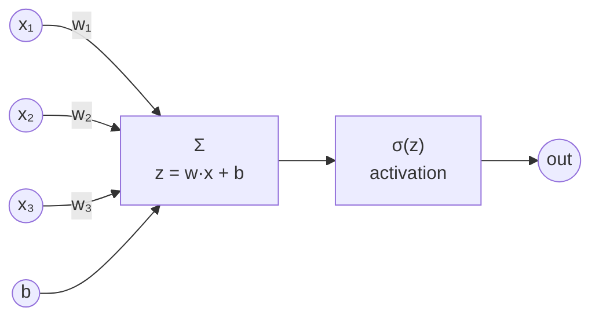

# L07 · Single Neuron

> [!success] 🟢 In one sentence
> **A neuron is linear regression plus an activation: `out = activation(w·x + b)`. Every neural network is built from this one block.**

> [!example] 🧠 Analogy: a bouncer at a club
> The bouncer weighs evidence: age (+), dress code (+), already too drunk (−).
> They add it up (**weighted sum**). If the total is high enough they let you in (**activation**, e.g. a sigmoid giving a "probability of entry").

## 👀 Picture it



```
   inputs     weights     sum        squash       output
  x₁=1.0  ──×  0.5 ─┐
  x₂=2.0  ──× −1.0 ─┼──► z = 0.5−2+0.9+0.1 = −0.5 ──► σ(−0.5) = 0.38
  x₃=3.0  ──×  0.3 ─┤
  bias    ──── 0.1 ─┘
```

**Biology version (loose):** inputs are dendrites, the weighted sum is the cell body, and "fire or not" is the axon. Don't push the analogy far, since real neurons are much more complex.

## 🧮 Tiny math
$$
z = \mathbf w \cdot \mathbf x + b, \qquad a = \sigma(z)
$$
A sigmoid neuron trained with binary cross-entropy is **logistic regression**: a classifier that draws one straight line between two classes.

```
  ○ ○ ○  ╲   ● ●
  ○ ○  ○  ╲  ● ● ●     one neuron = one straight boundary
  ○ ○      ╲   ● ●     (w·x + b = 0 is the line)
```

## 🔢 By hand
w = [0.5, −1.0, 0.3], b = 0.1, x = [1, 2, 3]
z = 0.5 − 2.0 + 0.9 + 0.1 = **−0.5** → σ(−0.5) = 1/(1+e^0.5) ≈ **0.38**. The neuron says 38% "yes".

## 💻 Code: train one neuron to do AND

```python
import numpy as np

def sigmoid(z): return 1 / (1 + np.exp(-z))

X = np.array([[0,0],[0,1],[1,0],[1,1]], dtype=float)
y = np.array([0, 0, 0, 1], dtype=float)      # AND gate

rng = np.random.default_rng(42)
w, b, lr = rng.normal(0, 0.1, 2), 0.0, 1.0

for epoch in range(2000):
    p = sigmoid(X @ w + b)                   # forward
    grad_z = (p - y) / len(y)                # BCE + sigmoid → (p − y), like softmax+CE
    w -= lr * X.T @ grad_z                   # backward + update
    b -= lr * grad_z.sum()

print("predictions:", sigmoid(X @ w + b).round(2))   # ≈ [0 0 0 1]
print("w, b:", w.round(2), round(b, 2))
```

## 💥 What one neuron can't do: XOR

```
  AND  (separable ✅)        XOR  (NOT separable ❌)
  1 │ ○    ●                 1 │ ●    ○
    │                          │
  0 │ ○    ○                 0 │ ○    ●
    └──────                    └──────
      0    1                     0    1
  one line splits them      no single line works!
```

```python
import numpy as np
def sigmoid(z): return 1 / (1 + np.exp(-z))
X = np.array([[0,0],[0,1],[1,0],[1,1]], dtype=float)
y = np.array([0, 1, 1, 0], dtype=float)      # XOR
w, b = np.zeros(2), 0.0
for _ in range(5000):
    p = sigmoid(X @ w + b); g = (p - y) / 4
    w -= X.T @ g; b -= g.sum()
print("XOR with 1 neuron:", sigmoid(X @ w + b).round(2), "← stuck near 0.5 😢")
```

That failure is exactly why we **stack layers**. Two layers can draw two lines and combine them, which solves XOR in [[L10 MLP from Scratch]].

## ⚠️ Common mistakes
- **Thinking a neuron is "smart".** It's a weighted sum plus a squash, nothing more.
- **Expecting one neuron to learn curved boundaries.** It can't, because its boundary is always a line (or a flat plane in higher dimensions).

## 🏋️ Try it
1. Train an OR gate. Then a NAND gate.
2. Print the learned decision line `w₁x₁ + w₂x₂ + b = 0` for AND and draw it.
3. Replace sigmoid with a step function. Why can't you train that with gradients?

---
**Prev ←** [[L06 Linear Regression - Training]] · **Next →** [[L08 Backpropagation]]
