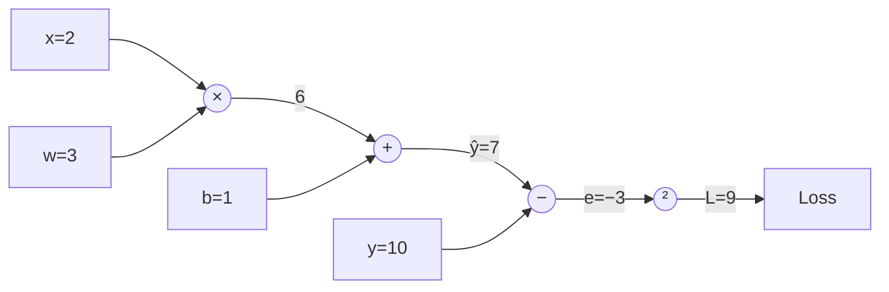

# L08 · Backpropagation

> [!success] 🟢 In one sentence
> **Backpropagation is the chain rule applied backwards through a computation. It works out how much each number in the network contributed to the error.**

> [!example] 🧠 Analogy: blame passed down a chain of command
> A product launch fails (the loss). The CEO asks each VP "how much was your part?", each VP asks their managers, and so on down.
> Everyone gets blame **in proportion to their influence**. Backprop hands out blame the same way, from the output back to every weight.

## 👀 Picture it: a computation graph

Compute $L = (w \cdot x + b - y)^2$ with x=2, w=3, b=1, y=10:



**Forward (left → right):** compute the values.
**Backward (right → left):** compute the gradients, each one being *local slope × gradient coming from the right*.

```
            forward  →                         ← backward
 x=2 ─┐                                   dL/dw = dL/dm · x = −6 · 2 = −12
      ×─ m=6 ─┐                           dL/dm = dL/dŷ · 1   = −6
 w=3 ─┘       +─ ŷ=7 ─ − ─ e=−3 ─ ² ─ L=9  dL/dŷ = dL/de · 1   = −6
       b=1 ───┘        │                  dL/de = 2e          = −6
                y=10 ──┘                  dL/db = dL/dŷ · 1   = −6
```

## 🧮 The chain rule (the only rule you need)
$$
\frac{\partial L}{\partial w} = \frac{\partial L}{\partial e}\cdot\frac{\partial e}{\partial \hat y}\cdot\frac{\partial \hat y}{\partial m}\cdot\frac{\partial m}{\partial w}
= (2e)(1)(1)(x) = (-6)(2) = -12
$$

### Local rules for each node type
| Node | Forward | Gradient passed back to inputs |
|---|---|---|
| **+** `a+b` | sum | copies the upstream grad to **both** inputs (a router) |
| **×** `a·b` | product | grad to a = upstream × **b**, grad to b = upstream × **a** (a swap) |
| **²** `a²` | square | upstream × **2a** |
| **relu** | max(0,a) | upstream if a>0, else **0** (a gate) |

> [!tip] Interpretation
> dL/dw = −12 means "increase w by a tiny amount ε and the loss drops by 12ε". So gradient descent **increases** w, and indeed w=3 is too small, since we need 3·2+1 to reach 10.

## 🔢 By hand → verify numerically
Change w by +0.001: ŷ = 7.002, L = (−2.998)² = 8.988. The loss changed by **−0.012**. Divide by 0.001 and you get **−12** ✅

## 💻 Code: a tiny autograd engine (micrograd-style)

```python
class Value:
    def __init__(self, data, parents=(), op=""):
        self.data, self.grad = data, 0.0
        self._parents, self._op = parents, op
        self._backward = lambda: None

    def __add__(self, other):
        other = other if isinstance(other, Value) else Value(other)
        out = Value(self.data + other.data, (self, other), "+")
        def _backward():
            self.grad += out.grad            # router
            other.grad += out.grad
        out._backward = _backward
        return out

    def __mul__(self, other):
        other = other if isinstance(other, Value) else Value(other)
        out = Value(self.data * other.data, (self, other), "*")
        def _backward():
            self.grad += other.data * out.grad   # swap
            other.grad += self.data * out.grad
        out._backward = _backward
        return out

    def __pow__(self, k):
        out = Value(self.data ** k, (self,), f"**{k}")
        def _backward():
            self.grad += k * self.data ** (k - 1) * out.grad
        out._backward = _backward
        return out

    def __sub__(self, other): return self + (other * -1 if isinstance(other, Value) else -other)

    def backward(self):
        # topological order: children before parents, then walk it in reverse
        order, seen = [], set()
        def visit(v):
            if v not in seen:
                seen.add(v)
                for p in v._parents: visit(p)
                order.append(v)
        visit(self)
        self.grad = 1.0
        for v in reversed(order):
            v._backward()

x, w, b, y = Value(2.0), Value(3.0), Value(1.0), Value(10.0)
L = (w * x + b - y) ** 2
L.backward()
print("L =", L.data)                 # 9.0
print("dL/dw =", w.grad)             # -12.0
print("dL/db =", b.grad)             # -6.0
print("dL/dx =", x.grad)             # -18.0
```

That ~50-line class is the core of what PyTorch's `loss.backward()` does (see [[L12 PyTorch Basics]]).

> [!warning] Why `+=` and not `=`?
> If a value is used twice (e.g. `a*a`), gradient arrives from **both** uses and must be **summed**. Using `=` would silently drop one of them.

## ⚠️ Common mistakes
- **Overwriting grads instead of accumulating.** Wrong whenever a value is reused.
- **Forgetting to zero grads between steps.** They keep piling up (PyTorch has the same issue, hence `optimizer.zero_grad()`).
- **Wrong order.** You must run `_backward` from output to inputs, in topological order.

## 🏋️ Try it
1. Add `relu()` and `__truediv__` to `Value`.
2. Compute grads for $L = (a\cdot b + a)^2$ by hand, then check with `Value`.
3. Check each gradient numerically with $(L(w+ε) − L(w−ε)) / 2ε$.

---
**Prev ←** [[L07 Single Neuron]] · **Next →** [[L09 Multi-Layer Backpropagation]]
