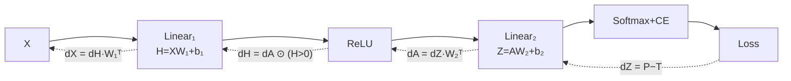

# L09 · Multi-Layer Backpropagation (Matrix Form)

> [!success] 🟢 In one sentence
> **Same chain rule, but on whole matrices at once. Each layer receives "the gradient of the loss with respect to my output" and returns "the gradient with respect to my input", plus the gradients for its own weights.**

> [!example] 🧠 Analogy: a bucket brigade, run in reverse
> Forward: each person (layer) transforms the bucket and passes it on.
> Backward: the error bucket travels back down the same line. Each person learns how to fix themselves (weight grads) and passes a modified bucket to the person behind them (input grad).

## 👀 Picture it



```
 forward:  X ─► [W₁] ─► H ─► relu ─► A ─► [W₂] ─► Z ─► loss
 backward: dX ◄─ [W₁ᵀ] ◄─ dH ◄─ gate ◄─ dA ◄─ [W₂ᵀ] ◄─ dZ ◄─ 1
                  │                        │
                dW₁ = Xᵀ·dH              dW₂ = Aᵀ·dZ
```

## 🧮 The 3 formulas for a Linear layer `Y = X W + b`

| Gradient | Formula | Shape check |
|---|---|---|
| weights | $dW = X^\top \, dY$ | (D,N)·(N,H) = **(D,H)** ✅ same as W |
| bias | $db = \sum_{\text{rows}} dY$ | **(H,)** ✅ same as b |
| input | $dX = dY \, W^\top$ | (N,H)·(H,D) = **(N,D)** ✅ same as X |

> [!tip] 🧩 The shape trick: never memorize, just match shapes
> **A gradient always has the same shape as the thing it's the gradient of.** If you know dY is (N,H) and need dW to be (D,H), the only way to combine X (N,D) with dY to get (D,H) is $X^\top dY$. The shapes force the formula.

## 🔢 Shapes walk-through
N=4 examples, D=3 inputs, H=5 hidden, C=2 classes:
```
 X  (4,3) @ W₁ (3,5) = H  (4,5) → relu → A (4,5)
 A  (4,5) @ W₂ (5,2) = Z  (4,2) → softmax → P (4,2)
 dZ (4,2)                         = (P − T)/N
 dW₂ = Aᵀ(5,4) @ dZ(4,2)          = (5,2) ✅
 dA  = dZ(4,2) @ W₂ᵀ(2,5)         = (4,5) ✅
 dH  = dA ⊙ (H>0)                  = (4,5)
 dW₁ = Xᵀ(3,4) @ dH(4,5)          = (3,5) ✅
```

## 💻 Code: 2-layer backprop + gradient check

```python
import numpy as np
rng = np.random.default_rng(0)

N, D, H, C = 4, 3, 5, 2
X = rng.normal(size=(N, D)); y = np.array([0, 1, 1, 0])
W1 = rng.normal(size=(D, H)) * 0.5; b1 = np.zeros(H)
W2 = rng.normal(size=(H, C)) * 0.5; b2 = np.zeros(C)

def forward(W1, b1, W2, b2):
    Hpre = X @ W1 + b1
    A = np.maximum(0, Hpre)
    Z = A @ W2 + b2
    Z = Z - Z.max(1, keepdims=True)
    P = np.exp(Z) / np.exp(Z).sum(1, keepdims=True)
    loss = -np.log(P[np.arange(N), y]).mean()
    return loss, (Hpre, A, P)

loss, (Hpre, A, P) = forward(W1, b1, W2, b2)

# ---- backward ----
dZ = P.copy(); dZ[np.arange(N), y] -= 1; dZ /= N   # softmax+CE
dW2 = A.T @ dZ;   db2 = dZ.sum(0)
dA  = dZ @ W2.T
dH  = dA * (Hpre > 0)                               # relu gate
dW1 = X.T @ dH;   db1 = dH.sum(0)

# ---- gradient check: nudge one weight, watch the loss ----
eps = 1e-5
W1p = W1.copy(); W1p[0, 0] += eps
W1m = W1.copy(); W1m[0, 0] -= eps
numeric = (forward(W1p, b1, W2, b2)[0] - forward(W1m, b1, W2, b2)[0]) / (2 * eps)
print(f"analytic dW1[0,0] = {dW1[0,0]:.6f}")
print(f"numeric  dW1[0,0] = {numeric:.6f}")   # should match to ~6 decimals ✅
```

> [!info] Gradient checking is your best friend
> Whenever you hand-write a backward pass, compare it to the numeric version on a few weights. If they disagree, there's a bug, almost always a missing transpose or a missing `/N`.

## ⚠️ Common mistakes
- **Forgetting the transpose.** `X @ dY` instead of `X.T @ dY` fails with a shape error, or worse, silently runs when the shapes happen to be square.
- **Summing the bias over the wrong axis.** Sum over **rows** (axis 0, the batch).
- **ReLU gate on the post-activation `A`** instead of the pre-activation `H`. Usually works out for ReLU, but it's wrong for other activations.

## 🏋️ Try it
1. Extend to 3 layers and grad-check every weight matrix.
2. Replace ReLU with tanh. Its local gradient is 1 − tanh².
3. Run the grad check without the `/N`. What changes?

---
**Prev ←** [[L08 Backpropagation]] · **Next →** [[L10 MLP from Scratch]]
