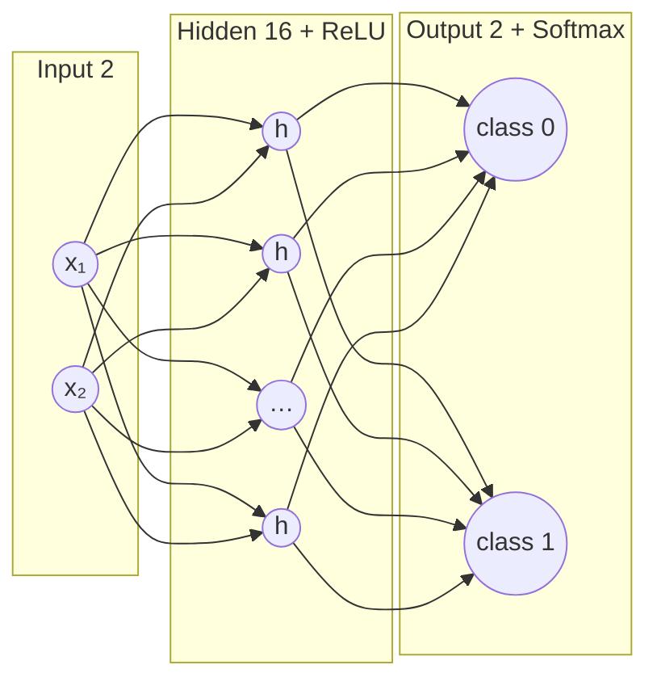
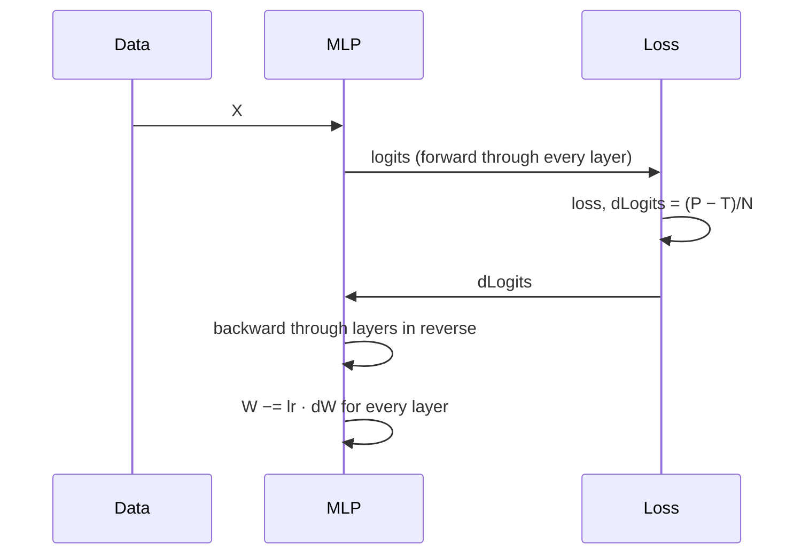

# L10 · MLP from Scratch

> [!success] 🟢 In one sentence
> **A Multi-Layer Perceptron is a stack of `Linear → ReLU` layers. Here we build one in pure NumPy and use it to solve problems a single neuron can't.**

> [!example] 🧠 Analogy: origami
> Each layer folds the paper (the input space) a little. After enough folds, points that were tangled together end up on opposite sides of one straight cut.

## 👀 Picture it



```
 XOR boundary learned by the MLP:
   1 │ ●  ░░░│░░  ○        ░ = predicted "1"
     │ ░░░░░░│             each hidden ReLU adds a fold line;
     │───────┼───────      combined, they carve the
     │       │░░░░░░       non-linear shape
   0 │ ○  ░░░│░░░ ●
     └──────────────
       0          1
```

## 🧱 The design: reusable layers

Every layer has the same two methods. This is exactly how PyTorch's `nn.Module` is organized.

```
 class Layer:
     forward(x)   → output      (and remember what backward will need)
     backward(dy) → dx          (and store grads for its own params)
```

## 💻 Code: full MLP, solves XOR and two-moons

```python
import numpy as np
rng = np.random.default_rng(0)

class Linear:
    def __init__(self, d_in, d_out):
        self.W = rng.normal(0, np.sqrt(2 / d_in), (d_in, d_out))   # He init → L11
        self.b = np.zeros(d_out)
    def forward(self, x):
        self.x = x
        return x @ self.W + self.b
    def backward(self, dy):
        self.dW = self.x.T @ dy
        self.db = dy.sum(0)
        return dy @ self.W.T
    def params(self):
        return [(self.W, self.dW), (self.b, self.db)]

class ReLU:
    def forward(self, x):
        self.mask = x > 0
        return x * self.mask
    def backward(self, dy):
        return dy * self.mask
    def params(self): return []

class MLP:
    def __init__(self, sizes):
        self.layers = []
        for i in range(len(sizes) - 1):
            self.layers.append(Linear(sizes[i], sizes[i + 1]))
            if i < len(sizes) - 2:
                self.layers.append(ReLU())
    def forward(self, x):
        for layer in self.layers: x = layer.forward(x)
        return x
    def backward(self, d):
        for layer in reversed(self.layers): d = layer.backward(d)
    def step(self, lr):
        for layer in self.layers:
            for p, g in layer.params():
                p -= lr * g        # in-place update

def softmax_ce(logits, y):
    z = logits - logits.max(1, keepdims=True)
    p = np.exp(z) / np.exp(z).sum(1, keepdims=True)
    n = len(y)
    loss = -np.log(p[np.arange(n), y] + 1e-12).mean()
    d = p.copy(); d[np.arange(n), y] -= 1
    return loss, d / n, p

def train(X, y, sizes, epochs=2000, lr=0.5):
    net = MLP(sizes)
    for ep in range(epochs):
        logits = net.forward(X)
        loss, d, p = softmax_ce(logits, y)
        net.backward(d)
        net.step(lr)
    acc = (p.argmax(1) == y).mean()
    return net, loss, acc

# 1) XOR: impossible for a single neuron
X = np.array([[0,0],[0,1],[1,0],[1,1]], dtype=float)
y = np.array([0, 1, 1, 0])
_, loss, acc = train(X, y, [2, 8, 2])
print(f"XOR      loss={loss:.4f} acc={acc:.0%}")

# 2) two interleaving half-moons
n = 200
t = rng.uniform(0, np.pi, n)
top = np.c_[np.cos(t), np.sin(t)]
bot = np.c_[1 - np.cos(t), 0.5 - np.sin(t)]
Xm = np.r_[top, bot] + rng.normal(0, 0.1, (2 * n, 2))
ym = np.r_[np.zeros(n, int), np.ones(n, int)]
_, loss, acc = train(Xm, ym, [2, 32, 32, 2], epochs=3000, lr=0.3)
print(f"moons    loss={loss:.4f} acc={acc:.0%}")
```

## 🔁 One training step, visualized



## ⚠️ Common mistakes
- **No activation between Linears.** The whole net collapses to one linear layer and XOR fails again.
- **Large init.** Activations explode. Too-small init makes them vanish (next lesson).
- **Learning rate too high** for deep nets. The loss bounces around instead of decreasing.

## 🏋️ Try it
1. Remove the ReLU and confirm that XOR accuracy drops to about 50–75%.
2. Add a `Sigmoid` layer class with its own backward.
3. Plot the decision boundary: predict on a grid with `np.meshgrid` and draw it with `contourf`.

---
**Prev ←** [[L09 Multi-Layer Backpropagation]] · **Next →** [[L11 Weight Initialization]]
