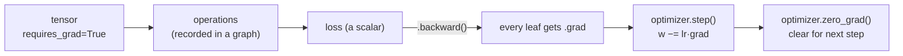

# L12 · PyTorch Basics

> [!success] 🟢 In one sentence
> **PyTorch is NumPy that runs on GPUs and computes gradients for you. `loss.backward()` does the backprop you hand-wrote in [[L08 Backpropagation]].**

> [!example] 🧠 Analogy
> NumPy is a calculator. PyTorch is a calculator that **records every button you press**, so it can replay the calculation backwards and tell you how each input affected the result.

## 👀 Picture it



## 🧰 The 5 things you need

| Concept | Code | NumPy equivalent |
|---|---|---|
| **Tensor** | `torch.tensor([[1., 2.]])` | `np.array` |
| **Autograd** | `requires_grad=True`, `.backward()`, `.grad` | your `Value` class |
| **Module** | `nn.Linear`, `nn.Sequential`, `class Net(nn.Module)` | your `Linear` / `MLP` |
| **Loss** | `nn.CrossEntropyLoss()`, `F.mse_loss` | `softmax_ce` |
| **Optimizer** | `torch.optim.SGD/AdamW` | `p -= lr * g` |

## 💻 Code, part 1: tensors and autograd

```python
import torch

# tensors look like numpy
a = torch.tensor([[1., 2.], [3., 4.]])
print(a.shape, a.dtype)          # torch.Size([2, 2]) torch.float32
print(a @ a.T)                   # matrix multiply
print(a.mean(dim=0))             # column means

# autograd: redo the L08 example
x = torch.tensor(2.0); y = torch.tensor(10.0)
w = torch.tensor(3.0, requires_grad=True)
b = torch.tensor(1.0, requires_grad=True)
L = (w * x + b - y) ** 2
L.backward()
print(w.grad, b.grad)            # tensor(-12.) tensor(-6.)  ✅ same as by hand

# device: same code on GPU / Apple Silicon if available
device = "cuda" if torch.cuda.is_available() else ("mps" if torch.backends.mps.is_available() else "cpu")
print("device:", device)
```

## 💻 Code, part 2: the L10 MLP in 15 lines

```python
import torch, torch.nn as nn
torch.manual_seed(0)

X = torch.tensor([[0,0],[0,1],[1,0],[1,1]], dtype=torch.float32)
y = torch.tensor([0, 1, 1, 0])                     # XOR

model = nn.Sequential(nn.Linear(2, 8), nn.ReLU(), nn.Linear(8, 2))
opt = torch.optim.SGD(model.parameters(), lr=0.5)
loss_fn = nn.CrossEntropyLoss()

for epoch in range(1000):
    logits = model(X)              # 1. forward
    loss = loss_fn(logits, y)      # 2. loss
    opt.zero_grad()                # 3. clear old grads
    loss.backward()                # 4. backprop
    opt.step()                     # 5. update

print("loss:", round(loss.item(), 4))
print("pred:", model(X).argmax(1).tolist())   # [0, 1, 1, 0] ✅
```

### Writing your own Module (you'll do this for GPT)

```python
import torch, torch.nn as nn

class MLP(nn.Module):
    def __init__(self, d_in, d_hidden, d_out):
        super().__init__()                    # must call!
        self.fc1 = nn.Linear(d_in, d_hidden)  # attributes get auto-registered as params
        self.fc2 = nn.Linear(d_hidden, d_out)
    def forward(self, x):
        return self.fc2(torch.relu(self.fc1(x)))

net = MLP(2, 16, 2)
print(net)
print("params:", sum(p.numel() for p in net.parameters()))   # 2*16+16 + 16*2+2 = 82
```

## 📐 Shape cheatsheet

| Op | Example | Result |
|---|---|---|
| `x.view(B, T, C)` / `reshape` | (6,) → (2,3) | reinterpret the shape |
| `x.transpose(1, 2)` | (B,T,C) → (B,C,T) | swap two dims |
| `x.unsqueeze(0)` | (3,) → (1,3) | add a dim |
| `x @ y` with batches | (B,T,C)@(B,C,T) | (B,T,T) |
| broadcasting | (B,T,C) + (C,) | adds to every row |

## ⚠️ Common mistakes
- **Forgetting `opt.zero_grad()`.** Grads accumulate across steps (the same `+=` from L08).
- **Calling `.item()` / `.numpy()` on tensors that need grad mid-graph.** That breaks the graph.
- **Tensors on different devices** (`cpu` vs `cuda`) raise a runtime error. Move both with `.to(device)`.
- **Applying softmax before `CrossEntropyLoss`.** It already includes softmax.

## 🏋️ Try it
1. Swap `SGD` for `torch.optim.Adam(lr=0.01)`. Does it converge faster?
2. Run the XOR model on `mps` or `cuda` if you have one.
3. Use `torch.no_grad()` for inference, and explain why it saves memory.

---
**Prev ←** [[L11 Weight Initialization]] · **Next →** [[L13 Layer Normalization]]
