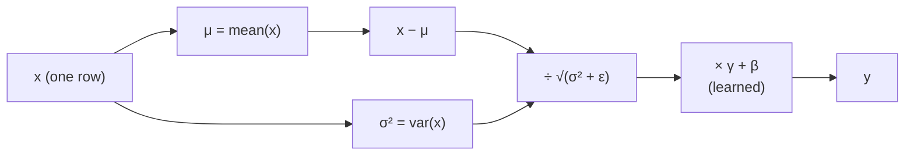

# L13 · Layer Normalization

> [!success] 🟢 In one sentence
> **LayerNorm rescales each example's feature vector to mean 0 and std 1, then lets the model learn its own scale (γ) and shift (β). This keeps activations in a healthy range in every layer.**

> [!example] 🧠 Analogy: grading on a curve, one student at a time
> One student's scores across 5 subjects are [90, 95, 85, 100, 80]. LayerNorm asks: *compared to this student's own average, which subjects were strong?* Result: [0, +0.7, −0.7, +1.4, −1.4].
> Every student ends up on the same scale, no matter how harsh their teacher was.

## 👀 Picture it: which numbers get averaged?

```
 activations x: shape (batch=3, features=4)

            f1    f2    f3    f4
 token A [ 2.0   4.0   6.0   8.0 ]  ──► mean=5, std=2.24 → [−1.34 −0.45 0.45 1.34]
 token B [ 0.1   0.2   0.1   0.2 ]  ──► normalized per ROW ─►
 token C [ 50    60    40    50  ]  ──►
          └──────── LayerNorm: normalize across features (→), each row on its own ────┘
```



## 🧮 Tiny math
For one vector $x \in \mathbb{R}^d$:
$$
\mu = \frac1d\sum x_i,\quad \sigma^2 = \frac1d\sum(x_i-\mu)^2,\quad
y = \gamma \odot \frac{x-\mu}{\sqrt{\sigma^2+\epsilon}} + \beta
$$
- **ε** (e.g. 1e-5) prevents division by zero.
- **γ, β** start at 1 and 0. They let the network undo the normalization if that helps.

> [!info] Why transformers love LayerNorm
> - It works on **one token at a time**, so it doesn't depend on batch size and behaves the same in training and inference.
> - It keeps each layer's input well-scaled, which makes deep stacks train stably.
> - GPT-2+ uses **Pre-LN**: `x + Attn(LN(x))` (see [[L26 Transformer Block]]).

## 🔢 By hand
x = [2, 4, 6, 8] → μ = 5, deviations [−3, −1, 1, 3], σ² = (9+1+1+9)/4 = 5, σ ≈ 2.236
y = [−1.34, −0.45, 0.45, 1.34] (with γ=1, β=0) ✅ mean 0, std 1

## 💻 Code from scratch vs PyTorch

```python
import torch, torch.nn as nn

class MyLayerNorm(nn.Module):
    def __init__(self, d, eps=1e-5):
        super().__init__()
        self.gamma = nn.Parameter(torch.ones(d))
        self.beta = nn.Parameter(torch.zeros(d))
        self.eps = eps
    def forward(self, x):                                     # x: (..., d)
        mu = x.mean(-1, keepdim=True)
        var = x.var(-1, keepdim=True, unbiased=False)         # biased var, like PyTorch
        return self.gamma * (x - mu) / torch.sqrt(var + self.eps) + self.beta

x = torch.tensor([[2., 4., 6., 8.],
                  [0.1, 0.2, 0.1, 0.2],
                  [50., 60., 40., 50.]])
mine = MyLayerNorm(4)(x)
ref = nn.LayerNorm(4)(x)
print(mine.round(decimals=2))
print("matches nn.LayerNorm:", torch.allclose(mine, ref, atol=1e-5))   # True ✅
print("row means:", mine.mean(-1).round(decimals=4))                    # ≈ 0
```

## ⚠️ Common mistakes
- **Normalizing over the wrong dim.** It must be the **last** dim (features), not the batch.
- **`unbiased=True` variance.** Gives a tiny mismatch with PyTorch, which divides by d, not d−1.
- **Forgetting γ and β.** Then the model can't learn the scale that suits it.

## 🏋️ Try it
1. Apply LayerNorm to a (2, 5, 8) tensor, i.e. (batch, tokens, features). Which dim is normalized?
2. Show that scaling the input by 100 gives (almost) the same output. That's **scale invariance**.
3. Compare with [[L14 Batch Normalization]], which normalizes down the columns instead.

---
**Prev ←** [[L12 PyTorch Basics]] · **Next →** [[L14 Batch Normalization]]
