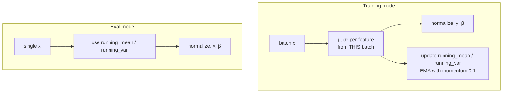

# L14 · Batch Normalization

> [!success] 🟢 In one sentence
> **BatchNorm normalizes each feature using the mean and std of that feature across the batch. It also keeps running averages, so it can do the same thing at inference time when there's no batch to average over.**

> [!example] 🧠 Analogy: grading on a curve across the class
> LayerNorm compares one student's subjects to each other.
> **BatchNorm compares all students on one subject**: "your math score vs. this class's math average".
> When a single student takes the test alone later, you use **last year's class average** (the running stats).

## 👀 Picture it: LayerNorm vs BatchNorm

```
                features →
              f1    f2    f3    f4
 batch  s1 [  ·     ·     ·     ·  ]   LayerNorm: normalize each ROW    ⟶
   ↓    s2 [  ·     ·     ·     ·  ]
        s3 [  ·     ·     ·     ·  ]   BatchNorm: normalize each COLUMN  ↓
              ↓     ↓     ↓     ↓
```



## 🧮 Tiny math
For each feature column $j$ over a batch of size $B$:
$$
\mu_j = \frac1B\sum_b x_{bj},\quad \sigma_j^2 = \frac1B\sum_b(x_{bj}-\mu_j)^2,\quad
y_{bj} = \gamma_j\frac{x_{bj}-\mu_j}{\sqrt{\sigma_j^2+\epsilon}}+\beta_j
$$
Running stats: $\text{running} \leftarrow (1-m)\cdot\text{running} + m\cdot\text{batch stat}$, with $m = 0.1$.

| | **BatchNorm** | **LayerNorm** |
|---|---|---|
| Normalizes over | batch (per feature) | features (per example) |
| Train ≠ eval behavior? | **yes** (running stats) | no |
| Needs a decent batch size | yes (≥ 16-ish) | no |
| Classic home | CNNs (ResNet) | **Transformers** |

## 🔢 By hand
Feature f1 across 3 examples = [1, 2, 3] → μ = 2, σ² = 2/3, σ ≈ 0.816 → y ≈ [−1.22, 0, 1.22]

## 💻 Code from scratch vs PyTorch

```python
import torch, torch.nn as nn
torch.manual_seed(0)

class MyBatchNorm1d(nn.Module):
    def __init__(self, d, eps=1e-5, momentum=0.1):
        super().__init__()
        self.gamma, self.beta = nn.Parameter(torch.ones(d)), nn.Parameter(torch.zeros(d))
        self.eps, self.m = eps, momentum
        self.register_buffer("running_mean", torch.zeros(d))   # saved, not trained
        self.register_buffer("running_var", torch.ones(d))
    def forward(self, x):                                      # x: (B, d)
        if self.training:
            mu = x.mean(0)
            var = x.var(0, unbiased=False)
            with torch.no_grad():
                n = x.shape[0]
                self.running_mean.lerp_(mu, self.m)
                self.running_var.lerp_(var * n / (n - 1), self.m)   # PyTorch stores unbiased
        else:
            mu, var = self.running_mean, self.running_var
        return self.gamma * (x - mu) / torch.sqrt(var + self.eps) + self.beta

x = torch.randn(8, 4) * 5 + 3
mine, ref = MyBatchNorm1d(4), nn.BatchNorm1d(4)
print("train match:", torch.allclose(mine(x), ref(x), atol=1e-5))
print("running_mean match:", torch.allclose(mine.running_mean, ref.running_mean, atol=1e-5))
mine.eval(); ref.eval()
one = torch.randn(1, 4)
print("eval match (batch of 1!):", torch.allclose(mine(one), ref(one), atol=1e-5))
```

> [!warning] The #1 BatchNorm bug
> Forgetting `model.eval()` before inference. In train mode a batch of 1 has variance 0, and predictions then depend on what else happens to be in the batch.

## ⚠️ Common mistakes
- Forgetting `model.train()` / `model.eval()`.
- Tiny batches (2–4), which make the statistics noisy. Use LayerNorm or GroupNorm instead.
- Using BatchNorm on variable-length text sequences, where padding pollutes the statistics. Transformers use LayerNorm for this reason.

## 🏋️ Try it
1. Train the L10 two-moons MLP with and without `nn.BatchNorm1d` after each Linear and compare convergence speed.
2. Feed one example in train mode and observe the error, or the output of all zeros.
3. Implement BatchNorm2d for images (B, C, H, W). Which dims do you average over?

---
**Prev ←** [[L13 Layer Normalization]] · **Next →** [[L15 RMS Normalization]]
