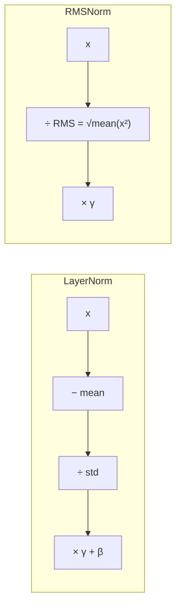

# L15 · RMS Normalization

> [!success] 🟢 In one sentence
> **RMSNorm is LayerNorm without the mean subtraction. It only divides by the root-mean-square size of the vector. It's cheaper, works just as well, and is what LLaMA, Mistral and most modern LLMs use.**

> [!example] 🧠 Analogy: volume normalization
> LayerNorm re-centers the song **and** sets its volume.
> RMSNorm only sets the volume. It turns out re-centering wasn't doing much.

## 👀 Picture it



```
 x = [3, 4]                      RMS = √((9+16)/2) = √12.5 ≈ 3.54
 RMSNorm(x) = [3, 4] / 3.54  =  [0.85, 1.13]
                                  ↑ same direction, vector rescaled to RMS 1
```

## 🧮 Tiny math
$$
\text{RMS}(x) = \sqrt{\frac1d\sum_i x_i^2 + \epsilon}, \qquad y = \gamma \odot \frac{x}{\text{RMS}(x)}
$$

| | LayerNorm | RMSNorm |
|---|---|---|
| Subtract mean | ✅ | ❌ |
| Divide by | std | RMS |
| Learnable | γ, β | γ only |
| Cost | 2 reductions (mean, var) | 1 reduction |
| Used in | GPT-2, BERT | **LLaMA 1–3, Mistral, Gemma, Qwen** |

> [!info] Why does dropping the mean work?
> The RMSNorm paper (Zhang & Sennrich, 2019) found that the **re-scaling** part is what stabilizes training. Re-centering adds compute and gives little benefit. At LLM scale, saving a reduction in every layer adds up.

## 💻 Code from scratch vs PyTorch

```python
import torch, torch.nn as nn

class RMSNorm(nn.Module):
    def __init__(self, d, eps=1e-6):
        super().__init__()
        self.weight = nn.Parameter(torch.ones(d))
        self.eps = eps
    def forward(self, x):
        rms = torch.sqrt(x.pow(2).mean(-1, keepdim=True) + self.eps)
        return self.weight * x / rms

x = torch.tensor([[3., 4.], [30., 40.]])
out = RMSNorm(2)(x)
print(out.round(decimals=2))     # both rows → [0.85, 1.13]: scale-invariant ✅

# PyTorch ≥ 2.4 ships one built in
ref = nn.RMSNorm(2, eps=1e-6)(x)
print("matches nn.RMSNorm:", torch.allclose(out, ref, atol=1e-5))
```

## ⚠️ Common mistakes
- **Using `x.mean()` instead of `x.pow(2).mean()`.** That isn't RMS.
- **Running it in fp16 without upcasting.** LLaMA's code does `x.float()` inside the norm to avoid overflow when squaring.

## 🏋️ Try it
1. Time LayerNorm vs RMSNorm on a (64, 1024, 4096) tensor.
2. Swap RMSNorm into the GPT you build in [[L32 Code GPT]]. Does the loss change?

---
**Prev ←** [[L14 Batch Normalization]] · **Next →** [[L16 Training Loop]] (module ④)
