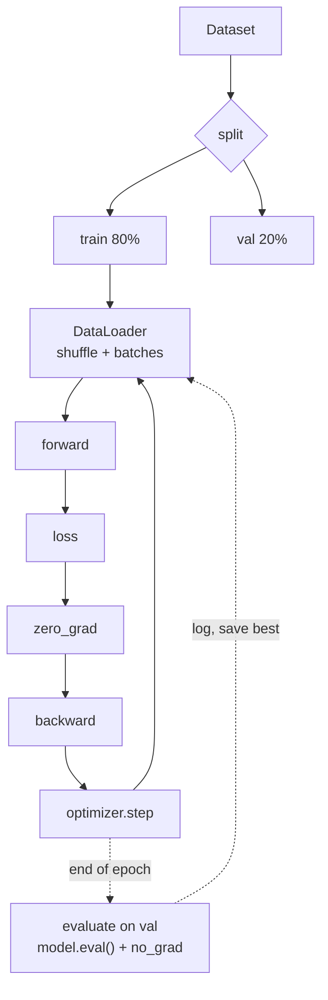

# L16 · The Training Loop

> [!success] 🟢 In one sentence
> **Every model, from XOR to GPT-4, trains with the same 5-line loop: forward → loss → zero_grad → backward → step. The rest is plumbing: batches, a validation split, and logging.**

> [!example] 🧠 Analogy: studying with flashcards
> - **Batch:** grab 32 cards.
> - **Forward + loss:** answer them and count your mistakes.
> - **Backward + step:** adjust your understanding.
> - **Epoch:** you've gone through the whole deck once.
> - **Validation set:** a practice exam with cards you **never** studied, to check you're actually learning and not just memorizing.

## 👀 Picture it



```
 epoch │ ████████████████████ │ all batches seen once
 batch │ ██                   │ 32 examples → 1 update
 step  │ ▌                    │ one optimizer.step()
 steps per epoch = ceil(N / batch_size)
```

## 💻 Code: the canonical PyTorch loop

```python
import torch, torch.nn as nn
from torch.utils.data import TensorDataset, DataLoader, random_split
torch.manual_seed(0)

# --- data: noisy spiral-ish 2-class problem ---
N = 1000
X = torch.randn(N, 2)
y = ((X[:, 0] ** 2 + X[:, 1] ** 2) < 1.0).long()     # inside circle = 1
ds = TensorDataset(X, y)
train_ds, val_ds = random_split(ds, [800, 200])
train_dl = DataLoader(train_ds, batch_size=32, shuffle=True)
val_dl = DataLoader(val_ds, batch_size=256)

# --- model, loss, optimizer ---
model = nn.Sequential(nn.Linear(2, 32), nn.ReLU(), nn.Linear(32, 32), nn.ReLU(), nn.Linear(32, 2))
loss_fn = nn.CrossEntropyLoss()
opt = torch.optim.AdamW(model.parameters(), lr=1e-2)

def evaluate(dl):
    model.eval()
    correct = total = 0
    with torch.no_grad():
        for xb, yb in dl:
            correct += (model(xb).argmax(1) == yb).sum().item()
            total += len(yb)
    model.train()
    return correct / total

for epoch in range(15):
    for xb, yb in train_dl:
        logits = model(xb)              # 1 forward
        loss = loss_fn(logits, yb)      # 2 loss
        opt.zero_grad()                 # 3 clear grads
        loss.backward()                 # 4 backprop
        opt.step()                      # 5 update
    if epoch % 3 == 0 or epoch == 14:
        print(f"epoch {epoch:2d}  last-batch loss {loss.item():.3f}  val acc {evaluate(val_dl):.1%}")
```

## 🧰 Optimizers in one table

| Optimizer | Idea | Typical lr |
|---|---|---|
| **SGD** | `w −= lr·g` | 0.01–0.1 |
| **SGD + momentum** | a rolling ball: keeps velocity across steps | 0.01–0.1 |
| **Adam** | a per-weight adaptive step size (from running mean and variance of g) | 1e-3 |
| **AdamW** ✅ | Adam + correct weight decay. The default for transformers | 1e-4 to 3e-4 for LLMs |

## 🧩 Upgrades you'll see in real code

| Add-on | One line | Why |
|---|---|---|
| LR schedule | `sched = torch.optim.lr_scheduler.CosineAnnealingLR(opt, T_max)` | big steps early, small steps late |
| Warmup | linear ramp of lr for the first ~1–5% of steps | avoids early instability |
| Grad clipping | `nn.utils.clip_grad_norm_(model.parameters(), 1.0)` | stops a single exploding step |
| Checkpointing | `torch.save(model.state_dict(), "best.pt")` | keep the best validation model |
| Mixed precision | `torch.autocast(device_type, dtype=torch.bfloat16)` | about 2× faster on GPU |

## ⚠️ Common mistakes
- **Evaluating without `model.eval()` and `torch.no_grad()`.** Dropout and BatchNorm misbehave and memory is wasted.
- **No shuffling.** The model sees all cats, then all dogs, and forgets the cats.
- **Testing on training data.** You get 100% accuracy and learn nothing about real performance.
- **Calling `loss.item()` every step on GPU.** It forces a sync; log every N steps instead.

## 🏋️ Try it
1. Add a cosine LR schedule and a warmup.
2. Save the model with the best validation accuracy and reload it.
3. Plot train vs val loss per epoch, which you'll need for [[L17 Training Diagnostics]].

---
**Prev ←** [[L15 RMS Normalization]] · **Next →** [[L17 Training Diagnostics]]
