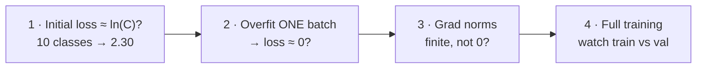

# L17 · Training Diagnostics

> [!success] 🟢 In one sentence
> **Learn to read the loss curves like a doctor reads an ECG. Each common failure (LR too high, overfitting, underfitting, a bug) has a recognizable shape.**

> [!example] 🧠 Analogy: a car dashboard
> Loss = speed, gradient norm = engine RPM, val vs train gap = fuel economy.
> You don't need to open the engine to know something's wrong. The gauges tell you first.

## 👀 The 6 curve shapes to memorize

```
 1. HEALTHY ✅             2. LR TOO HIGH 💥          3. LR TOO LOW 🐌
 loss                      loss                      loss
 │╲                        │  ╱╲  ╱╲ ╱  NaN          │‾‾‾‾‾‾‾‾╲___
 │ ╲___                    │╱╲╱  ╲╱  ╲╱              │            ‾‾
 │     ‾‾‾‾‾‾‾ train≈val   │                         │  barely moving
 └──────── step            └──────── step            └──────── step

 4. OVERFITTING 📚         5. UNDERFITTING 😴         6. BUG / NOT LEARNING 🐛
 │╲    ___ val ↗            │╲___________ val          │ ───────────── stuck at
 │ ╲__╱                     │ ╲__________ train        │               ln(C)!
 │    ‾‾‾‾‾ train ↘         │  both high & flat        │
 └──────── step            └──────── step            └──────── step
```

## 🩺 The diagnosis table

| Symptom | Likely cause | Fix |
|---|---|---|
| Loss → NaN / explodes | lr too high, bad init, log(0) | ↓ lr, grad clipping, check softmax stability |
| Flat from step 0 at **ln(C)** | bug: labels shuffled, no `.step()`, detached graph | run the **overfit-one-batch test** ↓ |
| Train ↓, val ↑ | overfitting | more data, dropout, weight decay, early stop |
| Train and val both high | underfitting | bigger model, train longer, ↑ lr |
| Noisy, zig-zag | batch too small or lr too high | ↑ batch, ↓ lr, momentum |
| Starts way above ln(C) | over-confident init | smaller init on the last layer |

## 🧪 Sanity checks (do them **before** long runs)



> [!tip] ⭐ The single most useful debugging trick
> **Overfit a single batch.** Train on the same 8–32 examples for ~200 steps. A working model and pipeline will memorize them, so the loss heads to ~0.
> If it can't, you have a **bug**, not a tuning problem. Don't touch the hyperparameters until this passes.

## 💻 Code: an automated health check

```python
import torch, torch.nn as nn, math
torch.manual_seed(0)
C = 10
X = torch.randn(512, 20); y = torch.randint(0, C, (512,))   # random labels!

def make():
    return nn.Sequential(nn.Linear(20, 64), nn.ReLU(), nn.Linear(64, C))

# Check 1: initial loss ≈ ln(C)
model = make()
init_loss = nn.functional.cross_entropy(model(X), y).item()
print(f"1. initial loss {init_loss:.2f}  (expect ≈ ln({C}) = {math.log(C):.2f})")

# Check 2: overfit one batch
xb, yb = X[:16], y[:16]
opt = torch.optim.Adam(model.parameters(), lr=1e-2)
for step in range(200):
    loss = nn.functional.cross_entropy(model(xb), yb)
    opt.zero_grad(); loss.backward(); opt.step()
print(f"2. one-batch loss after 200 steps: {loss.item():.4f}  (expect ≈ 0)")

# Check 3: gradient norms per layer
for name, p in model.named_parameters():
    print(f"3. grad norm {name:10s} {p.grad.norm().item():.2e}")

# Check 4: train vs val on random labels → classic overfitting signature
model, Xv, yv = make(), torch.randn(256, 20), torch.randint(0, C, (256,))
opt = torch.optim.Adam(model.parameters(), lr=1e-2)
for ep in range(300):
    loss = nn.functional.cross_entropy(model(X), y)
    opt.zero_grad(); loss.backward(); opt.step()
with torch.no_grad():
    val = nn.functional.cross_entropy(model(Xv), yv).item()
print(f"4. train {loss.item():.2f} vs val {val:.2f}  → memorized noise (overfit) 📚")
```

## 📊 What to log on every real run
- train loss (smoothed) and **val loss**
- learning rate (to confirm the schedule actually works)
- **gradient norm** (spikes come before blow-ups)
- a few sample predictions (for LMs, generated text, see [[L34 Make GPT Talk Back]])
- throughput (examples/sec) to catch silent slowdowns

## ⚠️ Common mistakes
- Tuning hyperparameters when the real problem is a bug. Do the overfit test first.
- Judging overfitting from training loss alone.
- Not fixing random seeds, so runs can't be compared.

## 🏋️ Try it
1. Break the loop on purpose: remove `opt.zero_grad()`. Which curve shape do you get?
2. Set lr = 10 and watch for NaN. Then add `clip_grad_norm_` and compare.
3. Add `nn.Dropout(0.5)` and weight decay to Check 4. Does the val gap shrink?

---
**Prev ←** [[L16 Training Loop]] · **Next →** [[L18 Dead ReLU Detector]]
