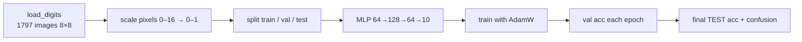

# L19 · Digit Classifier (Project)

> [!success] 🟢 In one sentence
> **Put modules ①–④ together: load images of handwritten digits, train an MLP, check the diagnostics, and reach about 97% accuracy on images it has never seen.**

> [!example] 🧠 Analogy
> This is the "hello world" of deep learning. If you can do it from memory, you understand the full pipeline.

## 👀 Picture it

```
 an 8×8 image of a "3"            flattened to 64 numbers
 ░░▓▓▓▓░░                          [0, 0, 9, 15, 15, 9, 0, 0,
 ░░░░░▓▓░                            0, 0, 0, 0, 0, 15, 12, 0, ... ]
 ░░▓▓▓▓░░                                   │
 ░░░░░▓▓░                                   ▼
 ░░▓▓▓▓░░          64 ─► Linear ─► ReLU ─► 128 ─► Linear ─► ReLU ─► 64 ─► Linear ─► 10 logits
                                                                                  │
                                                                     softmax → "it's a 3 (94%)"
```



> [!info] Why `load_digits` and not MNIST?
> It ships with scikit-learn (no download), and it trains in seconds on a CPU. Swapping in MNIST (28×28 → 784 inputs) via `torchvision.datasets.MNIST` only changes the input size.

## 💻 Code: full project

```python
import torch, torch.nn as nn
from sklearn.datasets import load_digits
from sklearn.model_selection import train_test_split
torch.manual_seed(0)

# 1. data
X, y = load_digits(return_X_y=True)                 # (1797, 64), labels 0..9
X = torch.tensor(X / 16.0, dtype=torch.float32)     # scale to [0, 1]
y = torch.tensor(y)
X_tr, X_te, y_tr, y_te = train_test_split(X, y, test_size=0.2, random_state=0, stratify=y)
X_tr, X_va, y_tr, y_va = train_test_split(X_tr, y_tr, test_size=0.15, random_state=0, stratify=y_tr)
print("train/val/test:", len(X_tr), len(X_va), len(X_te))

# 2. model
model = nn.Sequential(
    nn.Linear(64, 128), nn.ReLU(), nn.Dropout(0.1),
    nn.Linear(128, 64), nn.ReLU(),
    nn.Linear(64, 10),
)
opt = torch.optim.AdamW(model.parameters(), lr=3e-3, weight_decay=1e-4)
loss_fn = nn.CrossEntropyLoss()

def accuracy(X, y):
    model.eval()
    with torch.no_grad(): acc = (model(X).argmax(1) == y).float().mean().item()
    model.train(); return acc

# sanity check from L17
with torch.no_grad(): print(f"initial loss {loss_fn(model(X_tr), y_tr):.2f} (expect ≈ 2.30)")

# 3. train
best, best_state = 0, None
for epoch in range(40):
    perm = torch.randperm(len(X_tr))
    for i in range(0, len(X_tr), 64):
        idx = perm[i:i + 64]
        loss = loss_fn(model(X_tr[idx]), y_tr[idx])
        opt.zero_grad(); loss.backward(); opt.step()
    va = accuracy(X_va, y_va)
    if va > best:
        best, best_state = va, {k: v.clone() for k, v in model.state_dict().items()}
    if epoch % 10 == 0:
        print(f"epoch {epoch:2d}  loss {loss.item():.3f}  val {va:.1%}")

# 4. final test with the best checkpoint
model.load_state_dict(best_state)
print(f"\nbest val {best:.1%}   TEST accuracy {accuracy(X_te, y_te):.1%} 🎯")

# 5. which digits get confused?
model.eval()
with torch.no_grad(): pred = model(X_te).argmax(1)
cm = torch.zeros(10, 10, dtype=torch.long)
for t, p in zip(y_te, pred): cm[t, p] += 1
print("confusion matrix (row = true, col = predicted):")
print(cm)
```

## 🔍 Read the confusion matrix

```
          predicted →
         0  1  2  3 …
 true 0 [36  0  0  0 ]   diagonal = correct ✅
      1 [ 0 35  0  1 ]   off-diagonal = mistakes
      3 [ 0  0  1 34 ]   e.g. a 3 mistaken for 2 → visually similar shapes
```

## 🧪 What you just used
| Lesson | Where |
|---|---|
| [[L03 Softmax]] + [[L04 Cross-Entropy Loss]] | `nn.CrossEntropyLoss` |
| [[L10 MLP from Scratch]] | `nn.Sequential` |
| [[L11 Weight Initialization]] | PyTorch's default Linear init |
| [[L16 Training Loop]] | mini-batches, AdamW, eval mode |
| [[L17 Training Diagnostics]] | initial loss check, val tracking, best checkpoint |

## 🏋️ Try it
1. Remove the hidden layers and use plain logistic regression `nn.Linear(64, 10)`. How much accuracy do you lose?
2. Add the dead-ReLU report from [[L18 Dead ReLU Detector]].
3. Swap in MNIST with `torchvision` and reach 98%+.
4. Bonus: a tiny CNN with `nn.Conv2d(1, 16, 3)` on the 8×8 images.

---
**Prev ←** [[L18 Dead ReLU Detector]] · **Next →** [[L20 Intro to NLP]] (module ⑤)
