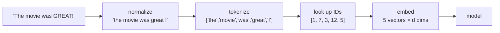

# L20 · Intro to Natural Language Processing

> [!success] 🟢 In one sentence
> **Neural nets only understand numbers, so NLP starts by turning text into numbers: split it into tokens, give each token an ID, then turn the IDs into vectors.**

> [!example] 🧠 Analogy: a library catalog
> Each book gets a number (**token ID**), and the catalog maps titles to numbers (**vocabulary**).
> The number itself means nothing, since book #42 isn't "more" than book #41. That's why IDs later become **vectors** that *do* carry meaning ([[L21 Word Embeddings]]).

## 👀 Picture it: the text pipeline



## 🧱 Three ways to tokenize

| Level | "unbelievable!" | Vocab size | Problem |
|---|---|---|---|
| **Character** | `u n b e l i e v a b l e !` | ~100 | very long sequences |
| **Word** | `unbelievable` `!` | 100k+ | unseen words → `<unk>` |
| **Subword (BPE)** ✅ | `un` `believ` `able` `!` | 30k–200k | the best of both, used by GPT |

You'll build a BPE tokenizer in [[L27 Tokenizer - Byte Pair Encoding]].

## 🎒 The first idea: Bag of Words

Ignore word order and just count words.

```
 vocab:       [the, movie, was, great, bad, boring]
 "the movie was great"   → [1, 1, 1, 1, 0, 0]
 "great great movie"     → [0, 1, 0, 2, 0, 0]
 "boring bad movie"      → [0, 1, 0, 0, 1, 1]
```

> [!warning] What bag-of-words loses
> "dog bites man" and "man bites dog" get the **same** vector. Word order matters, and handling it is what [[L23 Positional Encoding]] and attention are for.

## 💻 Code: tokenizer, vocab and bag-of-words from scratch

```python
import re
from collections import Counter

corpus = ["The movie was GREAT!", "What a boring, bad movie.", "Great acting, great story."]

def tokenize(text):
    return re.findall(r"[a-z]+|[^\sa-z]", text.lower())   # words OR single punctuation

tokens = [tokenize(t) for t in corpus]
print(tokens[0])                        # ['the', 'movie', 'was', 'great', '!']

# vocabulary: special tokens first, then by frequency
counts = Counter(tok for sent in tokens for tok in sent)
itos = ["<pad>", "<unk>"] + [w for w, _ in counts.most_common()]
stoi = {w: i for i, w in enumerate(itos)}
print("vocab size:", len(itos))

def encode(text): return [stoi.get(t, stoi["<unk>"]) for t in tokenize(text)]
def decode(ids):  return " ".join(itos[i] for i in ids)

ids = encode("great movie, terrible plot")
print(ids, "→", decode(ids))            # unknown words become <unk>

def bag_of_words(text):
    v = [0] * len(itos)
    for i in encode(text): v[i] += 1
    return v
print(bag_of_words("great great movie"))
```

## 🗺️ What NLP models do with the vectors

| Task | Input → Output | Example |
|---|---|---|
| Classification | text → label | sentiment ([[L22 Sentiment Analysis]]), spam |
| Token tagging | text → a label per token | named entities |
| Generation | text → next token, repeated | **GPT** (module ⑦) |
| Seq2seq | text → text | translation |

## ⚠️ Common mistakes
- Building the vocab from the test set (data leakage).
- Forgetting `<unk>` and `<pad>`, which leads to crashes on new words or uneven batch lengths.
- Lowercasing everything when case matters (e.g. "US" vs "us").

## 🏋️ Try it
1. Add a `max_vocab` limit that maps rare words to `<unk>`.
2. Pad a batch of encoded sentences to equal length with `<pad>`.
3. Compute TF-IDF instead of raw counts.

---
**Prev ←** [[L19 Digit Classifier]] · **Next →** [[L21 Word Embeddings]]
