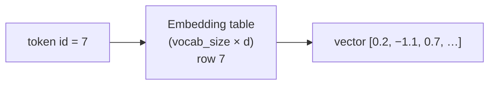

# L21 · Word Embeddings

> [!success] 🟢 In one sentence
> **An embedding gives each word a learned vector (a list of, say, 64 numbers). Words used in similar contexts end up with similar vectors, so "cat" lands near "dog" and far from "banana".**

> [!example] 🧠 Analogy: a map of meaning
> Imagine every word as a city on a map. Words that show up in similar sentences ("I fed my ___") become **neighboring cities**.
> *"You shall know a word by the company it keeps."* (J. R. Firth, 1957)

## 👀 Picture it

```
 one-hot (useless distances)          embeddings (meaningful distances)
 cat    = [1,0,0,0,0]                   ▲ dim 2
 dog    = [0,1,0,0,0]                   │   🐱cat  🐶dog
 banana = [0,0,1,0,0]                   │      🐭mouse
 every pair is equally far apart 😐     │
                                         │               🍌banana 🍎apple
                                         └──────────────────────► dim 1
```



> [!info] An embedding layer is just a lookup table
> `nn.Embedding(V, d)` is a learnable matrix of shape (V, d). Calling it with id 7 returns **row 7**. That's mathematically the same as `one_hot(7) @ W`, but much faster.

## 🧮 How do vectors learn meaning? (word2vec skip-gram)

Train a tiny task: **given a word, predict its neighbors.**
```
 sentence: "the  cat  drinks  milk"
                 ↑ center
 training pairs: (cat → the), (cat → drinks), (cat → milk)
```
To predict the same neighbors, "cat" and "dog" are pushed toward **similar vectors**. The meaning is a side effect of the task.

**Similarity** = cosine of the angle between vectors:
$$
\cos(a,b) = \frac{a\cdot b}{\|a\|\,\|b\|} \in [-1, 1]
$$

## 💻 Code: train mini word2vec in PyTorch

```python
import torch, torch.nn as nn, torch.nn.functional as F, random
torch.manual_seed(0); random.seed(0)

animals, foods = ["cat", "dog", "mouse", "horse"], ["apple", "banana", "bread", "cheese"]
corpus = []
for _ in range(400):
    a, f = random.choice(animals), random.choice(foods)
    corpus += [f"the {a} runs fast", f"the {a} sleeps at home", f"i eat the {f}", f"the {f} tastes sweet"]
words = " ".join(corpus).split()
vocab = sorted(set(words)); stoi = {w: i for i, w in enumerate(vocab)}

# (center, context) pairs within each sentence, window = 2
pairs = []
for s in corpus:
    ids = [stoi[w] for w in s.split()]
    for i, c in enumerate(ids):
        for j in range(max(0, i - 2), min(len(ids), i + 3)):
            if i != j: pairs.append((c, ids[j]))
pairs = torch.tensor(pairs)

class SkipGram(nn.Module):
    def __init__(self, V, d=16):
        super().__init__()
        self.emb = nn.Embedding(V, d)      # the vectors we want
        self.out = nn.Linear(d, V)         # predicts a context word
    def forward(self, center): return self.out(self.emb(center))

model = SkipGram(len(vocab))
opt = torch.optim.Adam(model.parameters(), lr=0.01)
for epoch in range(30):
    for batch in pairs[torch.randperm(len(pairs))].split(256):
        loss = F.cross_entropy(model(batch[:, 0]), batch[:, 1])
        opt.zero_grad(); loss.backward(); opt.step()

E = F.normalize(model.emb.weight.detach(), dim=1)
def sim(a, b): return (E[stoi[a]] @ E[stoi[b]]).item()
print(f"cat~dog     {sim('cat', 'dog'):+.2f}   (same group → high)")
print(f"apple~bread {sim('apple', 'bread'):+.2f}   (same group → high)")
print(f"cat~apple   {sim('cat', 'apple'):+.2f}   (different → low)")

def nearest(w, k=3):
    scores = E @ E[stoi[w]]
    return [vocab[i] for i in scores.argsort(descending=True)[1:k + 1]]
print("nearest to 'dog':", nearest("dog"))
```

## ✨ The famous vector arithmetic
On large corpora, directions in embedding space carry meaning:
```
 king − man + woman ≈ queen
 Paris − France + Italy ≈ Rome
```
It's a *tendency*, not a guarantee, but it shows the space has structure.

## 🔗 Embeddings everywhere
- Every LLM's first layer is an `nn.Embedding` (GPT-2: 50,257 × 768).
- **Sentence embeddings** for search and RAG: [[Embeddings and Embedding Models]].
- In a transformer the embedding is **contextual**: "bank" gets different vectors in "river bank" vs "bank account", thanks to attention ([[L24 Self-Attention]]).

## ⚠️ Common mistakes
- Comparing raw dot products. Normalize first (cosine), or frequent words with large norms dominate.
- Expecting good embeddings from a tiny corpus. Real word2vec used billions of words.

## 🏋️ Try it
1. Increase `d` to 64. Does the similarity gap grow?
2. Project the embeddings to 2D with PCA (`torch.pca_lowrank`) and plot them.
3. Add a third group (colors) to the corpus and check that it forms its own cluster.

---
**Prev ←** [[L20 Intro to NLP]] · **Next →** [[L22 Sentiment Analysis]]
