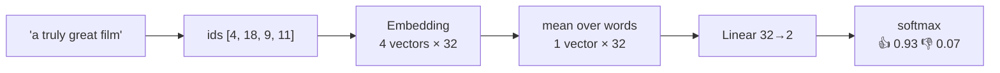

# L22 · Sentiment Analysis (Project)

> [!success] 🟢 In one sentence
> **Classify a review as positive or negative: tokenize → embed every word → average the vectors → linear layer → probability.**

> [!example] 🧠 Analogy: a panel of judges
> Every word is a judge holding up a score card (its embedding). "Amazing" votes strongly 👍 and "awful" strongly 👎. We average the cards and a final referee (the linear layer) reads the average and decides.

## 👀 Picture it



```
  "not"   [ .1 −.3  .2 …]  ┐
  "a"     [ .0  .1 −.1 …]  │  average  ─►  [ .4  .5  .3 …] ─► Linear ─► 👍
  "great" [ .9  .8  .7 …]  │
  "film"  [ .1  .2  .0 …]  ┘
```

> [!warning] The weakness of averaging
> "not good" vs "good" differ by one judge. Averaging can't really model "not *flips* the next word", because order is lost.
> That limitation is the motivation for attention ([[L24 Self-Attention]]), where words can look at each other.

## 💻 Code: train an EmbeddingBag classifier

```python
import torch, torch.nn as nn, random, re
torch.manual_seed(0); random.seed(0)

pos_w = ["great", "amazing", "wonderful", "loved", "brilliant", "fun", "beautiful", "excellent"]
neg_w = ["terrible", "awful", "boring", "hated", "dull", "bad", "worst", "weak"]
nouns = ["movie", "film", "story", "acting", "plot", "ending", "soundtrack"]
templates = ["the {n} was {a}", "a truly {a} {n}", "i thought the {n} was {a}", "{a} {n} overall", "what a {a} {n}"]

def make(n):
    data = []
    for _ in range(n):
        label = random.randint(0, 1)
        adj = random.choice(pos_w if label else neg_w)
        data.append((random.choice(templates).format(n=random.choice(nouns), a=adj), label))
    return data
train, test = make(2000), make(400)

tok = lambda s: re.findall(r"[a-z']+", s.lower())
vocab = ["<unk>"] + sorted({w for s, _ in train for w in tok(s)})
stoi = {w: i for i, w in enumerate(vocab)}
enc = lambda s: torch.tensor([stoi.get(w, 0) for w in tok(s)])

class SentimentNet(nn.Module):
    def __init__(self, V, d=32):
        super().__init__()
        self.emb = nn.EmbeddingBag(V, d, mode="mean")   # embed + average in one op
        self.fc = nn.Linear(d, 2)
    def forward(self, ids, offsets): return self.fc(self.emb(ids, offsets))

def batchify(rows):
    ids = [enc(s) for s, _ in rows]
    offsets = torch.tensor([0] + [len(x) for x in ids[:-1]]).cumsum(0)  # where each sentence starts
    return torch.cat(ids), offsets, torch.tensor([y for _, y in rows])

model = SentimentNet(len(vocab))
opt = torch.optim.Adam(model.parameters(), lr=1e-2)
for epoch in range(5):
    random.shuffle(train)
    for i in range(0, len(train), 64):
        ids, off, y = batchify(train[i:i + 64])
        loss = nn.functional.cross_entropy(model(ids, off), y)
        opt.zero_grad(); loss.backward(); opt.step()
    with torch.no_grad():
        ids, off, y = batchify(test)
        acc = (model(ids, off).argmax(1) == y).float().mean()
    print(f"epoch {epoch}  loss {loss.item():.3f}  test acc {acc:.1%}")

def predict(text):
    with torch.no_grad():
        p = model(enc(text), torch.tensor([0])).softmax(-1)[0, 1].item()
    return f"{'👍' if p > .5 else '👎'} {p:.2f}  '{text}'"
for s in ["what a brilliant film", "the plot was dull", "not bad at all"]:
    print(predict(s))

# 🔍 peek inside: score each word on its own
with torch.no_grad():
    w_scores = model.fc(model.emb.weight)[:, 1] - model.fc(model.emb.weight)[:, 0]
top = w_scores.argsort()
print("most 👎:", [vocab[i] for i in top[:4]])
print("most 👍:", [vocab[i] for i in top[-4:]])
```

> [!tip] Look at "not bad at all"
> It's probably classified 👎. The model only sees the average and has no notion that "not" flips "bad". That's the gap transformers close.

## ⚠️ Common mistakes
- Template data gives inflated accuracy. Real reviews (IMDB, SST-2) are much harder.
- Padding tokens included in the average. `EmbeddingBag` avoids this by using offsets.
- Class imbalance (90% positive). A model that always says 👍 then scores 90%.

## 🏋️ Try it
1. Add "not {adj}" templates with flipped labels. How bad does the averaging model get?
2. Replace averaging with a small `nn.TransformerEncoderLayer`. Does "not bad" work now?
3. Train on the real SST-2 dataset with the `datasets` library.

---
**Prev ←** [[L21 Word Embeddings]] · **Next →** [[L23 Positional Encoding]]
