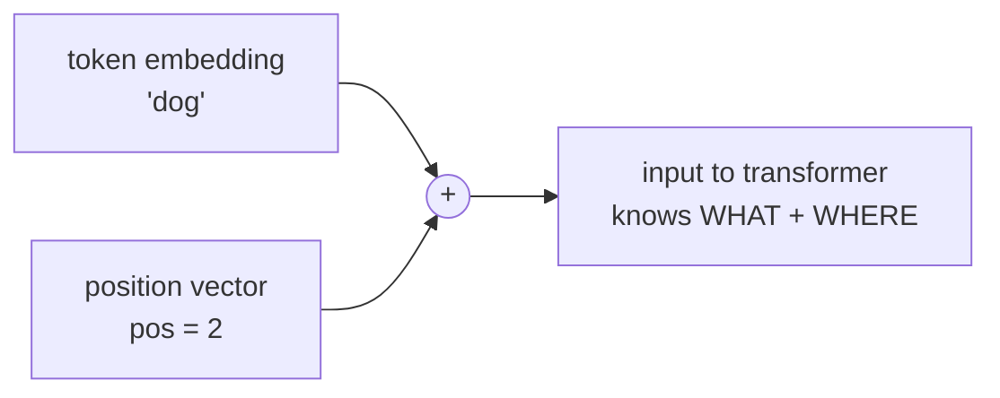

# L23 · Positional Encoding

> [!success] 🟢 In one sentence
> **Attention treats a sentence as an unordered bag, so we add a "position signal" to each token's embedding. That's how the model knows "dog bites man" ≠ "man bites dog".**

> [!example] 🧠 Analogy: seat numbers at a concert
> Everyone (the tokens) enters the hall at once. Without seat numbers you know who came but not where they sit.
> Positional encoding **stamps a seat number onto each person's ticket** (adds it to their vector).

## 👀 Picture it



### Sinusoidal encoding: like clock hands at different speeds

```
 dim 0 (fast)   ∿∿∿∿∿∿∿∿∿∿∿∿∿∿∿∿   ← like a seconds hand
 dim 2          ∿  ∿  ∿  ∿  ∿  ∿
 dim 4          ∿    ∿    ∿    ∿   ← like a minutes hand
 dim 6 (slow)   ∿        ∿         ← like an hours hand
                └──────────────── position 0 … 50
 Each position gets a unique combination of hand angles → a unique fingerprint.
```

## 🧮 Tiny math (the original Transformer, 2017)
$$
PE_{(pos,\,2i)} = \sin\!\left(\frac{pos}{10000^{2i/d}}\right) \qquad
PE_{(pos,\,2i+1)} = \cos\!\left(\frac{pos}{10000^{2i/d}}\right)
$$
- Low dims: high frequency (they change every token).
- High dims: low frequency (they change slowly, which encodes "roughly where").
- A nice property: $PE_{pos+k}$ is a **rotation** of $PE_{pos}$, so *relative* offsets are easy to learn.

## 🧭 The 3 families you'll meet

| Method | How | Used by |
|---|---|---|
| **Sinusoidal** | fixed sin/cos, **added** to embeddings | original Transformer |
| **Learned absolute** | `nn.Embedding(max_len, d)`, **added** | GPT-2, BERT (and our GPT in [[L32 Code GPT]]) |
| **RoPE** | **rotate** q and k by an angle ∝ position | LLaMA, Mistral, Qwen → [[Positional Encodings - RoPE, ALiBi and Long Context]] |

## 💻 Code: sinusoidal PE + proof that order now matters

```python
import torch, math

def sinusoidal_pe(max_len, d):
    pos = torch.arange(max_len).unsqueeze(1)                       # (L, 1)
    div = torch.exp(torch.arange(0, d, 2) * (-math.log(10000.0) / d))  # (d/2,)
    pe = torch.zeros(max_len, d)
    pe[:, 0::2] = torch.sin(pos * div)
    pe[:, 1::2] = torch.cos(pos * div)
    return pe

pe = sinusoidal_pe(50, 16)
print("PE shape:", pe.shape)
print("pos 0:", pe[0, :6].round(decimals=2))
print("pos 1:", pe[1, :6].round(decimals=2))

# nearby positions are similar, far ones are less similar
cos = torch.nn.functional.cosine_similarity
print(f"sim(pos5, pos6)  = {cos(pe[5], pe[6], dim=0):.2f}")
print(f"sim(pos5, pos40) = {cos(pe[5], pe[40], dim=0):.2f}")

# without PE: a "sentence" and its reverse look identical to an order-blind model
torch.manual_seed(0)
emb = torch.nn.Embedding(10, 16)
s1, s2 = torch.tensor([1, 2, 3]), torch.tensor([3, 2, 1])      # "dog bites man" vs "man bites dog"
bag = lambda x: torch.relu(x).mean(0)    # order-blind "model": a per-token layer, then pool
print("no PE   same?", torch.allclose(bag(emb(s1)), bag(emb(s2))))                         # True 😐
print("with PE same?", torch.allclose(bag(emb(s1) + pe[:3]), bag(emb(s2) + pe[:3])))       # False ✅
# why the relu? a plain mean of (emb + pe) is still order-blind: the PE sum is the same
# for any ordering. A non-linear layer mixes WHAT and WHERE inside each token first.
```

### Learned positions (what GPT-2 does, in 2 lines)

```python
import torch, torch.nn as nn
tok_emb, pos_emb = nn.Embedding(100, 16), nn.Embedding(32, 16)   # vocab 100, max_len 32
idx = torch.tensor([[5, 9, 2, 7]])                                # (B=1, T=4)
x = tok_emb(idx) + pos_emb(torch.arange(idx.shape[1]))            # (1, 4, 16)
print(x.shape)
```

## ⚠️ Common mistakes
- **Sequence longer than `max_len`** with learned positions. That's an index error, since the model has no vector for seat #33.
- Multiplying instead of adding PE to sinusoidal or learned embeddings.
- Forgetting PE entirely. Attention then ignores word order.

## 🏋️ Try it
1. Show `pe` as a heatmap (`plt.imshow(pe)`) to see the striped "barcode".
2. Verify that `pe[pos+k]` can be computed from `pe[pos]` with a fixed rotation matrix per frequency pair.
3. Read the RoPE note and explain why rotation preserves **relative** distance in q·k.

---
**Prev ←** [[L22 Sentiment Analysis]] · **Next →** [[L24 Self-Attention]] (module ⑥)
