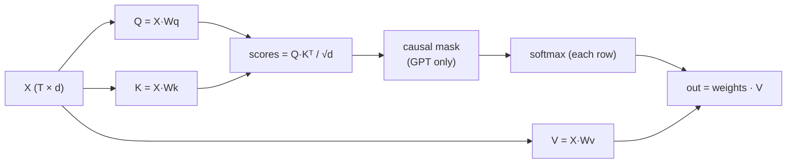

# L24 · Self-Attention

> [!success] 🟢 In one sentence
> **Self-attention lets every token look at every other token and pull in the information it needs, as a weighted average. The weights come from how well a token's "question" (query) matches each other token's "label" (key).**

> [!example] 🧠 Analogy: a search engine inside the sentence
> Each word asks a **Query** ("I'm 'it', which noun do I refer to?").
> Each word advertises a **Key** ("I'm 'animal', a noun, singular").
> Each word also carries a **Value** (the actual info it will share).
> Match the query against all keys, turn the match scores into weights with softmax, and return the weighted mix of values.

## 👀 Picture it

```
 "The animal didn't cross the street because it was tired"

  it ──attends to──►  The   animal  didn't  cross  the  street  because  it   was  tired
  weights:            .02   .61     .01     .03    .01  .12     .02      .08  .03  .07
                            ▲▲▲▲ "it" mostly pulls info from "animal"
```



## 🧮 The formula (the most important equation in modern AI)
$$
\text{Attention}(Q,K,V) = \text{softmax}\!\left(\frac{QK^\top}{\sqrt{d_k}}\right)V
$$

| Piece | Shape (T tokens, d dims) | Meaning |
|---|---|---|
| $Q K^\top$ | (T, T) | how much token i likes token j |
| $/\sqrt{d_k}$ | | keeps scores from getting huge, so softmax doesn't saturate |
| softmax (rows) | (T, T), rows sum to 1 | attention weights |
| $\times V$ | (T, d) | each token becomes a weighted mix of values |

### 🎭 The causal mask (for GPT)
When predicting the next word, a token **must not see the future**:
```
          k: The  cat  sat  on
 q: The    [ ✓    ✗    ✗    ✗ ]
    cat    [ ✓    ✓    ✗    ✗ ]      ✗ = set the score to −∞ before softmax
    sat    [ ✓    ✓    ✓    ✗ ]          → weight exactly 0
    on     [ ✓    ✓    ✓    ✓ ]
```

## 🔢 By hand (T=2, d=2, Wq = Wk = Wv = I for simplicity)
x₁ = [1, 0], x₂ = [0, 1] → Q = K = V = X
scores = QKᵀ/√2 = [[1, 0],[0, 1]]/1.41 = [[0.71, 0],[0, 0.71]]
softmax row 1: [e^.71, e^0]/sum = [0.67, 0.33]
out₁ = 0.67·[1,0] + 0.33·[0,1] = **[0.67, 0.33]**. Token 1 kept mostly itself plus a bit of token 2.

## 💻 Code: from scratch, then verify against PyTorch

```python
import torch, torch.nn as nn, torch.nn.functional as F, math
torch.manual_seed(0)

class SelfAttention(nn.Module):
    def __init__(self, d, causal=True):
        super().__init__()
        self.q, self.k, self.v = nn.Linear(d, d, bias=False), nn.Linear(d, d, bias=False), nn.Linear(d, d, bias=False)
        self.causal = causal
    def forward(self, x):                                   # x: (B, T, d)
        B, T, d = x.shape
        Q, K, V = self.q(x), self.k(x), self.v(x)
        scores = Q @ K.transpose(-2, -1) / math.sqrt(d)     # (B, T, T)
        if self.causal:
            mask = torch.tril(torch.ones(T, T, dtype=torch.bool))
            scores = scores.masked_fill(~mask, float("-inf"))
        self.weights = scores.softmax(dim=-1)              # keep for visualization
        return self.weights @ V                             # (B, T, d)

x = torch.randn(1, 4, 8)
attn = SelfAttention(8)
out = attn(x)
print("out shape:", out.shape)
print("attention weights (rows sum to 1, upper triangle = 0):")
print(attn.weights[0].round(decimals=2))

# PyTorch's fused kernel gives the same result (and uses FlashAttention on GPU)
ref = F.scaled_dot_product_attention(attn.q(x), attn.k(x), attn.v(x), is_causal=True)
print("matches F.scaled_dot_product_attention:", torch.allclose(out, ref, atol=1e-6))
```

## 🤯 Why √d? A quick demo

```python
import torch
torch.manual_seed(0)
for d in [4, 64, 1024]:
    q, k = torch.randn(d), torch.randn(10, d)
    raw = (k @ q).softmax(0).max().item()
    scaled = (k @ q / d ** 0.5).softmax(0).max().item()
    print(f"d={d:5d}  max weight raw={raw:.2f}  scaled={scaled:.2f}")
# raw: as d grows, one weight → 1.0 (softmax saturates, gradients ≈ 0)
```

## ⚠️ Common mistakes
- Softmax over the **wrong axis**. It must be over keys (the last dim), so each query's row sums to 1.
- Forgetting the mask in a decoder. The model then cheats by reading the answer during training.
- Masking with 0 instead of −∞. Since e⁰ = 1, the future still gets weight.

## 🏋️ Try it
1. Print attention weights for `causal=False`. How is the matrix different?
2. Give all tokens the same input. What do the weights become, and why?
3. Count the FLOPs of `Q @ Kᵀ` as T grows. Why is attention O(T²)?

---
**Prev ←** [[L23 Positional Encoding]] · **Next →** [[L25 Multi-Head Self-Attention]] · Deeper: [[Attention]]
