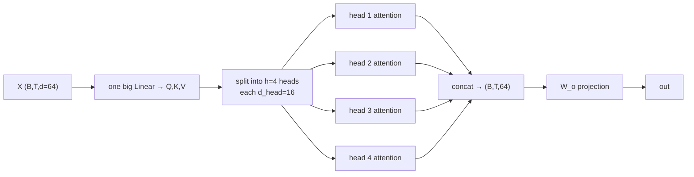

# L25 · Multi-Head Self-Attention

> [!success] 🟢 In one sentence
> **Instead of one attention pattern, run several smaller ones (heads) in parallel. Each head can specialize (one tracks grammar, another tracks who "it" refers to), and their results are concatenated.**

> [!example] 🧠 Analogy: a team of detectives
> One detective can only follow one lead at a time. Hire **8 detectives**, each with a smaller notebook (fewer dims):
> - 🕵️ #1 tracks **subject ↔ verb**
> - 🕵️ #2 tracks **pronoun → noun**
> - 🕵️ #3 watches **the previous word**
>
> At the end they pool their notes (concatenate) and a chief (the output projection) writes the report.

## 👀 Picture it



### The reshape trick (where most bugs live)

```
 Q: (B, T, d)                       d = n_heads × d_head = 4 × 16
     │ view(B, T, n_heads, d_head)
     ▼
    (B, T, 4, 16)
     │ transpose(1, 2)              ← heads become a "batch" dimension
     ▼
    (B, 4, T, 16)  ── attention runs independently per head ──► (B, 4, T, 16)
     │ transpose(1, 2).contiguous().view(B, T, d)
     ▼
    (B, T, 64)  → W_o
```

## 🧮 Tiny math
$$
\text{head}_i = \text{Attention}(XW_q^{(i)}, XW_k^{(i)}, XW_v^{(i)}), \quad
\text{MHA}(X) = \text{Concat}(\text{head}_1,\dots,\text{head}_h)\,W_o
$$
> [!info] Same cost, more expressive
> 4 heads × 16 dims cost about the same FLOPs as 1 head × 64 dims. You get 4 different attention patterns for free.

| Model | d_model | heads | d_head |
|---|---|---|---|
| GPT-2 small | 768 | 12 | 64 |
| LLaMA-2 7B | 4096 | 32 | 128 |
| Our mini GPT | 64 | 4 | 16 |

## 💻 Code: MHA from scratch + check against PyTorch

```python
import torch, torch.nn as nn, torch.nn.functional as F
torch.manual_seed(0)

class MultiHeadAttention(nn.Module):
    def __init__(self, d, n_heads):
        super().__init__()
        assert d % n_heads == 0, "d must divide evenly into heads"
        self.h, self.dh = n_heads, d // n_heads
        self.qkv = nn.Linear(d, 3 * d, bias=False)   # one matmul for Q, K, V
        self.proj = nn.Linear(d, d, bias=False)      # W_o
    def forward(self, x):
        B, T, d = x.shape
        q, k, v = self.qkv(x).split(d, dim=-1)
        # (B, T, d) → (B, h, T, dh)
        q, k, v = (t.view(B, T, self.h, self.dh).transpose(1, 2) for t in (q, k, v))
        att = (q @ k.transpose(-2, -1)) / self.dh ** 0.5          # (B, h, T, T)
        mask = torch.tril(torch.ones(T, T, dtype=torch.bool))
        att = att.masked_fill(~mask, float("-inf")).softmax(-1)
        self.att = att
        y = att @ v                                               # (B, h, T, dh)
        y = y.transpose(1, 2).contiguous().view(B, T, d)          # merge heads
        return self.proj(y)

mha = MultiHeadAttention(d=64, n_heads=4)
x = torch.randn(2, 5, 64)
y = mha(x)
print("in", x.shape, "→ out", y.shape)
print("per-head attention shape:", mha.att.shape)   # (2, 4, 5, 5): 4 different patterns

# verify against PyTorch's nn.MultiheadAttention by copying weights
ref = nn.MultiheadAttention(64, 4, bias=False, batch_first=True)
ref.in_proj_weight.data = mha.qkv.weight.data.clone()
ref.out_proj.weight.data = mha.proj.weight.data.clone()
causal = torch.triu(torch.ones(5, 5, dtype=torch.bool), 1)   # True = blocked
y_ref, _ = ref(x, x, x, attn_mask=causal, need_weights=False)
print("matches nn.MultiheadAttention:", torch.allclose(y, y_ref, atol=1e-5))
```

## 🔬 What heads learn (in real trained models)
| Head type | Pattern | Visual |
|---|---|---|
| Previous-token head | looks at position i−1 | a diagonal stripe `╲` just below the main diagonal |
| Induction head | "A B … A → predict B" | the key mechanism behind in-context learning |
| Positional / BOS head | dumps attention on token 0 | a vertical stripe in column 0 |

## ⚠️ Common mistakes
- `view` without `.contiguous()` after `transpose` raises a runtime error.
- Scaling by √d instead of **√d_head**.
- Mixing up the (B, T, h, dh) and (B, h, T, dh) layouts. Attention must run with heads as a batch dimension.

## 🏋️ Try it
1. Set `n_heads=1` and `n_heads=16`. Is the parameter count the same? (Yes, so why?)
2. Plot `mha.att[0, i]` for each head as a heatmap.
3. Replace the manual attention with `F.scaled_dot_product_attention(q, k, v, is_causal=True)`.

---
**Prev ←** [[L24 Self-Attention]] · **Next →** [[L26 Transformer Block]]
