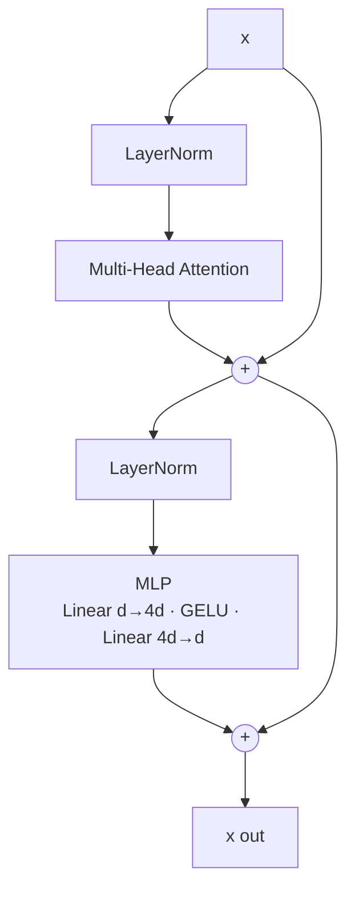

# L26 · Transformer Block

> [!success] 🟢 In one sentence
> **A transformer block is attention (tokens talk to each other) plus an MLP (each token thinks on its own), each wrapped in LayerNorm and a residual "skip" connection. GPT is this block stacked N times.**

> [!example] 🧠 Analogy: a meeting followed by desk work
> 1. **Attention = the meeting.** Everyone shares information with everyone else.
> 2. **MLP = desk work.** Each person goes back to their desk and processes what they heard, alone.
> 3. **Residual = the notebook.** You keep your original notes and only *add* what's new, so nothing is lost.
> Repeat the cycle 12 times (GPT-2 small) or 80 times (LLaMA-70B).

## 👀 Picture it (Pre-LN, as in GPT-2 and LLaMA)



```
           ┌─────────── residual highway (identity) ────────────┐
 x ───────►┼──► LN ─► Attention ──(+)──►┼──► LN ─► MLP ──(+)──► x'
           └────────────────────────────┘└─────────────────────┘
             "communicate"                 "compute"
```

## 🧮 Two lines of math
$$
x \leftarrow x + \text{MHA}(\text{LN}(x)) \qquad\qquad x \leftarrow x + \text{MLP}(\text{LN}(x))
$$

### Why each piece is there

| Piece | Job | Remove it and… |
|---|---|---|
| **Attention** | mixes information **across** tokens | each token stays isolated, so it's a bag of words |
| **MLP** (4× wide) | per-token compute, stores "facts" | very little capacity |
| **Residual `x +`** | a gradient highway through deep stacks | deep nets stop training (vanishing gradients) |
| **LayerNorm** | keeps activation scale stable | training blows up |

> [!tip] 🛣️ The residual stream mental model
> Picture `x` as a **shared highway** that runs through all the layers. Each block *reads* from it (via LN) and *writes* a small update back (via +). Gradients flow straight down the highway, which is why 100+ layer models can train.

## 📊 Where the parameters are

For d = 768 (GPT-2 small), per block:
```
 Attention: Wqkv 768×2304 + Wo 768×768   ≈ 2.4M  (≈ 1/3)
 MLP:       768×3072 + 3072×768          ≈ 4.7M  (≈ 2/3)  ← most params live here
 LayerNorms:                             ≈ 3k
 ───────────────────────────────────────────────
 ≈ 7.1M per block × 12 blocks ≈ 85M  (+ 39M token embeddings ≈ 124M total)
```

## 💻 Code: the full block

```python
import torch, torch.nn as nn, torch.nn.functional as F
torch.manual_seed(0)

class CausalSelfAttention(nn.Module):
    def __init__(self, d, n_heads):
        super().__init__()
        self.h = n_heads
        self.qkv = nn.Linear(d, 3 * d)
        self.proj = nn.Linear(d, d)
    def forward(self, x):
        B, T, d = x.shape
        q, k, v = self.qkv(x).split(d, dim=-1)
        q, k, v = (t.view(B, T, self.h, d // self.h).transpose(1, 2) for t in (q, k, v))
        y = F.scaled_dot_product_attention(q, k, v, is_causal=True)   # L24/L25, fused
        return self.proj(y.transpose(1, 2).contiguous().view(B, T, d))

class MLP(nn.Module):
    def __init__(self, d):
        super().__init__()
        self.net = nn.Sequential(nn.Linear(d, 4 * d), nn.GELU(), nn.Linear(4 * d, d))
    def forward(self, x): return self.net(x)

class Block(nn.Module):
    def __init__(self, d, n_heads):
        super().__init__()
        self.ln1, self.attn = nn.LayerNorm(d), CausalSelfAttention(d, n_heads)
        self.ln2, self.mlp = nn.LayerNorm(d), MLP(d)
    def forward(self, x):
        x = x + self.attn(self.ln1(x))     # communicate
        x = x + self.mlp(self.ln2(x))      # compute
        return x

block = Block(d=64, n_heads=4)
x = torch.randn(2, 10, 64)
print("in", x.shape, "→ out", block(x).shape)            # same shape: blocks stack!
print("params per block:", sum(p.numel() for p in block.parameters()))   # ≈ 12·d²

# stacking = a tiny GPT body
body = nn.Sequential(*[Block(64, 4) for _ in range(4)])
print("4 blocks out:", body(x).shape)

# GPT-2 small sanity check: params per block at d=768
print("GPT-2 block params:", sum(p.numel() for p in Block(768, 12).parameters()))  # ≈ 7.1M
```

## 🧬 Modern variants (LLaMA-style), same skeleton

| GPT-2 | LLaMA / Mistral |
|---|---|
| LayerNorm | **RMSNorm** ([[L15 RMS Normalization]]) |
| GELU MLP | **SwiGLU** MLP |
| learned positions | **RoPE** in attention |
| MHA | **GQA** ([[L36 Grouped Query Attention]]) |

## ⚠️ Common mistakes
- **Post-LN** (`LN(x + attn(x))`) in deep stacks makes training unstable without careful warmup. Pre-LN is the safe default.
- Forgetting the final LayerNorm before the output head (GPT adds `ln_f`).
- Changing the shape inside a block. In and out must both be (B, T, d) so blocks can stack.

## 🏋️ Try it
1. Remove the residuals, stack 12 blocks, and train on any toy task. Watch the loss stall.
2. Implement SwiGLU: `W2(silu(W1 x) * W3 x)`.
3. Derive the 12·d² parameter estimate per block.

---
**Prev ←** [[L25 Multi-Head Self-Attention]] · **Next →** [[L27 Tokenizer - Byte Pair Encoding]] (module ⑦) · Deeper: [[Transformer Architecture Deep Dive]]
