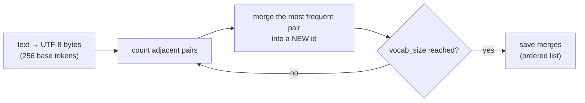

# L27 · Tokenizer: Byte Pair Encoding (BPE)

> [!success] 🟢 In one sentence
> **BPE starts with single bytes and repeatedly glues together the most frequent neighboring pair into a new token, until the vocabulary reaches the size you want.**

> [!example] 🧠 Analogy: inventing abbreviations
> Taking notes in class, you notice you write "t-h-e" constantly, so you invent the symbol **ŧ** for it. Then "ŧ space" keeps showing up, so that gets a symbol too.
> Common chunks get short codes and rare words stay spelled out. That's BPE.

## 👀 Picture it: merges on "low lower lowest"

```
 start (bytes):   l o w ␣ l o w e r ␣ l o w e s t
 count pairs:     (l,o)=3  (o,w)=3  (w,e)=2  …
 merge 1: l+o→lo  lo w ␣ lo w e r ␣ lo w e s t
 merge 2: lo+w→low  low ␣ low e r ␣ low e s t
 merge 3: low+e→lowe  low ␣ lowe r ␣ lowe s t
 …   vocab grows: 256 bytes + 1 token per merge
```



## 🧮 Why bytes and not characters?
- 256 bytes can represent **any** text: emoji, Chinese, code. You never need `<unk>`.
- GPT-2, GPT-4 and LLaMA-3 tokenizers are all byte-level BPE.

| | Train | Encode new text |
|---|---|---|
| Input | big corpus + target vocab size | a string |
| Output | **ordered merge list** | list of ids |
| Rule | merge the most frequent pair | apply merges in **learned order** (earliest first) |

## 💻 Code: train and use the tokenizer from `mini_gpt.py`

```python
from mini_gpt import BPETokenizer, CORPUS

tok = BPETokenizer().train(CORPUS, vocab_size=300, verbose=True)   # prints the first merges

text = "The robot read a book."
ids = tok.encode(text)
print("\nbytes :", len(text.encode()), "→ tokens:", len(ids))
print("ids   :", ids)
print("pieces:", [tok.vocab[i].decode(errors="replace") for i in ids])
print("roundtrip ok:", tok.decode(ids) == text)
```

### The core in 15 lines (what's inside the class)

```python
def pair_counts(ids):
    counts = {}
    for p in zip(ids, ids[1:]):
        counts[p] = counts.get(p, 0) + 1
    return counts

def merge(ids, pair, new_id):
    out, i = [], 0
    while i < len(ids):
        if i < len(ids) - 1 and (ids[i], ids[i + 1]) == pair:
            out.append(new_id); i += 2
        else:
            out.append(ids[i]); i += 1
    return out

ids = list("low lower lowest".encode())
for new_id in range(256, 259):
    best = max(pair_counts(ids), key=pair_counts(ids).get)
    ids = merge(ids, best, new_id)
    print(f"merged {bytes([best[0]]) if best[0] < 256 else best[0]}+{bytes([best[1]]) if best[1] < 256 else best[1]} → {new_id}: {ids}")
```

## 📏 Compression = why it matters
More merges mean fewer tokens per text, which means **cheaper and faster** LLM calls and more text fitting in the context window.

| Tokenizer | Vocab | English ≈ |
|---|---|---|
| bytes only | 256 | 1 token / char |
| GPT-2 | 50,257 | ~4 chars / token |
| GPT-4 (cl100k) | ~100k | ~4+ chars / token, better for code |
| LLaMA-3 | 128k | better multilingual |

## ⚠️ Common mistakes
- Encoding by applying merges in **frequency order on the new text** instead of the learned order. You then get different tokens than at training time.
- Training on one language and serving another. The tokens become fragmented and costs rise.

## 🏋️ Try it
1. Plot compression ratio (bytes / tokens) vs vocab_size from 256 to 600.
2. Encode "robot" and "robots". Do they share a prefix token?
3. Compare with `tiktoken.get_encoding("gpt2")` if you have it installed.

---
**Prev ←** [[L26 Transformer Block]] · **Next →** [[L28 Build Vocabulary]]
