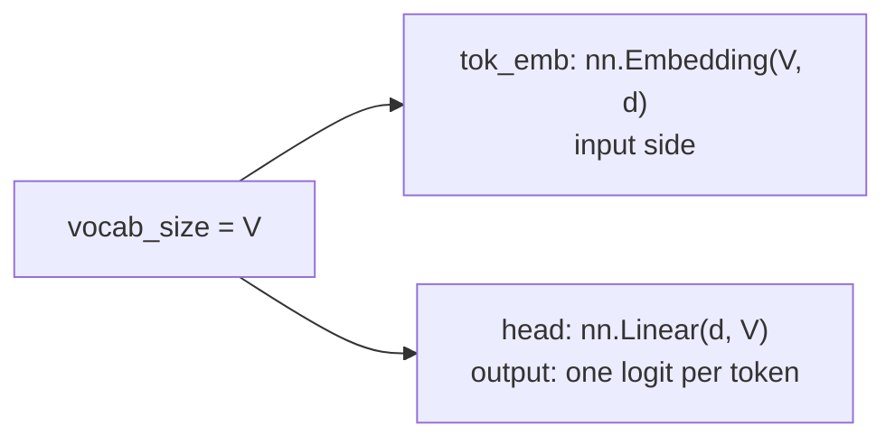

# L28 · Build the Vocabulary

> [!success] 🟢 In one sentence
> **The vocabulary is the two-way dictionary `id ↔ bytes`, plus special tokens like `<|endoftext|>`. Its size sets the shape of the model's first and last layers.**

> [!example] 🧠 Analogy: a phrasebook
> Each entry has a page number (id) and a phrase (bytes). The model only ever speaks in page numbers. The phrasebook translates back and forth.

## 👀 Picture it

```
  id   bytes          origin
 ────  ─────────────  ──────────────────
   0   b'\x00'        base byte
  …
  84   b'T'           base byte
 104   b'h'           base byte
 256   b'e '          merge (b'e' + b' ')
 257   b'th'          merge (b't' + b'h')
 258   b'the '        merge (257 + 256)
  …
 320   <|endoftext|>  special token (never produced by merges)
```



## 🧮 Vocab size is a trade-off

| Small V (e.g. 256) | Large V (e.g. 128k) |
|---|---|
| tiny embedding table | big table (V × d params) |
| long sequences (more compute) | short sequences |
| every word is split up | common words are one token |

GPT-2: V = 50,257, d = 768 → the embedding alone has **38.6M params**, about 31% of GPT-2 small. That's why GPT-2 **ties** the input embedding and output head weights (as `mini_gpt.py` does).

## 🏷️ Special tokens
| Token | Purpose |
|---|---|
| `<\|endoftext\|>` | separates documents: "a new story starts here" |
| `<pad>` | fills batches to the same length (masked out of the loss) |
| chat tokens like `<\|user\|>` | mark turns in chat models |

Special tokens get ids **after** all merges, and they must never be produced by encoding normal text, otherwise a user could type "<|endoftext|>" and inject it (see [[L29 Tokenization Edge Cases]]).

## 💻 Code: inspect the vocab

```python
from mini_gpt import BPETokenizer, CORPUS

tok = BPETokenizer().train(CORPUS, vocab_size=320)
print("vocab size (incl. special):", tok.vocab_size)
print("special:", tok.special)

# the longest learned tokens = the most "compressed" chunks
longest = sorted(tok.vocab.items(), key=lambda kv: -len(kv[1]))[:8]
for i, b in longest:
    print(f"{i:4d} → {b.decode(errors='replace')!r}")

# appending the end-of-text token by id when building training data
eot = tok.special[tok.EOT]
ids = tok.encode("The robot woke up.") + [eot]
print(ids[-3:], "→", repr(tok.decode(ids[-3:])))

# embedding params at GPT-2 scale
print("GPT-2 embedding params:", 50257 * 768)
```

## ⚠️ Common mistakes
- Mismatch between the tokenizer's vocab size and the model's `vocab_size`, which causes an index error in `nn.Embedding`.
- Rounding V up to a multiple of 64 is a common GPU speed trick (nanoGPT uses 50,304). The extra ids are simply never used.
- Saving the model but not the tokenizer. You need both to run inference.

## 🏋️ Try it
1. Save the merges to JSON and reload them into a fresh tokenizer.
2. Count how many vocab entries are whole words (end with a space).
3. Pad V up to the next multiple of 64.

---
**Prev ←** [[L27 Tokenizer - Byte Pair Encoding]] · **Next →** [[L29 Tokenization Edge Cases]]
