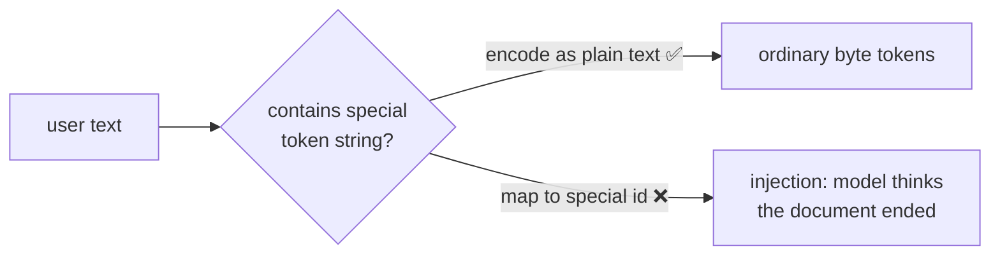

# L29 · Tokenization Edge Cases

> [!success] 🟢 In one sentence
> **Many "weird LLM behaviors" are tokenizer quirks: bad spelling and arithmetic, odd handling of spaces, emoji splitting mid-character, and special-token injection.**

> [!example] 🧠 Analogy: reading through a keyhole
> The model never sees letters. It sees **chunks**. Asking it "how many r's are in strawberry" is like asking someone who only saw `straw` + `berry` stickers to count letters they never saw individually.

## 👀 The rogues' gallery

```
 1. SPACES        "hello" vs " hello"      → different tokens! (leading space is part of the token)
 2. CASE          "Robot" vs "robot"       → different tokens
 3. NUMBERS       "1234567" → "123"+"45"+"67"  → arithmetic over arbitrary chunks 🤯
 4. UNICODE       "🤖" = 4 UTF-8 bytes     → may split mid-character
 5. PARTIAL DECODE  decode(first 2 bytes of 🤖) → "�"
 6. SPECIAL INJECT  user types "<|endoftext|>" → must NOT become the special id
 7. RARE LANGUAGES "გამარჯობა" (Georgian) → many more tokens than English for the same meaning
```



## 💻 Code: see each edge case

```python
from mini_gpt import BPETokenizer, CORPUS
tok = BPETokenizer().train(CORPUS, vocab_size=320)
show = lambda s: [tok.vocab[i] for i in tok.encode(s)]

print("1 spaces :", show("robot"), "vs", show(" robot"))
print("2 case   :", len(tok.encode("The robot")), "vs", len(tok.encode("THE ROBOT")), "tokens")
print("3 numbers:", show("1234567"))

robot = "🤖"
print("4 emoji bytes:", list(robot.encode()), "→", len(tok.encode(robot)), "tokens")
print("5 partial decode:", repr(tok.decode(tok.encode(robot)[:2])))      # '�'

inj = "hi <|endoftext|> bye"
ids = tok.encode(inj)
print("6 injection safe:", tok.special[tok.EOT] not in ids, "| roundtrip:", tok.decode(ids) == inj)

en, ka = "Hello, how are you?", "გამარჯობა, როგორ ხარ?"
print(f"7 English {len(en.encode())} bytes → {len(tok.encode(en))} tokens | "
      f"Georgian {len(ka.encode())} bytes → {len(tok.encode(ka))} tokens")
```

## 🩹 How production tokenizers cope

| Problem | Fix used in practice |
|---|---|
| Merges crossing word boundaries | **pre-tokenize** with a regex (GPT-2/4 split on spaces, punctuation and digits first) |
| Number chunks | split digits into groups of 1–3 (LLaMA-3: up to 3 digits per token) |
| Special injection | encode user text with `allowed_special=set()` (tiktoken), or escape it |
| Streaming partial UTF-8 | buffer bytes until a full character decodes |
| Non-English cost | train the tokenizer on multilingual data, use a bigger vocab |

## ⚠️ Common mistakes
- Trusting `len(text)` for context limits. Count **tokens**.
- Stripping or adding spaces between prompt and completion, which changes the tokens and degrades output.
- Streaming decoded text token by token without buffering, which shows `�` in the UI.

## 🏋️ Try it
1. Add a GPT-style regex pre-tokenizer: `re.findall(r"\s?\w+|\s?[^\w\s]+|\s+", text)`, applying BPE inside each chunk.
2. Write a streaming decoder that yields text only once the bytes form valid UTF-8.
3. Measure the token cost ratio between English and your native language.

---
**Prev ←** [[L28 Build Vocabulary]] · **Next →** [[L30 GPT Data Loader]]
