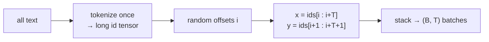

# L30 · GPT Data Loader

> [!success] 🟢 In one sentence
> **A GPT learns "predict the next token", so every training example is a window of tokens `x` paired with the same window shifted one step to the right, `y`.**

> [!example] 🧠 Analogy: a fill-in-the-next-word quiz
> Cover everything after the word you're on and guess the next one. Slide one word to the right and repeat.
> One window of 8 tokens is really **8 quiz questions at once**.

## 👀 Picture it

```
 token stream: [ The | robot | read | a | book | about | the | sea | . ]

 block_size = 4, window starting at i=1:
   x = [ robot  read   a      book  ]
   y = [ read   a      book   about ]      ← x shifted left by one

 the 4 questions hidden inside:
   robot              → read
   robot read         → a
   robot read a       → book
   robot read a book  → about
```



> [!info] Why the causal mask makes this work
> Thanks to the mask from [[L24 Self-Attention]], position *t* can only see tokens ≤ *t*. So the model makes T predictions in **one** forward pass, each without peeking at its own answer.

## 💻 Code: the simplest loader (random batches)

```python
import torch
torch.manual_seed(0)

ids = torch.arange(100)            # pretend tokens 0..99 for visibility
block_size, batch_size = 8, 4

def get_batch(ids, block_size, batch_size):
    ix = torch.randint(len(ids) - block_size, (batch_size,))   # random start offsets
    x = torch.stack([ids[i : i + block_size] for i in ix])
    y = torch.stack([ids[i + 1 : i + block_size + 1] for i in ix])
    return x, y

x, y = get_batch(ids, block_size, batch_size)
print("x:\n", x)
print("y:\n", y)                   # every y = x + 1 here → shift confirmed
assert torch.equal(y, x + 1)
```

## 🧮 Batch shapes to remember

| Tensor | Shape | Meaning |
|---|---|---|
| `x` | (B, T) | input token ids |
| `y` | (B, T) | target token ids |
| `logits` | (B, T, V) | a prediction at every position |
| loss | scalar | cross-entropy over all B·T positions |

## ⚠️ Common mistakes
- **Off-by-one.** Forgetting `+1` in y gives the model the answer: it learns to copy, the loss goes to 0, and it generates garbage.
- **Train/val overlap.** Split the token stream into two contiguous parts *before* sampling windows.
- Tokenizing on the fly every step (slow). Tokenize once and cache the ids.

## 🏋️ Try it
1. Use real text: tokenize `CORPUS` from `mini_gpt.py` and decode one `x`/`y` pair to see the shift.
2. Make a deterministic val loader that walks windows in order without overlap.
3. Store the ids as `np.uint16` in a memory-mapped file (how nanoGPT handles gigabytes).

---
**Prev ←** [[L29 Tokenization Edge Cases]] · **Next →** [[L31 GPT Dataset]]
