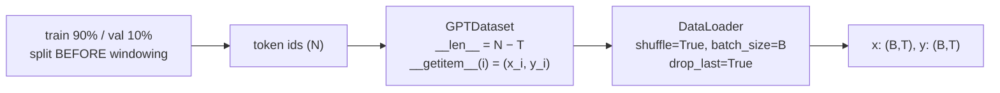

# L31 · GPT Dataset (PyTorch `Dataset` + `DataLoader`)

> [!success] 🟢 In one sentence
> **Wrap the token stream in a PyTorch `Dataset` whose item *i* is the window starting at *i*. A `DataLoader` then handles shuffling, batching and parallel loading for you.**

> [!example] 🧠 Analogy
> The `Dataset` is the **library shelf**: "give me book #i". The `DataLoader` is the **librarian**, who grabs 32 random books, stacks them and hands you the pile.

## 👀 Picture it



```
 N = 12 tokens, T = 4  →  8 possible windows (i = 0..7)
 i=0  [0 1 2 3]→[1 2 3 4]
 i=1    [1 2 3 4]→[2 3 4 5]      windows overlap by T−1 tokens:
 i=2      [2 3 4 5]→[3 4 5 6]    one epoch ≈ every token seen ~T times
 …
```

## 💻 Code: the `GPTDataset` from `mini_gpt.py`

```python
import torch
from mini_gpt import GPTDataset, BPETokenizer, CORPUS

tok = BPETokenizer().train(CORPUS, vocab_size=320)
ids = tok.encode(CORPUS)
split = int(0.9 * len(ids))
T = 16
train_ds = GPTDataset(ids[:split], block_size=T)
val_ds = GPTDataset(ids[split - T:], block_size=T)   # small overlap so val has ≥ 1 window
print("tokens:", len(ids), "| train windows:", len(train_ds), "| val windows:", len(val_ds))

x, y = train_ds[0]
print("x:", repr(tok.decode(x.tolist())))
print("y:", repr(tok.decode(y.tolist())))

dl = torch.utils.data.DataLoader(train_ds, batch_size=8, shuffle=True, drop_last=True)
xb, yb = next(iter(dl))
print("batch shapes:", xb.shape, yb.shape)
assert torch.equal(xb[:, 1:], yb[:, :-1])          # shift invariant holds ✅
```

### Its source (about 15 lines)
```python
import torch

class GPTDataset(torch.utils.data.Dataset):
    def __init__(self, ids, block_size):
        self.ids = torch.as_tensor(ids, dtype=torch.long)
        self.block_size = block_size
        if len(self.ids) <= block_size:
            raise ValueError("text is shorter than block_size")
    def __len__(self):
        return len(self.ids) - self.block_size
    def __getitem__(self, i):
        chunk = self.ids[i : i + self.block_size + 1]
        return chunk[:-1], chunk[1:]

ds = GPTDataset(list(range(12)), 4)
print(len(ds), ds[0])
```

## 📚 Many documents? Join them with `<|endoftext|>`

```
 doc A tokens ⟨EOT⟩ doc B tokens ⟨EOT⟩ doc C tokens …
```
Windows may span a boundary. That's fine: the EOT token teaches the model "a new, unrelated text starts here".

## ⚠️ Common mistakes
- Random-splitting **windows** into train and val. They overlap, so validation is leaked. Split the token stream first.
- `num_workers > 0` on macOS/Windows without an `if __name__ == "__main__":` guard, which crashes.
- A dataset shorter than `block_size` gives `len < 0`. The guard in `__init__` catches it.

## 🏋️ Try it
1. Add a `stride` argument so windows don't overlap (`i * stride`).
2. Concatenate 3 documents with EOT and confirm EOT appears in some windows.
3. Benchmark `DataLoader(num_workers=0)` vs `get_batch` from L30.

---
**Prev ←** [[L30 GPT Data Loader]] · **Next →** [[L32 Code GPT]]
