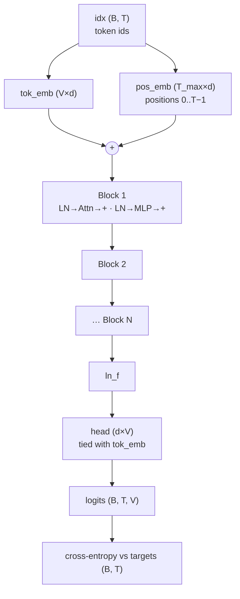

# L32 · Code GPT

> [!success] 🟢 In one sentence
> **GPT = token embedding + position embedding → N transformer blocks → final LayerNorm → a linear "head" that outputs a score for every word in the vocabulary, at every position.**

> [!example] 🧠 Analogy: an assembly line
> Raw ids come in, get dressed up as vectors (embeddings), pass through N identical workstations (blocks), and come out the other end as a **ranked list of next-word guesses**.

## 👀 Picture it: the whole model



```
 shapes through the model (B=2, T=8, d=128, V=321):
 idx      (2, 8)           ints
 tok+pos  (2, 8, 128)      vectors
 blocks   (2, 8, 128)      same shape in → out (blocks stack)
 logits   (2, 8, 321)      a score for every vocab entry at every position
 loss     ()               mean CE over 2·8 = 16 predictions
```

## 🧩 Every part, and the lesson it came from

| Part | Code in `mini_gpt.py` | Lesson |
|---|---|---|
| token embedding | `nn.Embedding(V, d)` | [[L21 Word Embeddings]] |
| position embedding | `nn.Embedding(block_size, d)` | [[L23 Positional Encoding]] |
| causal multi-head attention | `CausalSelfAttention` | [[L24 Self-Attention]], [[L25 Multi-Head Self-Attention]] |
| block (Pre-LN + residual) | `Block` | [[L26 Transformer Block]] |
| final norm | `ln_f` | [[L13 Layer Normalization]] |
| LM head + **weight tying** | `head.weight = tok_emb.weight` | [[L28 Build Vocabulary]] |
| init std 0.02 | `_init` | [[L11 Weight Initialization]] |
| loss | `F.cross_entropy` on (B·T, V) | [[L04 Cross-Entropy Loss]] |

## 💻 Code: build it and check its shapes and starting loss

```python
import math, torch
from mini_gpt import GPT, GPTConfig
torch.manual_seed(0)

cfg = GPTConfig(vocab_size=321, block_size=64, n_layer=4, n_head=4, d_model=128)
model = GPT(cfg)
print(f"params: {sum(p.numel() for p in model.parameters()):,}")

idx = torch.randint(0, cfg.vocab_size, (2, 8))
targets = torch.randint(0, cfg.vocab_size, (2, 8))
logits, loss = model(idx, targets)
print("logits:", tuple(logits.shape))                          # (2, 8, 321)
print(f"initial loss {loss.item():.2f} ≈ ln(V) = {math.log(cfg.vocab_size):.2f}")   # L17 sanity check ✅

# causality check: changing a FUTURE token must not change earlier logits
idx2 = idx.clone(); idx2[0, -1] = (idx2[0, -1] + 1) % cfg.vocab_size
model.eval()
with torch.no_grad():
    same = torch.allclose(model(idx)[0][0, :-1], model(idx2)[0][0, :-1], atol=1e-6)
print("no peeking at the future:", same)
```

### The forward pass, the heart of `GPT`
```text
def forward(self, idx, targets=None):
    B, T = idx.shape
    pos = torch.arange(T)
    x = self.drop(self.tok_emb(idx) + self.pos_emb(pos))   # (B, T, d)
    for block in self.blocks:
        x = block(x)                                       # (B, T, d)
    logits = self.head(self.ln_f(x))                       # (B, T, V)
    loss = F.cross_entropy(logits.view(-1, V), targets.view(-1)) if targets is not None else None
    return logits, loss
```

## 📏 Scale it up: same code, bigger numbers

| Config | n_layer | n_head | d_model | Params |
|---|---|---|---|---|
| ours | 4 | 4 | 128 | ~0.8M |
| GPT-2 small | 12 | 12 | 768 | 124M |
| GPT-2 XL | 48 | 25 | 1600 | 1.5B |
| GPT-3 | 96 | 96 | 12288 | 175B |

## ⚠️ Common mistakes
- Forgetting `ln_f`. Training is still possible but noticeably worse.
- `view` on (B, T, V) without reshaping targets to (B·T,) too.
- Learned position embeddings mean a **hard max length**. Feeding more than `block_size` tokens is an error, so generation must crop the context (L34).

## 🏋️ Try it
1. Count parameters by hand for our config. Check: 12·n_layer·d² + V·d + T·d (roughly).
2. Swap `nn.LayerNorm` for the `RMSNorm` from [[L15 RMS Normalization]].
3. Remove weight tying. How many params does that add?

---
**Prev ←** [[L31 GPT Dataset]] · **Next →** [[L33 Train Your GPT]]
