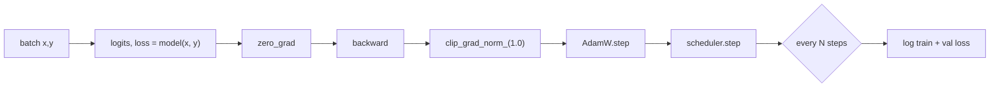

# L33 · Train Your GPT

> [!success] 🟢 In one sentence
> **Training GPT is the same loop as [[L16 Training Loop]], plus three LLM habits: AdamW with weight decay, a warmup-then-decay learning rate, and gradient clipping.**

> [!example] 🧠 Analogy: learning to drive
> - **Warmup:** drive slowly in an empty parking lot first, so you don't jerk the wheel.
> - **Decay:** slow down as you approach the parking spot (fine adjustments).
> - **Clipping:** a speed governor, so one panicked stomp can't wreck the car.

## 👀 Picture it

```
 learning rate (OneCycle schedule)
 max ┤      ╱‾‾‾‾╲
     │    ╱        ╲___
     │  ╱               ‾‾‾╲____
   0 ┤╱                         ‾‾‾──
     └──────────────────────────────── step
      warmup 10%      cosine decay

 loss
 5.8 ┤●  ← starts at ln(V) (L17 check ✅)
     │ ●
     │  ●●
     │    ●●●●●●●●●● train
     │   ○○○○○○○○○○○ val
     └──────────────── step
```



## 🧮 The LLM training recipe

| Knob | Our value | Why |
|---|---|---|
| Optimizer | AdamW, weight_decay 0.1 | a stable per-parameter step size |
| Peak LR | 3e-3 (tiny model) | big models use ~3e-4 to 6e-4 |
| Schedule | 10% warmup → cosine decay | avoids early blow-ups, lets the model settle at the end |
| Grad clip | 1.0 | stops a rare huge gradient |
| Dropout | 0.1 | regularization, since our data is tiny |

## 💻 Code: train (short run, so it fits in this note)

```python
import torch
from mini_gpt import train

model, tok = train(steps=200, log_every=50)       # full default: `python mini_gpt.py`

# what did it learn? sample a few tokens
prompt = torch.tensor([tok.encode("The engineer")])
print(tok.decode(model.generate(prompt, max_new_tokens=30, temperature=0.7, top_k=20)[0].tolist()))
```

> [!warning] 📚 Our run is a memorization run
> The built-in corpus is only ~480 tokens. Train loss heads to ~0 while val loss stays high: textbook overfitting from [[L17 Training Diagnostics]].
> To get a model that **generalizes**, give it more text:
> ```bash
> curl -o input.txt https://raw.githubusercontent.com/karpathy/char-rnn/master/data/tinyshakespeare/input.txt
> python mini_gpt.py --text input.txt --steps 3000 --vocab 512
> ```

## 📏 How long would a real model take? (rule of thumb)
Training compute ≈ **6 × params × tokens** FLOPs.
- Ours: 6 × 0.85M × (600 steps × 32 × 64 tokens) ≈ 6.3e12 FLOPs. Easy on a laptop.
- GPT-2 124M on 10B tokens: 6 × 1.24e8 × 1e10 ≈ 7.4e18 FLOPs, a few hours on 8 GPUs.
- More in [[Pretraining - Scaling Laws and Compute Math]].

## ⚠️ Common mistakes
- No warmup with a high LR, which gives NaN within the first ~50 steps.
- Evaluating val loss in train mode (with dropout on), which makes it look worse than it is.
- Not saving the **tokenizer** with the checkpoint.

## 🏋️ Try it
1. Train on Tiny Shakespeare. Can you get val loss < 1.8 with vocab 512?
2. Turn off clipping and set lr=1e-2. Watch for spikes.
3. Save and load: `torch.save({"model": model.state_dict(), "merges": tok.merges}, "ckpt.pt")`.

---
**Prev ←** [[L32 Code GPT]] · **Next →** [[L34 Make GPT Talk Back]]
