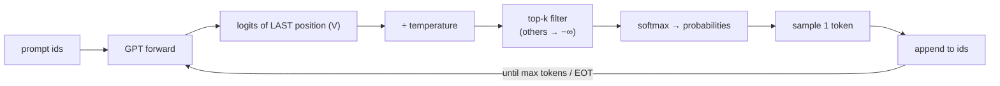

# L34 · Make GPT Talk Back (Generation & Sampling)

> [!success] 🟢 In one sentence
> **Generation is a loop: feed the text, take the scores for the *last* position, pick one token (greedy or sampled), append it, and repeat.**

> [!example] 🧠 Analogy: a game of improv
> An actor hears the story so far and adds one word. **Temperature** is how bold they are: low means safe and predictable, high means wild and creative. **Top-k** means "only consider your k best ideas".

## 👀 Picture it



```
 next-token probabilities after "The robot read a"

                T = 0.3 (sharp)        T = 1.0           T = 2.0 (flat)
 " book"        ███████████ 0.92       ██████ 0.55       ███ 0.27
 " small"       ▌ 0.04                 ██ 0.18           ██ 0.20
 " gift"        ▏ 0.02                 █ 0.12            ██ 0.19
 " star"        ▏ 0.02                 █ 0.10            ██ 0.18
 (rest)         ▏                      ▌ 0.05            ██ 0.16  ← nonsense creeps in
```

## 🎛️ Decoding strategies

| Strategy | Rule | Feel |
|---|---|---|
| **Greedy** | always the argmax | deterministic, loops ("the the the") |
| **Temperature** | softmax(logits / T) | T<1 focused, T>1 creative |
| **Top-k** | keep the k best, renormalize | cuts off the nonsense tail |
| **Top-p (nucleus)** | keep the smallest set with total prob ≥ p | adapts k to how confident the model is |
| Stop condition | EOT token or max_new_tokens | |

More detail: [[Decoding and Sampling]].

## 💻 Code: sample with different settings

```python
import torch
from mini_gpt import train
torch.manual_seed(0)

model, tok = train(steps=300, log_every=1000)
prompt = torch.tensor([tok.encode("The robot")])

for temp, k in [(0.01, None), (0.8, 20), (1.5, None)]:
    torch.manual_seed(1)
    out = model.generate(prompt, max_new_tokens=40, temperature=temp, top_k=k)
    print(f"\n--- T={temp}, top_k={k} ---\n{tok.decode(out[0].tolist())}")
```

### The sampling step, isolated

```python
import torch
torch.manual_seed(0)
logits = torch.tensor([3.0, 1.5, 1.0, 0.5, -1.0])      # pretend vocab of 5

def sample(logits, temperature=1.0, top_k=None, top_p=None):
    logits = logits / temperature
    if top_k is not None:
        kth = torch.topk(logits, top_k).values[-1]
        logits = logits.masked_fill(logits < kth, float("-inf"))
    probs = logits.softmax(-1)
    if top_p is not None:                                 # nucleus
        sp, si = probs.sort(descending=True)
        keep = sp.cumsum(0) - sp < top_p                   # keep until mass ≥ p
        probs = torch.zeros_like(probs).scatter(0, si[keep], sp[keep])
        probs /= probs.sum()
    return torch.multinomial(probs, 1).item(), probs

for args in [dict(), dict(temperature=0.5), dict(top_k=2), dict(top_p=0.8)]:
    _, p = sample(logits, **args)
    print(f"{str(args):22s} probs={p.numpy().round(2)}")
```

## ⚠️ Common mistakes
- Using logits from **all** positions instead of only the last, `[:, -1, :]`.
- Not cropping the context to `block_size`, which crashes with learned positions.
- Temperature = 0 means dividing by zero. Treat it as greedy (or clamp it, as `mini_gpt` does).
- Forgetting `model.eval()` and `torch.no_grad()`. Dropout makes the output noisy and memory is wasted.

## 🏋️ Try it
1. Add top-p to `GPT.generate`.
2. Stop generation when the model emits `<|endoftext|>`.
3. Add a **repetition penalty**: lower the logits of tokens already generated.

---
**Prev ←** [[L33 Train Your GPT]] · **Next →** [[L35 KV-Cache]]
