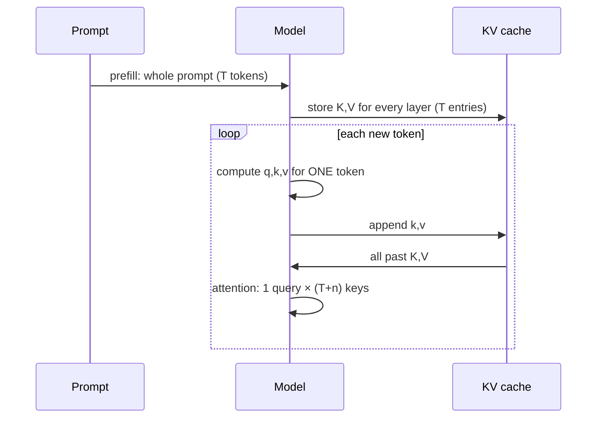

# L35 · KV-Cache

> [!success] 🟢 In one sentence
> **When generating, the keys and values of past tokens never change, so we store them (the cache) and only compute Q, K and V for the one new token each step. That turns repeated O(T²) work into O(T) per token.**

> [!example] 🧠 Analogy: taking minutes in a meeting
> Without a cache, every time someone speaks you **re-read the entire transcript from the beginning**.
> With a cache, you keep the notes and just **add one line**. Same information, far less work.

## 👀 Picture it

```
 WITHOUT cache: each step recomputes everything
 step 1:  [The robot read]            → K,V for 3 tokens
 step 2:  [The robot read a]          → K,V for 4 tokens  (3 recomputed!)
 step 3:  [The robot read a book]     → K,V for 5 tokens  (4 recomputed!)

 WITH cache:
 prefill: [The robot read]  → K,V for 3 → 💾 cache
 step 2:  [a]               → K,V for 1 → cache += 1 → attend to 4
 step 3:  [book]            → K,V for 1 → cache += 1 → attend to 5
```



## 🧮 Why it's safe (and why it costs memory)
- With a **causal** mask, token *t*'s K and V depend only on tokens ≤ *t*, so they're fixed once computed ✅.
- The new token's query attends to all cached keys. No mask is needed, because there's no future in the cache.

**Memory per token** = 2 (K and V) × n_layers × n_kv_heads × d_head × bytes:
| Model | KV per token (fp16) | 8k-token context |
|---|---|---|
| LLaMA-2 7B (32 layers, 32 heads × 128) | 2·32·32·128·2 B = **512 KB** | **4 GB** |
| same with GQA, 8 KV heads ([[L36 Grouped Query Attention]]) | 128 KB | 1 GB |

That's why the KV-cache is the #1 memory problem in LLM serving → [[KV Cache]], [[Long Context and KV Cache Engineering]].

## 💻 Code: prove cache = no-cache, then time both

```python
import time, torch
from mini_gpt import GPT, GPTConfig
torch.manual_seed(0)

cfg = GPTConfig(vocab_size=321, block_size=256, n_layer=4, n_head=4, d_model=128, dropout=0.0)
model = GPT(cfg).eval()
prompt = torch.randint(0, 321, (1, 8))

# 1) identical output? (greedy, so it's deterministic)
a = model.generate(prompt, 40, temperature=1e-6, use_cache=False)
b = model.generate(prompt, 40, temperature=1e-6, use_cache=True)
print("same tokens with and without cache:", torch.equal(a, b))

# 2) identical logits at each step?
with torch.no_grad():
    full, _ = model(a[:, :20])                          # no cache: all 20 at once
    caches = [{} for _ in model.blocks]
    model(a[:, :19], caches=caches)                     # prefill 19
    step, _ = model(a[:, 19:20], caches=caches, pos_offset=19)   # decode token #20
print("last-position logits match:", torch.allclose(full[:, -1], step[:, -1], atol=1e-4))
print("cache shape (B, kv_heads, T, d_head):", tuple(caches[0]["k"].shape))

# 3) speed
for use_cache in (False, True):
    t0 = time.time()
    model.generate(prompt, 240, temperature=1.0, use_cache=use_cache)
    print(f"use_cache={use_cache!s:5}  {time.time() - t0:.2f}s for 240 tokens")
```

### The 4 lines that implement it (inside `CausalSelfAttention.forward`)
```text
if cache is not None:
    if "k" in cache:                                  # decode step: append
        k = torch.cat([cache["k"], k], dim=2)
        v = torch.cat([cache["v"], v], dim=2)
    cache["k"], cache["v"] = k, v                     # store for the next step
```
Plus: feed only the **last** token with the right `pos_offset`, so position embeddings stay correct.

## ⚖️ Prefill vs decode (an interview favorite)
| Phase | Work | Bottleneck |
|---|---|---|
| **Prefill** | all prompt tokens in parallel | compute-bound |
| **Decode** | 1 token per step, reads the whole cache | **memory-bandwidth bound** |
→ [[Prefill vs Decode]]

## ⚠️ Common mistakes
- Wrong `pos_offset`. Every new token gets position 0 and the output turns to garbage.
- Keeping the causal mask on single-token decode steps. With T=1 the default `is_causal` would wrongly block all past keys.
- Exceeding `block_size` with learned positions. You must crop and **rebuild** the cache (`mini_gpt` does this).

## 🏋️ Try it
1. Plot generation time vs number of tokens with and without the cache. Which grows quadratically?
2. Compute the KV memory of our model for a 256-token context.
3. Pre-allocate the cache tensors instead of `torch.cat` (what real engines do).

---
**Prev ←** [[L34 Make GPT Talk Back]] · **Next →** [[L36 Grouped Query Attention]]
