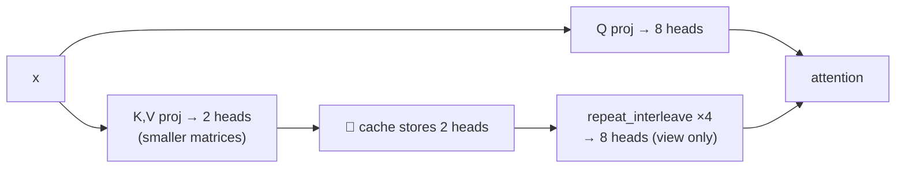

# L36 · Grouped Query Attention (GQA)

> [!success] 🟢 In one sentence
> **GQA keeps many query heads but lets groups of them share one key/value head. That shrinks the KV-cache (often 4–8×) with almost no quality loss. LLaMA-2 70B, LLaMA-3 and Mistral all use it.**

> [!example] 🧠 Analogy: students sharing textbooks
> - **MHA:** 8 students, 8 textbooks. Great, but heavy to carry.
> - **MQA:** 8 students, 1 textbook. Light, but everyone fights over it (quality drops).
> - **GQA:** 8 students, 2 textbooks, one per table of 4. Nearly as good as MHA and 4× lighter. 🎯

## 👀 Picture it

```
            Query heads:  Q1 Q2 Q3 Q4 Q5 Q6 Q7 Q8
 MHA (8 KV)               │  │  │  │  │  │  │  │
                          K1 K2 K3 K4 K5 K6 K7 K8     cache: 8 units

 GQA (2 KV)               └──┴──┴──┘  └──┴──┴──┘
                              K1           K2         cache: 2 units  (4× smaller)

 MQA (1 KV)               └──┴──┴──┴──┴──┴──┴──┘
                                    K1                cache: 1 unit   (8× smaller)
```



## 🧮 The trade-off

| | MHA | **GQA** | MQA |
|---|---|---|---|
| KV heads | h | h / g | 1 |
| KV-cache size | 1× | **1/g** | 1/h |
| Quality | best | ≈ MHA | noticeably lower |
| Used by | GPT-2/3 | **LLaMA-2 70B, LLaMA-3, Mistral** | PaLM, Falcon |

> [!info] Why it speeds up decoding
> Decoding is **memory-bandwidth bound**: each step reads the whole KV-cache ([[L35 KV-Cache]]). A 4× smaller cache means about 4× less to read per token, so more users per GPU and longer contexts. See [[Grouped Query Attention]] for the deeper dive.

## 💻 Code: flip one config knob in `mini_gpt.py`

```python
import torch
from mini_gpt import GPT, GPTConfig
torch.manual_seed(0)

def kv_cache_bytes(model, T):
    caches = [{} for _ in model.blocks]
    with torch.no_grad():
        model(torch.randint(0, 321, (1, T)), caches=caches)
    return sum(c["k"].numel() + c["v"].numel() for c in caches) * 4   # fp32 bytes

for name, kvh in [("MHA", 8), ("GQA", 2), ("MQA", 1)]:
    cfg = GPTConfig(vocab_size=321, block_size=128, n_layer=4, n_head=8, n_kv_head=kvh, d_model=128)
    m = GPT(cfg).eval()
    params = sum(p.numel() for p in m.parameters())
    print(f"{name}: kv_heads={kvh}  params={params:,}  KV-cache@128 tokens={kv_cache_bytes(m, 128)/1024:.0f} KB")
```

### The core trick (inside `CausalSelfAttention`)
```text
self.kv = nn.Linear(d, 2 * n_kv_head * d_head)          # smaller K/V projection
...
cache["k"], cache["v"] = k, v                             # cache the SMALL tensors
if n_kv_head != n_head:
    rep = n_head // n_kv_head
    k = k.repeat_interleave(rep, dim=1)                   # (B, kvh, T, dh) → (B, h, T, dh)
    v = v.repeat_interleave(rep, dim=1)
```
Query heads 0–3 read KV head 0, and query heads 4–7 read KV head 1.

## 🧪 Real numbers (LLaMA-2 70B: 80 layers, 64 Q heads, d_head 128, fp16)

| | KV heads | KV per token | 4k context × 1 user |
|---|---|---|---|
| if MHA | 64 | 2·80·64·128·2 B = 2.6 MB | 10.7 GB |
| **actual GQA** | **8** | 0.33 MB | **1.3 GB** |

## ⚠️ Common mistakes
- `n_head % n_kv_head != 0`. Groups must divide evenly (the assert in `mini_gpt` catches it).
- `repeat` instead of `repeat_interleave`. That gives the wrong grouping: head order becomes 0,1,0,1 instead of 0,0,1,1.
- Caching **after** the repeat, which throws the memory win away.

## 🏋️ Try it
1. Train `mini_gpt` with `cfg_overrides={"n_head": 8, "n_kv_head": 2}`. Compare val loss with MHA.
2. "Uptrain" an MHA model into GQA by mean-pooling its K/V heads within each group (the trick from the GQA paper).
3. Compute the KV-cache for your favorite open model from its `config.json`.

---
**Prev ←** [[L35 KV-Cache]] · 🎉 **You built GPT from scratch!** Back to [[00 ML From Scratch - Roadmap]] · Go deeper: [[ML Foundations Roadmap]] · [[Transformer Architecture Deep Dive]]
