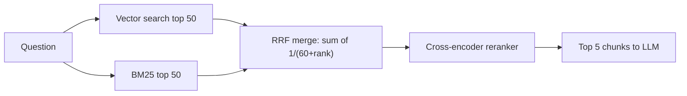

# Hybrid Search, HyDE, Reranking, ColBERT

> [!success] 🟢 Junior Explanation
> **In plain words:** Tricks to find better chunks: combine meaning search with keyword search, rewrite the question, and rescore results with a more careful model.
>
> **Analogy:** Two detectives — one understands meaning, one matches exact words — then a judge (the reranker) picks the best evidence.
>
> **Why interviewers ask:** These are the cheapest big quality wins in RAG.
>
> **Say it in one sentence:** "I use hybrid search (vector + BM25 merged with RRF), then a cross-encoder reranker to keep the top 5 of 50."
>
> 🎯 **Junior must know:** hybrid search and reranking. · **Middle adds:** RRF, HyDE, query rewriting, multi-query, bi- vs cross-encoder, ColBERT trade-offs.

## Hybrid search `[OS]`
- Vector search: great at **meaning**, bad at exact match ("Order ID 12345", "Section 4.2.1").
- **BM25** (Best Matching 25) keyword search: great at exact match.
→ Run both, merge.
**Reciprocal Rank Fusion (RRF)** merges lists on different score scales by ignoring raw scores and using **rank position**; a chunk high in both lists rises to top.
Native support: Elasticsearch, OpenSearch, Weaviate, Qdrant.

## Query transformation `[OS]`
### HyDE (Hypothetical Document Embeddings)
Questions are short & question-like; answers in docs are long & answer-like → embeddings don't align. HyDE: ask LLM to write a **fake answer**, search using **its** embedding. Fake answer never shown nor trusted; final answer still from real docs.
Illustration: question↔real chunk closeness 0.55; fake answer↔real chunk 0.88.
- ✅ Better chunks for short/vague/technical questions, no training.
- ❌ Extra LLM call (latency, cost); fake answer can drift off-topic.
- Practice: A/B plain vs HyDE on same question set; keep the winner.

### Query Rewriting
LLM rewrites question into a clear **standalone** search query (great for follow-ups / vague).
### Multi-Query Retrieval
LLM generates several versions from different angles → search each → merge with **RRF**.

## Reranking `[OS]`
Two-stage funnel:
```
Question -> Stage 1 Retrieval (vector + BM25): fast, cheap, ~ok recall -> top 50
         -> Stage 2 Reranker (cross-encoder): slower, very accurate   -> top 5 -> LLM
```
- **Bi-encoder (vector search)**: question and chunk encoded **separately**, compare vectors → fast, shallow.
- **Cross-encoder**: question + chunk fed **together** → one relevance score → slower, much more accurate.
Rerankers: Cohere Rerank, BGE Reranker, Jina Reranker.
One of the **simplest, biggest** quality jumps; also mitigates [[Context Window Limits - Context Rot, Lost in the Middle, RoPE|Lost in the Middle]] (5 good chunks > 50 average).

## ColBERT & late interaction `[OS]`
| Approach | Accuracy | Speed | Precompute docs? |
|---|---|---|---|
| Cross-encoder | High | Slow (BERT per pair) | No |
| Single-vector dual encoder | Blunt | Fast (one dot product) | Yes |
| **ColBERT (late interaction)** | High | Fast | Yes |

ColBERT keeps **one vector per token**. Docs encoded offline. At query time each query token finds its best-matching doc token (**MaxSim**), scores summed.
Price = **storage**: 100-token passage → 100 vectors (100× storage). Use as strong reranker or end-to-end retrieval when quality > storage cost.

## 🌐 Deeper Context `[WEB]`

**Reciprocal Rank Fusion (RRF) — the formula** (Cormack, Clarke & Büttcher, SIGIR 2009):

$$\text{RRF}(d) = \sum_{\text{each result list } i} \frac{1}{k + \text{rank}_i(d)}, \qquad k = 60 \text{ (common default)}$$

A document missing from a list adds 0 for that list.

> [!example] Worked example (k = 60)
> - Doc A: rank 1 in vector search, rank 3 in BM25 → 1/61 + 1/63 = 0.0164 + 0.0159 = **0.0323**
> - Doc B: rank 1 in BM25 only → 1/61 = **0.0164**
> → Doc A wins: **agreement between retrievers beats one strong vote.**

| Finding | Why it matters |
|---|---|
| RRF uses **ranks, not raw scores**, so you never normalize BM25 scores against cosine similarities | Why it's the easy default |
| RRF is the default hybrid ranking in **OpenSearch, Elasticsearch, Azure AI Search, MongoDB Atlas, Weaviate** | You rarely implement it yourself |
| Critique: with k = 60 the #1 position gets little extra weight, so a doc ranked top by only one retriever can lose to "moderately good in both" docs | Tune k or use weighted fusion if exact-match hits matter |
| Contextual BM25 + contextual embeddings + reranking: retrieval failures **5.7% → 1.9%** | Hybrid + rerank is measurable, not just theory |



**Sources:** [RRF explained (BigData Boutique)](https://bigdataboutique.com/blog/reciprocal-rank-fusion-how-it-works-and-when-to-use-it) · [Chroma hybrid search docs](https://docs.trychroma.com/cloud/search-api/hybrid-search) · [Why k=60 can bury your best hit](https://dev.to/ji_ai/reciprocal-rank-fusion-why-k60-buries-your-best-hit-525c) · [Contextual Retrieval coverage](https://getcoai.com/news/anthropic-introduces-contextual-retrieval-to-boost-accuracy-of-rag-systems)


> [!question] Recall
> 1. Why hybrid? How does RRF merge?
> 2. Explain HyDE and its trade-off.
> 3. Bi-encoder vs cross-encoder vs ColBERT — accuracy/speed/storage.

Related: [[RAG Fundamentals]] · [[Agentic RAG, GraphRAG, Vectorless RAG]]
