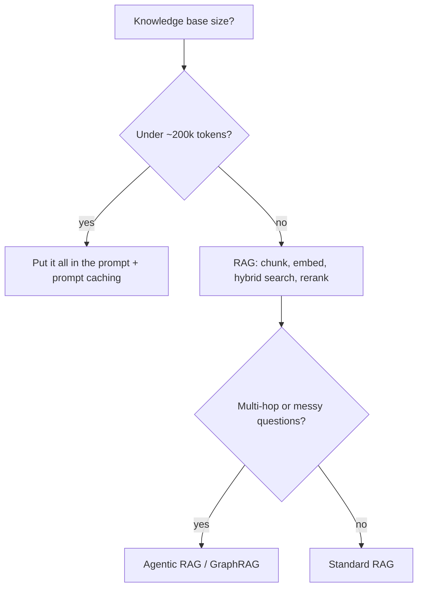

# RAG Fundamentals

> [!success] 🟢 Junior Explanation
> **In plain words:** Before answering, search your own documents, paste the best pieces into the prompt, and let the model answer from them.
>
> **Analogy:** An open-book exam: the student looks up the right pages before answering.
>
> **Why interviewers ask:** RAG is the #1 architecture for AI products — expect it in almost every interview.
>
> **Say it in one sentence:** "RAG = retrieve relevant chunks, augment the prompt with them, and generate a grounded answer."
>
> 🎯 **Junior must know:** the offline indexing and online query flows; RAG vs fine-tuning. · **Middle adds:** the quality ladder: parsing, contextual retrieval, hybrid search, query rewriting, reranking.

## Why `[OS]`
LLMs don't know your company data (trained on public data with a cutoff). "What is our refund policy?" → unknown.

**RAG = Retrieval + Augmented + Generation** `[OS]`
1. **Retrieval** — find relevant pieces of private data via vector search.
2. **Augmented** — add them to the prompt as context.
3. **Generation** — LLM answers using that context.

## Flow `[OS]`
**Indexing (offline, once):** documents → chunk (~500 tokens) → embed each chunk → store embedding + original text in vector DB.
**Query (online, every request):** question → embed → top-k (e.g. 5) similar chunks → prompt = instructions + chunks + question → LLM → answer.
```
Indexing: Documents -> Chunker -> Embedding Model -> Vector DB
Query:    User -> Backend -> Embedding Model -> Vector DB (top-k)
                                         -> LLM (prompt + chunks) -> Response
```

## Librarian vs Researcher `[OS]`
- **Standard RAG** = librarian fetches one best-matching book. One shot. Fast, but can't adapt.
- **Agentic RAG** = researcher that decides every step → [[Agentic RAG, GraphRAG, Vectorless RAG]].

RAG is the **most popular architecture** for AI products: ChatGPT search, Perplexity, support bots, code assistants `[OS]`. RAG is the standard for search-driven designs `[SDH]`.

## Production RAG upgrades (quality ladder) `[OS]`
1. Clean [[Document Parsing and Chunking|parsing + chunking]] (60–80% of effort!)
2. **Contextual retrieval** (LLM-written context note per chunk)
3. **Hybrid search** (vector + BM25, RRF merge)
4. **Query transformation** (HyDE, rewriting, multi-query)
5. **Reranking** (cross-encoder; top-50 → top-5)
6. Agentic / Graph / Vectorless RAG when needed
→ details in [[Hybrid Search, HyDE, Reranking, ColBERT]].

## RAG vs Fine-tuning `[OS]`
**RAG gives new knowledge. Fine-tuning gives new behavior** (format, tone, narrow skill). → [[Fine-Tuning and LoRA]].

## Evaluate RAG `[OS]`
Ragas (faithfulness), retrieval quality (are top chunks right?), refusal accuracy → [[Evaluation - LLM and Agent]].

## 🌐 Deeper Context `[WEB]`

| Finding | Why it matters |
|---|---|
| The original **RAG paper** (Lewis et al., NeurIPS 2020) combined **parametric memory** (knowledge stored in model weights) with **non-parametric memory** (a dense vector index of Wikipedia searched by a neural retriever) | The two words to use: model knowledge = *parametric*; your documents = *non-parametric* |
| It set state-of-the-art on three open-domain QA tasks and produced more **specific, diverse and factual** text than a weights-only model | Why RAG reduces hallucinations |
| Anthropic: if the whole knowledge base is **under ~200,000 tokens (~500 pages)**, you may skip retrieval and put **everything in the prompt** with prompt caching | Great senior-sounding point: *"Do we even need RAG? For 500 short articles, maybe not."* |
| Anthropic's contextual retrieval + hybrid search + reranking cut retrieval failures by **67%** (relative) | Quantifies the "quality ladder" → [[Hybrid Search, HyDE, Reranking, ColBERT]] |



**Sources:** [RAG paper (arXiv 2005.11401)](https://arxiv.org/abs/2005.11401v4) · [NeurIPS 2020 abstract](https://papers.nips.cc/paper/2020/hash/6b493230205f780e1bc26945df7481e5-Abstract.html) · [Contextual Retrieval coverage](https://getcoai.com/news/anthropic-introduces-contextual-retrieval-to-boost-accuracy-of-rag-systems) · [DataCamp tutorial](https://www.datacamp.com/ko/tutorial/contextual-retrieval-anthropic)


> [!question] Recall
> 1. Draw offline indexing and online query flows.
> 2. Name 5 upgrades that turn naive RAG into production RAG.
> 3. RAG or fine-tuning: (a) model doesn't know product docs, (b) model ignores our JSON format.

Related: [[Vector Databases and Indexes]] · [[Context Engineering]] · [[Case - Customer Support Chatbot]]
