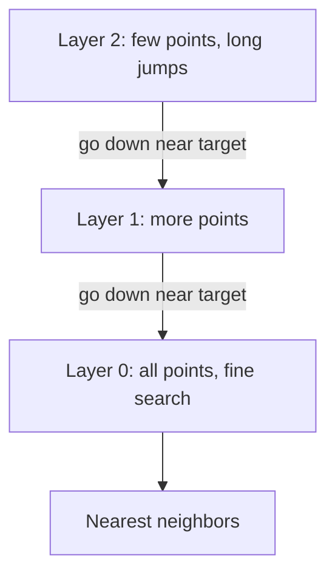

# Vector Databases and Indexes

> [!success] 🟢 Junior Explanation
> **In plain words:** A database built to quickly find the stored embeddings closest to your question's embedding.
>
> **Analogy:** In a huge library you don't check every book; you go straight to the right shelf area — fast and almost always right (approximate search).
>
> **Why interviewers ask:** Every RAG design needs one; interviewers like to hear you don't over-engineer it.
>
> **Say it in one sentence:** "A vector DB uses approximate nearest-neighbor indexes like HNSW; for most apps pgvector in Postgres is enough."
>
> 🎯 **Junior must know:** what it does; pgvector is often enough. · **Middle adds:** HNSW vs IVF+PQ vs DiskANN vs ScaNN by data size and memory.

## Why `[OS]`
Regular DBs do exact match (SQL `WHERE`). Similarity between embeddings needs math → normal DB too slow. A **Vector DB** stores embeddings and finds the most similar ones fast.

Examples: **Pinecone, Weaviate, Qdrant, Chroma, Milvus** `[OS]` `[SDH]`; vector support in **PostgreSQL + pgvector, MongoDB, Redis** `[OS]`.

## ANN `[OS]`
Comparing against every vector = exact but too slow at scale. **Approximate Nearest Neighbor** gives up a tiny bit of accuracy to be **thousands of times faster**.

## Index types `[OS]`
| Index | How | Use when |
|---|---|---|
| **HNSW** (Hierarchical Navigable Small World) | Graph; greedy walk | **Default**; index fits in RAM (~up to 100M vectors) |
| **IVF** (Inverted File) **+ PQ** (Product Quantization) | Cluster vectors, search relevant clusters; PQ compresses | Memory tight; accept small recall drop |
| **DiskANN** | Graph on disk minimizing random reads | Doesn't fit RAM; have SSDs |
| **ScaNN** (Google) | Quantization + direction-aware clustering | Billion-scale |

> [!tip] Pragmatic default `[OS]`
> For most apps **pgvector + HNSW inside PostgreSQL** is enough. You don't always need a dedicated vector DB.

## Other index types `[SDH]`
- **Inverted index** — keyword retrieval (BM25). See [[Hybrid Search, HyDE, Reranking, ColBERT]].
- **Trie** — prefix search (typeahead/autocomplete).
These coexist: typeahead uses Trie for prefixes while AI retrieval uses vectors for semantics `[SDH]`. HNSW balances recall and performance `[SDH]`.

## 🌐 Deeper Context `[WEB]`

**How HNSW works (Malkov & Yashunin, arXiv 2016 / IEEE TPAMI 2018), in plain words:**
- Build **several layers of graphs**. The top layer has very few points (long "highway" jumps); each lower layer has more points; the bottom layer has all of them.
- Each point's top layer is chosen **at random** with an exponentially decaying probability — that's why upper layers are sparse.
- Search: start at the top, **greedily walk** toward the query, drop one layer, repeat, finish on the bottom layer. This gives roughly **logarithmic** search cost.

> [!note] Knobs you'll see in every vector DB (general knowledge)
> **M** = links per node (more = better recall, more memory) · **ef_construction** = effort when building · **ef / ef_search** = candidate list size when querying (higher = better recall, slower). Tuning ef at query time is the main recall-vs-latency knob.

**Sources:** [HNSW paper (arXiv 1603.09320)](https://arxiv.org/abs/1603.09320v1) · [Paper PDF](https://arxiv.org/pdf/1603.09320) · [Summary](https://tldr.takara.ai/p/1603.09320)

> [!question] Recall
> 1. Pick an index: 20M vectors in RAM; 2B vectors; 500M vectors on single box with SSD; RAM-constrained.
> 2. When is pgvector sufficient?

Related: [[Embeddings and Embedding Models]] · [[RAG Fundamentals]]
