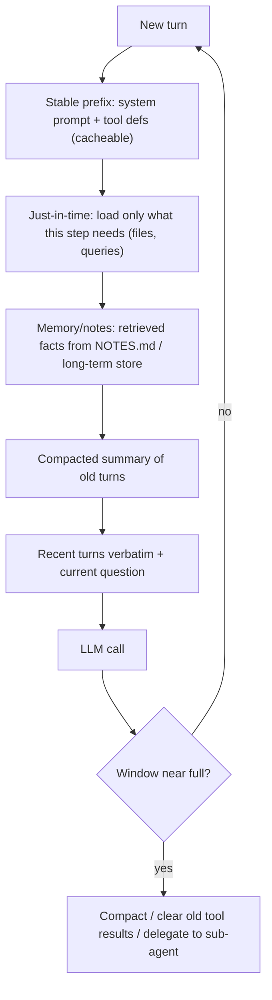

# 09 · Context Engineering

> [!success] 🟢 Junior Explanation
> **In plain words:** Deciding what goes into the prompt, what stays out, and in which order.
>
> **Analogy:** Packing a small suitcase: only what you need, the important things on top.
>
> **Why interviewers ask:** It's the core skill for both RAG and agents.
>
> **Say it in one sentence:** "Context engineering manages everything the model sees — instructions, retrieved chunks, tools, memory, history — and how it's ordered and compressed."
>
> 🎯 **Junior must know:** summarization for chat, compaction for agents, what never to compress (goal, instructions, latest messages). · **Middle adds:** building a context builder and the common mistakes.

> Core track #09 — What goes into the context, why not to send everything, building a context builder, summarization, retrieval and structured state, common mistakes.

## Definition `[OS]`
**Context Engineering** = designing, organizing, and managing **everything that goes into an LLM's context window** so the model can do its task reliably.

| Prompt engineering | Context engineering |
|---|---|
| Wording of one instruction | Everything the model sees: system prompt, retrieved chunks, tool definitions, tool results, memory, conversation history |

It decides `[OS]`: **what to include · what to exclude · where to place it (top/middle/bottom) · how to summarize/compress older info · how to structure so the model can find things.**
Mental model: context window = small **workspace**; you decide what goes on it. The model only sees what you place there.

## Why not send everything `[OS]`
[[Context Window Limits - Context Rot, Lost in the Middle, RoPE|Context rot, lost-in-the-middle, RoPE decay]] + cost (every token billed) + TTFT (longer prefill).

## Management strategies `[OS]`
| Strategy | How | Best for |
|---|---|---|
| **Truncation** | Drop oldest messages at overflow | Simple; loses info |
| **Summarization** | Summarize older messages into a short summary | **Chat** (most chat products) |
| **Sliding window** | Keep system prompt + last N messages | Chat where only recent matters (same idea as sliding-window attention inside models) |
| **Compaction** | Shrink old conversation/tool results into summary; keep goal, decisions, findings | **Agents** |
| **Hierarchical memory** | Full history in vector DB; retrieve relevant parts | **Q&A** |

### Compaction rules `[OS]`
- **Never** summarize away: system instructions, the user's main goal, the latest messages. Only the **messy middle** gets compressed.
- Drop verbose tool outputs once no longer needed.
- Example: an hour of coding-agent work → *"Goal: fix login bug. Changed auth.py and login.py. Tests passing."* → agent can work for hours without losing the plot.

## Building blocks of a context builder (synthesized from `[OS]`)
```
[system prompt + fixed tool defs]      <- stable prefix (prompt-cacheable)
[retrieved long-term memory facts]     <- Read step of memory
[retrieved chunks, reranked top-k]     <- most relevant at edges
[compacted summary of older turns]
[recent turns verbatim]
[current user question]                <- important things near the question
```
- Order fixed → variable to maximize [[Prompt Cache]] hits `[OS]`.
- Trim tool observations (10,000-line outputs drown the loop) `[OS]` → [[Agent Loop]].
- Structured state (plan, current step, results) lives in short-term memory scratchpad → [[Agent Memory]].
- Few, sharp tools; Agent Skills via progressive disclosure keep context small → [[MCP, A2A and Agent Skills]].
- Isolate big sub-tasks in [[Multi-Agent Systems and SubAgents|SubAgents]] with fresh context; return only short results.

## Common mistakes (from the sources)
- Dumping 50 chunks into the prompt (lost in the middle) `[OS]`.
- Burying key facts in the middle `[OS]`.
- Putting changing content before fixed content (breaks prompt cache) `[OS]`.
- Summarizing away the goal or system instructions `[OS]`.
- Raw, untrimmed tool outputs `[OS]`.
- Too many overlapping tools `[OS]`.
- Not inquiring about context-window limits / long-term memory needs at requirements time `[SDH]`.

> [!quote] `[OS]`
> Prompt Engineering fixes what the model **hears**, Context Engineering fixes what the model **knows**, Loop Engineering fixes what the model is **allowed to do over time**.

## 🌐 Deeper Context `[WEB]`

From Anthropic's **"Effective context engineering for AI agents"** (Sept 29, 2025) — the most-cited guide on this topic:

| Idea | Plain meaning | How to apply it |
|---|---|---|
| **Definition** | "The set of strategies for curating and maintaining the optimal set of tokens during LLM inference" | It happens **every turn**, not once |
| **Context rot / attention budget** | Recall drops as the window fills; each token spends budget | Smallest set of high-signal tokens wins |
| **Right altitude system prompt** | Between brittle if-else rules and vague "be helpful" | Start **minimal**, add instructions only for observed failures |
| **Tools** | Token-efficient, **minimal overlap**; "bloated tool sets" are a top failure | If a human can't pick the right tool, the model can't either |
| **Examples** | Few-shot still works | Use a few **diverse, canonical** examples — not every edge case |
| **Just-in-time context** | Keep lightweight references (**file paths, stored queries, links**) and load data with tools when needed | Don't pre-load everything; hybrid = some upfront + exploration |
| **Compaction** | Summarize a near-full window and restart with the summary; **clearing old tool results** is the lightest form | Long agent sessions |
| **Structured note-taking** | Agent writes notes **outside** the window (e.g. `NOTES.md`, to-do lists) and reads them back later | Multi-hour tasks survive resets |
| **Sub-agents** | A sub-agent may burn **tens of thousands of tokens** exploring but returns a **~1,000–2,000-token** summary | Main context stays clean → [[Multi-Agent Systems and SubAgents]] |



**Sources:** [Anthropic: Effective context engineering](https://www.anthropic.com/engineering/effective-context-engineering-for-ai-agents) · [Context engineering primer (aman.ai)](https://aman.ai/primers/ai/context-engineering/) · [Fighting context rot (Inkeep)](https://inkeep.com/blog/fighting-context-rot)


> [!question] Recall
> 1. Define context engineering vs prompt engineering.
> 2. Pick strategy: chat app; coding agent running 2 hours; Q&A over 3 years of chat history.
> 3. What must compaction never remove?
> 4. Sketch a context builder layout and justify the order.

Related: [[Agent Memory]] · [[Agent Loop]] · [[RAG Fundamentals]]
