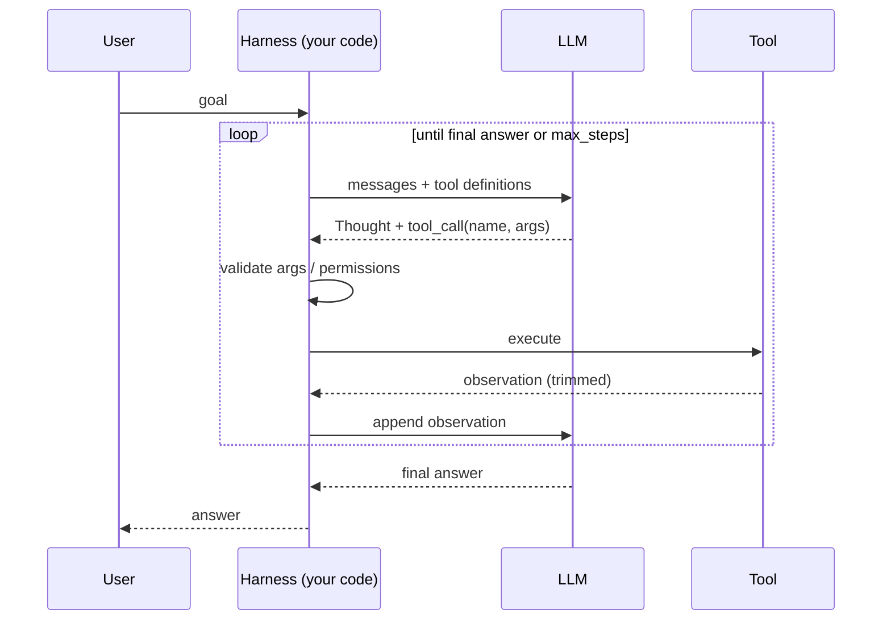

# 07 · Agent Loop

> [!success] 🟢 Junior Explanation
> **In plain words:** A while-loop: ask the model what to do → run the tool it asked for → give it the result → repeat, until it says 'done' or you hit a step limit.
>
> **Analogy:** A GPS that recalculates the route after every turn.
>
> **Why interviewers ask:** You may be asked to write it on the whiteboard.
>
> **Say it in one sentence:** "The agent loop sends context to the model, executes requested tools, feeds results back, and stops on a final answer or step limit."
>
> 🎯 **Junior must know:** write the loop with a step limit. · **Middle adds:** loop-engineering knobs: goal, budget, tools, observation trimming, memory, failure feedback.

> Core track #07 — The loop that sends context to a model, executes the tool it requests, and feeds the result back until the model returns a final answer.

## The cycle `[OS]`
```
User goal -> LLM decides: (a) pick tool  or  (b) final answer
             (a) -> loop runs Tool -> Observation -> back to LLM
             (b) -> Final Answer
```
Also called the **think → act → observe** cycle. The code around the LLM that runs it = the **harness** `[OS]`.

## Minimal implementation `[OS]`
```python
async def run_agent(user_goal, tools, max_steps=10):
    messages = [{"role": "user", "content": user_goal}]
    step = 0

    while True:
        # Safety stop: bail out if we hit the step limit
        if step >= max_steps:
            return "Reached step limit without completing the task."
        step += 1

        # Ask the LLM what to do next
        response = await call_llm(messages, tools)

        # If the LLM says "I am done", stop the loop and return the final answer
        if response.is_done:
            return response.final_answer

        # Otherwise, run each tool the LLM picked and feed the result back
        for tool_call in response.tool_calls:
            result = await call_tool(tool_call.name, tool_call.arguments)
            messages.append({
                "role": "tool",
                "name": tool_call.name,
                "content": str(result),
            })
```
~20 lines: a `while` loop, an LLM call, a stop check, a tool branch feeding results back. Memory, parallel tool calls, retries, logging = **polish around this core** `[OS]`.

## Loop Engineering — what engineers decide `[OS]`
| Knob | Guidance |
|---|---|
| **Goal** | Machine-checkable "done". "Fix the bug" weak; "test_login passes" strong. |
| **Step budget** | Max turns; when exhausted, **stop and honestly report** not finished. |
| **Tools** | Short, sharp list > long overlapping list. |
| **Observation** | Trim/summarize — 10,000-line outputs drown the loop. |
| **Memory** | Full history (honest, expensive) vs running summary (cheap, may lose details). |
| **Failure feedback** | "Error" teaches nothing. "File not found at src/mian.py, did you mean src/main.py" → recovery next turn. |

> AI works best when a **machine can check whether the task is done** `[OS]`.

## Production concerns `[OS]`
- Long runs → [[Async Processing and Message Queues|queue + worker]].
- Cost explosion — one request → dozens of LLM + tool calls → step & token budgets, [[Observability|traces/spans]].
- Context growth → [[Context Engineering|compaction]].
- Security → LLM only *requests* tools; harness validates args → [[Prompt Injection|code gates]].
- Real example: Claude Code loop = gather context → take action → verify results → repeat → [[Case - Claude Code]].

## 🌐 Deeper Context `[WEB]`

| Finding | Why it matters |
|---|---|
| **ReAct** (Yao et al., ICLR 2023) interleaves **reasoning traces** ("Thought") with **actions** (tool calls) so each informs the other — the origin of the think → act → observe loop | Name the paper when you draw the loop |
| A 2025 TMLR critique (Bhambri, Verma, Kambhampati) found ReAct's gains **brittle** — small setup changes hurt performance | Don't oversell ReAct; evaluate on your task |
| Anthropic: agents should check **ground truth from the environment each step**, may stop at **human checkpoints**, and use **stopping conditions such as max iterations**; test in **sandboxes** with guardrails | Matches the `[OS]` step-budget rule |
| **LLMCompiler** (ICML 2024) plans a dependency graph and runs independent tool calls **in parallel** — reported up to **3.7× lower latency than ReAct** | Sequential ReAct isn't the only option |



**Sources:** [ReAct paper (OpenReview PDF)](https://openreview.net/pdf/d49877b783d60e3cf6fdb22185a1a37de0ced704.pdf) · [Anthropic: Building effective agents](https://www.anthropic.com/engineering/building-effective-agents) · [Agent architectures overview](https://blckalpaca.at/en/knowledge-base/ai-agents/agent-architectures-overview.md)


> [!question] Recall
> 1. Write the agent loop from memory with a step limit.
> 2. Six loop-engineering knobs.
> 3. Why is "the test passes" a better goal than "fix the bug"?

Related: [[What is an AI Agent]] · [[Tool Calling]] · [[AI Orchestration vs Agents - Loop and Graph Engineering]]
