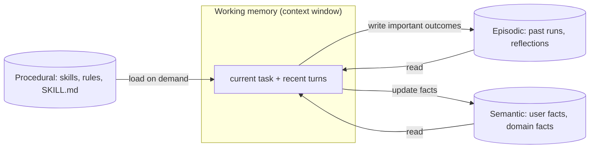

# 10 · Agent Memory

> [!success] 🟢 Junior Explanation
> **In plain words:** The model forgets everything between calls. The agent saves important notes and reads the relevant ones back into the prompt each turn.
>
> **Analogy:** Desk (context window), notepad (short-term), diary (long-term), library (external knowledge).
>
> **Why interviewers ask:** Personalization and long tasks depend on it.
>
> **Say it in one sentence:** "Agent memory is stored outside the LLM — short-term for the task, long-term for user facts — and is read into context and written back every turn."
>
> 🎯 **Junior must know:** short vs long-term; store what will matter next week. · **Middle adds:** the 4 operations, the runtime flow, and what not to store.

> Core track #10 — Why agents need memory, context vs memory, short-term / long-term / episodic / semantic memory, and the extract → store → retrieve → update → forget lifecycle.

## Why `[OS]` `[SDH]`
An LLM is **stateless** — every call is like meeting a stranger. Agents, unlike stateless REST APIs, need memory to operate `[SDH]`.
**Memory = the system that lets a stateless LLM act like it remembers across turns, sessions, and users.** The LLM remembers nothing; **the agent remembers on its behalf** `[OS]`.

## Context vs Memory
- **Context** = what's in *this* LLM call (Layer 1 below) — fast, small, lost on overflow.
- **Memory** = everything persisted *outside* the call and selectively **read back into** context. See [[Context Engineering]].

## The memory stack `[OS]`
| Layer | What | Lifespan | Analogy |
|---|---|---|---|
| 1. **Context window** | Text in current prompt | Lost on overflow | Desk |
| 2. **Short-term** | Scratchpad: plan, current step, intermediate results | Ends with session | Notepad |
| 3. **Long-term** | User facts, preferences, past-conversation summaries, learned behaviors | Persistent across sessions | Diary in drawer |
| 4. **External knowledge** | Docs, DBs, APIs, web — queried, **not maintained** by agent | External | Library across street |

Long-term sub-types `[OS]`:
- **Episodic** — past experiences (what happened in previous runs).
- **Semantic** — facts and concepts ("user prefers Go").
- **Procedural** — how to do things.

`[SDH]`: short-term tracks current session; long-term stored in a **vector database** to recall preferences/interactions over weeks or months.

## Lifecycle — four core operations `[OS]`
> **Memory System = Write + Read + Update + Forget.** If any one breaks, the whole system breaks.

| Core-track step | `[OS]` op | What |
|---|---|---|
| **Extract** | (part of Write) | Decide what's worth keeping from the turn (see rules below) |
| **Store** | **Write** | "I prefer code in Go" → `preferred language: Go` |
| **Retrieve** | **Read** | Pull only what matters now — **the hardest part** |
| **Update** | **Update** | Python last month → Go now: overwrite contradiction |
| **Forget** | **Forget** | Remove stale/wrong/irrelevant; otherwise store grows forever and retrieval degrades |

## Runtime flow `[OS]`
```
User msg -> READ memory (long-term facts/prefs/summaries + short-term plan/steps)
         -> BUILD prompt (system + retrieved memories + message)
         -> LLM (may call tools / external knowledge)
         -> WRITE memory (short-term step; long-term if worth keeping)
         -> Response
```
**Read → Build prompt → Respond → Write**, every turn.

### Example `[OS]`
- Turn 1: "My name is Priya and I code in Go." → memory empty → reply → **write** "Name Priya; prefers Go".
- Turn 2 (a week later): "Write a function that reverses a string." → **read** "Priya, prefers Go" → prompt includes it → Go function addressed to Priya.
This is how ChatGPT feels personal across chats.

## What to store `[OS]`
> **Store what will matter next week. Skip what only matters for the next minute.**

✅ Stable facts (name, role, language, timezone) · strong preferences · outcomes of past tasks · decisions shaping future work.
❌ Every message (context already has it) · chit-chat ("hi", "thanks") · temporary state already in short-term · **sensitive data without consent** ([[Data Privacy and Compliance]]).

Tools: **Mem0, Letta (formerly MemGPT), Zep** `[OS]`. Example of file-based project memory: `CLAUDE.md` in Claude Code → [[Case - Claude Code]].

## 🌐 Deeper Context `[WEB]`

| Framework | Key idea | Use it to explain… |
|---|---|---|
| **CoALA** — "Cognitive Architectures for Language Agents" (Sumers, Yao, Narasimhan, Griffiths, 2023) | **Working memory** (active info for the current decision cycle) + three long-term stores: **episodic** (past experiences/trajectories), **semantic** (facts about the world), **procedural** (rules/skills that drive behavior) | Where the episodic/semantic/procedural words come from |
| **MemGPT** (Packer et al., UC Berkeley, 2023) → now **Letta** | Treat the context window like **RAM** and external storage like **disk**; the LLM uses **function calls** to page information in and out ("virtual context") | How an agent can feel like it has unlimited memory |
| **Reflexion** (Shinn et al., NeurIPS 2023) | After a failed attempt, the agent writes a **verbal self-reflection** and stores it in **episodic memory** for the next try — learning without weight updates | Memory as a learning/replanning tool |
| **Anthropic structured note-taking** | Agent keeps notes like `NOTES.md` / to-do lists outside the window and re-reads them after resets | Simple, production-friendly long-term memory |



**Sources:** [CoALA (arXiv 2309.02427)](https://arxiv.org/pdf/2309.02427) · [MemGPT (arXiv 2310.08560)](https://arxiv.org/pdf/2310.08560) · [Berkeley MemGPT project](https://sky.cs.berkeley.edu/project/memgpt/) · [Anthropic: Effective context engineering](https://www.anthropic.com/engineering/effective-context-engineering-for-ai-agents)


> [!question] Recall
> 1. Four layers with analogies.
> 2. Map extract/store/retrieve/update/forget to the four ops.
> 3. What's the hardest op and why?
> 4. Five things you should NOT store.

Related: [[Context Engineering]] · [[Agent Loop]] · [[Semantic Cache]]
