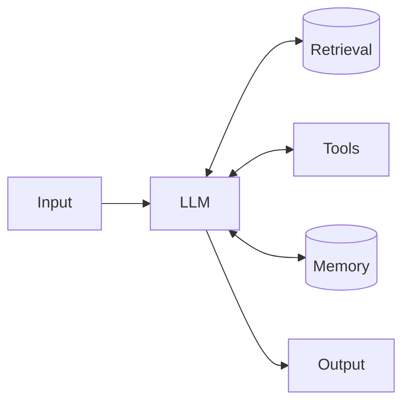
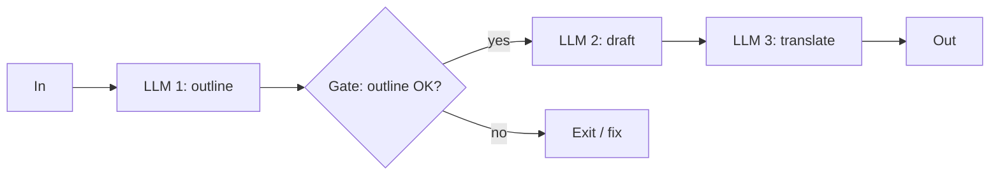
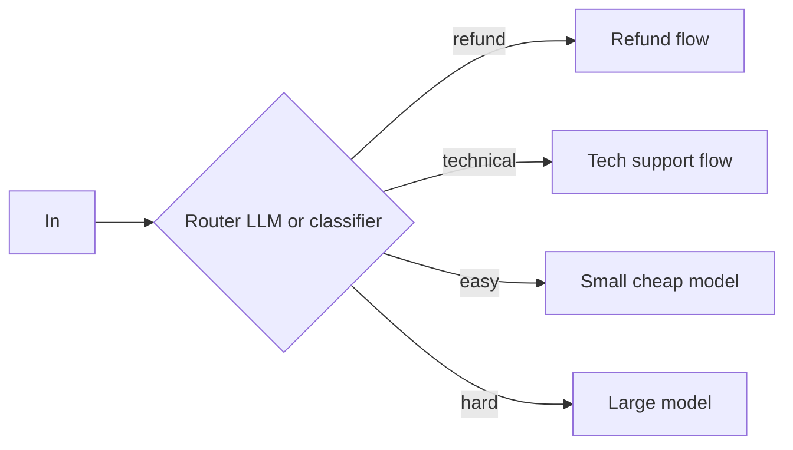
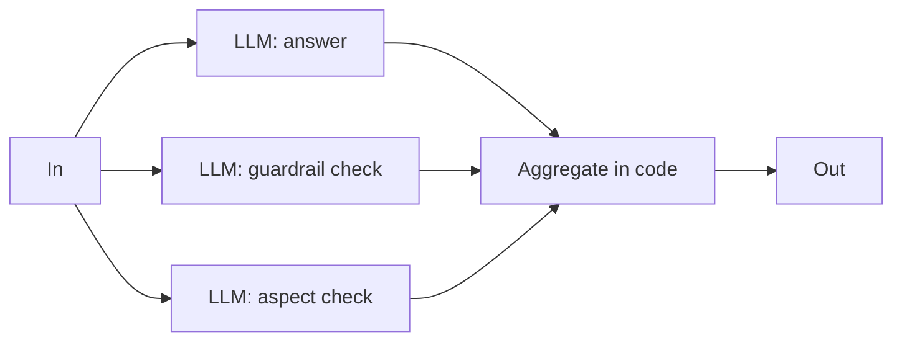
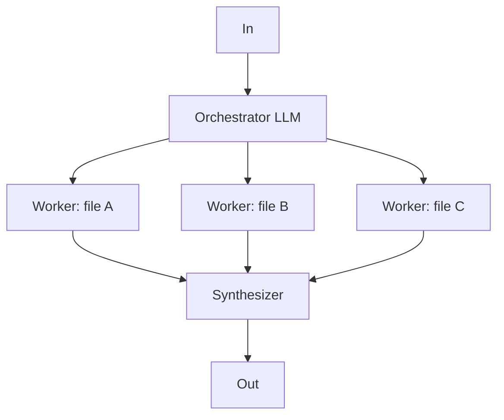
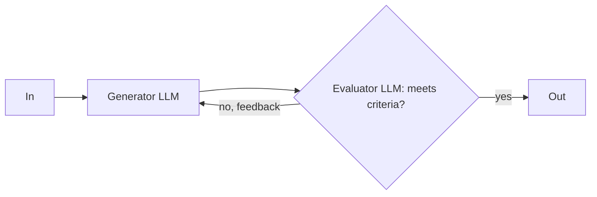
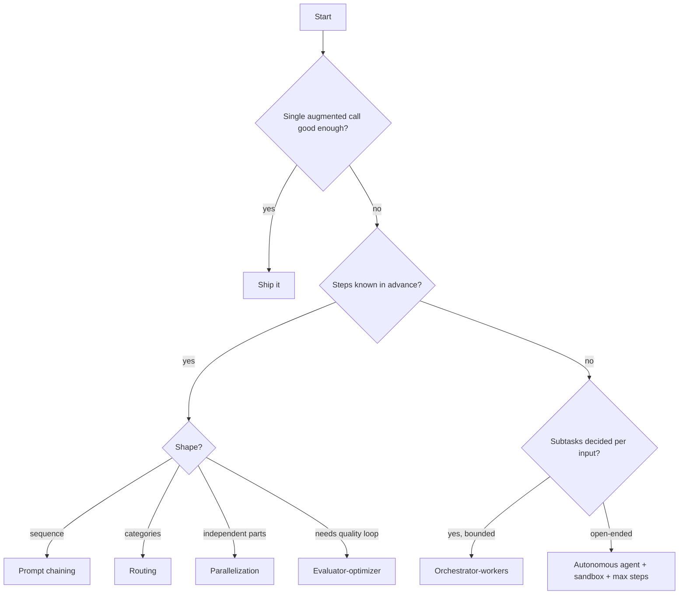

# Agentic Workflow Patterns

> [!success] 🟢 Junior Explanation
> **In plain words:** There are a handful of standard ways to wire LLM calls together. Most "AI agents" in real products are one of these simple patterns, not a fully autonomous robot.
>
> **Analogy:** LEGO pieces. Chain them, branch them, run them side by side, add a boss, add a reviewer — or let the model build freely (agent).
>
> **Why interviewers ask:** They want to see you pick the **simplest pattern that works** instead of jumping to multi-agent chaos.
>
> **Say it in one sentence:** "I start with a single augmented LLM call, move to a workflow like chaining or routing if needed, and only use an autonomous agent when the steps can't be predicted."
>
> 🎯 **Junior must know:** chaining, routing, and when an agent is overkill. · **Middle adds:** orchestrator-workers vs parallelization, evaluator-optimizer, risks of autonomy.

Source: Anthropic, **"Building effective agents"** (Dec 19, 2024) `[WEB]` — with links to `[OS]` concepts.

## 0. The building block — Augmented LLM
An LLM enhanced with **retrieval, tools, and memory**. Everything below is built from it.

Often **one well-optimized augmented call is enough** (good prompt + retrieval + examples).

## 1. Prompt chaining
Split a task into **fixed sequential steps**; optional programmatic **gate** checks between steps.

- **Use when:** the task cleanly splits into known subtasks; trades latency for accuracy.
- **Examples:** write marketing copy → translate it; outline → check outline → write document.

## 2. Routing
**Classify** the input, send it to a **specialized** handler.

- **Use when:** distinct categories handled better separately; classification is accurate.
- **Examples:** support tickets by type; easy → small model, hard → large model → [[LLM Routing]].

## 3. Parallelization
Run LLM calls **at the same time**, combine in code. Two flavors:
- **Sectioning** — different independent subtasks (e.g. one model answers while a **separate guardrail model** screens the input; parallel evals each checking one aspect).
- **Voting** — same task N times for confidence (e.g. several prompts review code for vulnerabilities; majority decides).

## 4. Orchestrator-workers
A central LLM **decides the subtasks at runtime** from the input, delegates them, then synthesizes.

- **Difference from parallelization:** subtasks are **not predefined** — the orchestrator chooses them.
- **Examples:** coding tools changing many files; research across many sources → [[Multi-Agent Systems and SubAgents]].

## 5. Evaluator-optimizer
One LLM generates, another **critiques**, loop until good enough.

- **Use when:** clear evaluation criteria exist and iteration measurably helps (like a writer revising a draft).
- **Examples:** literary translation; multi-round search where the evaluator decides if more searching is needed.

## 6. Autonomous agent
The LLM plans and acts in a loop, checking **ground truth from the environment** (tool results) each step; may pause for human checkpoints; stops at completion or **max iterations** → [[Agent Loop]].
- **Use when:** open-ended problems; number of steps can't be predicted; environment is trusted/sandboxed.
- **Risks:** higher cost, **compounding errors** → sandbox + guardrails.
- **Examples:** coding agent solving SWE-bench issues; computer-use agents → [[Computer Use and Browser Agents]].

## Choosing — decision ladder

## Three principles (Anthropic)
1. **Simplicity** — smallest design that works.
2. **Transparency** — show the agent's planning steps.
3. **Agent–computer interface** — document and test tools as carefully as prompts → [[Tool Calling]].

> [!warning] Frameworks
> Anthropic advises trying **direct API calls and simple code** before heavy agent frameworks — abstractions can hide prompts and make debugging harder.

> [!question] Recall
> 1. Name the 5 workflow patterns + autonomous agent, one example each.
> 2. Orchestrator-workers vs parallelization — the exact difference?
> 3. Sectioning vs voting?
> 4. Walk the decision ladder for: a support-ticket bot; a "fix this GitHub issue" agent.

**Sources:** [Anthropic: Building effective agents](https://www.anthropic.com/engineering/building-effective-agents) · [Simon Willison's notes](https://simonwillison.net/2024/Dec/20/building-effective-agents) · [Workflow patterns summary](https://learn.traeai.com/t/ai-engineering/phases/14-agent-engineering/12-anthropic-workflow-patterns.html)

Related: [[What is an AI Agent]] · [[AI Orchestration vs Agents - Loop and Graph Engineering]] · [[Planning and Task Decomposition]]
