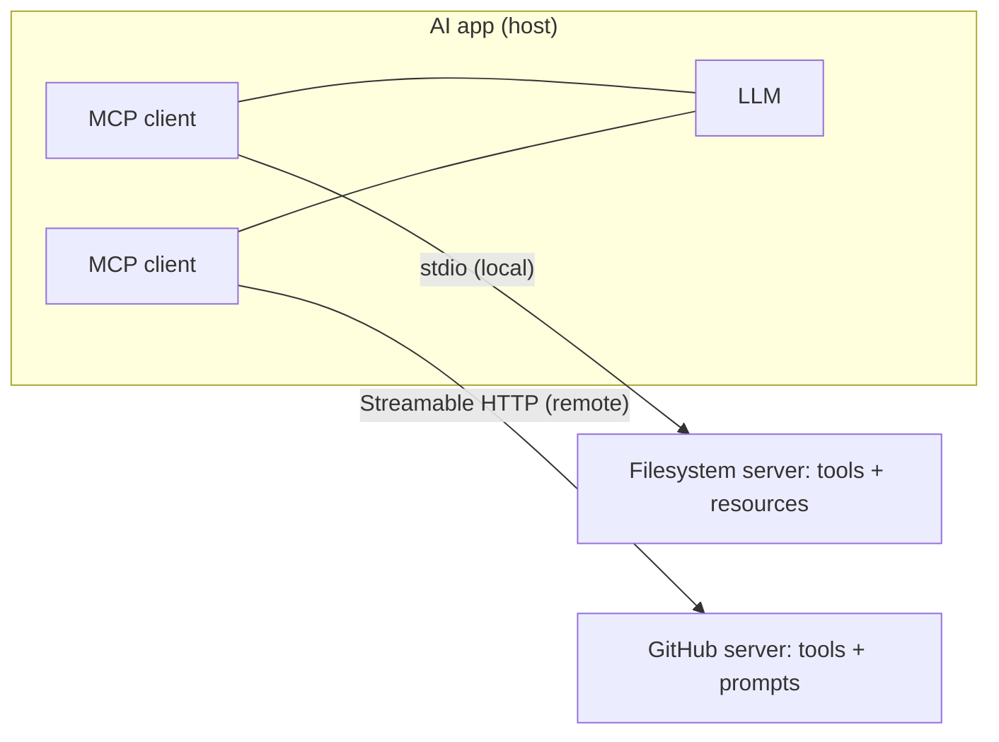

# MCP, A2A and Agent Skills

> [!success] 🟢 Junior Explanation
> **In plain words:** MCP is a standard plug to connect AI apps to tools and data. A2A lets agents from different companies talk. Skills are how-to manuals an agent loads only when needed.
>
> **Analogy:** MCP = USB-C port; A2A = a phone call between two companies' assistants; Skills = chapters of the team handbook.
>
> **Why interviewers ask:** Mentioning MCP is expected in 2026 agent designs.
>
> **Say it in one sentence:** "MCP gives an agent reach to tools, A2A connects agents to agents, and Agent Skills give know-how loaded on demand."
>
> 🎯 **Junior must know:** what MCP is and why it saves integration work. · **Middle adds:** MCP vs A2A vs Skills, progressive disclosure, MCP security.

## MCP — Model Context Protocol `[OS]`
Problem: agent must talk to GitHub, Slack, Drive, DB + 20 more — don't write 20 bespoke integrations.
**MCP = universal standard for connecting AI applications to tools and data sources.** "**USB-C port for AI**." Introduced by Anthropic late 2024; adopted by OpenAI, Microsoft, parts of Google & AWS; thousands of servers by 2026. `[SDH]` frames MCP as managing context and tool interaction in agentic systems.

- **MCP Server** — small program exposing a tool/data source (DB, FS, Slack, GitHub) over MCP.
- **MCP Client** — inside your AI app / AI Gateway; connects to servers, exposes their tools uniformly to the LLM.
```
Agent (MCP Client) <-> MCP standard <-> GitHub / Slack / Database (MCP Servers)
```
### Why it matters `[OS]`
Reuse existing servers · standard schemas · same server works with Claude, ChatGPT, Cursor, your agent · **security boundary** (separate process, own permissions).
**Use** when many external systems / provider portability / exposing internal systems. **Overkill** for small agent with 1–2 tightly-coupled custom tools.
Mentioning MCP in a 2026 AISD interview is **expected** `[OS]`.

> [!warning] MCP security `[OS]`
> Server = code with real permissions. Only connect to **trusted** servers, give **least privilege**, treat **every tool result as untrusted text** ([[Prompt Injection]]).

## A2A — Agent2Agent Protocol `[OS]`
Open standard by Google (2025), now Linux Foundation; 50+ companies (Atlassian, Cohere, Salesforce, SAP, Workday). Lets agents built by **different teams/vendors/frameworks** talk. Agents are **black boxes** (don't reveal prompts/tools).
- **Agent Card** (JSON): name, description, skills (+ I/O schemas), endpoint, auth, streaming modes.
- Discovery → request via **JSON-RPC over HTTP**.
- Modes: **sync** request/response · **streaming (SSE)** · **async push notifications** (minutes–hours).

### MCP vs A2A `[OS]`
MCP = agent ↔ **tools/data**. A2A = agent ↔ **agents** as peers. Complementary.
```
Agent A <-A2A-> Agent B <-A2A-> Agent C
   |MCP           |MCP           |MCP
 tools          tools          tools
```
Internal multi-agent in one codebase → don't need A2A.

## Agent Skills `[OS]`
MCP gives **reach**; agent also needs **know-how** (your steps, format, checklists). Stuffing it all in the system prompt fills context.
**Agent Skill** = folder of instructions (+ optional scripts/reference files) the agent loads **only when the task needs it**. Anthropic, Oct 2025, open format. Required file: `SKILL.md` (name, description, instructions). Analogy: one chapter of the team handbook.

**Progressive disclosure:**
```
Level 1 -> name + description         (always loaded, ~100 tokens each)
Level 2 -> full SKILL.md instructions  (loaded on match, < ~5k tokens)
Level 3 -> extra files in folder       (only if needed)
```
50 skills at L1 ≈ cost of one skill body → agent "knows" 50 procedures with near-empty context.

| | Agent Skills | MCP |
|---|---|---|
| Gives | Know-how | Reach |
| Made of | Instruction folder (+ scripts) | Running program exposing tools/data |
| Answers | *How* should this be done? | *What* can the agent reach? |
| Server running | No | Yes |
| Best for | Procedures, formats, style, checklists | DBs, apps, live data, actions |
Use both: MCP connects to issue tracker; Skill says how your team writes an issue. **OKF (Open Knowledge Format)**: markdown folder describing what your data/tables mean.

## 🌐 Deeper Context `[WEB]`

### MCP — what the spec actually says
| Piece | Details |
|---|---|
| **Server primitives** | **Tools** (actions the model can invoke) · **Resources** (contextual data to read) · **Prompts** (reusable templates); clients discover them with `*/list` methods |
| **Wire format** | JSON-RPC |
| **Transports** | **stdio** — server runs as a local subprocess (desktop/IDE clients) · **Streamable HTTP** — one endpoint (POST/GET), optional SSE streaming; replaced the older two-endpoint HTTP+SSE transport in the **2025-03-26** spec revision |
| **Governance** | **Dec 9, 2025**: the Linux Foundation formed the **Agentic AI Foundation (AAIF)** with MCP (Anthropic), **goose** (Block) and **AGENTS.md** (OpenAI) as founding projects |
| **Adoption** | Claude, Cursor, Microsoft Copilot, Gemini, VS Code, ChatGPT (per press coverage) |



> [!warning] Security angle (Simon Willison)
> Mixing MCP servers from different sources can quietly assemble the **"lethal trifecta"** (private data + untrusted content + a way to send data out). See [[Prompt Injection]].

### A2A — verified details
- Announced by Google on **April 9, 2025** with 50+ partners; later donated to the Linux Foundation.
- **Agent Card**: JSON at a **well-known URL** describing identity, skills, endpoint, auth.
- **Task lifecycle**: submitted → working → input-required → completed / failed / canceled; results returned as **artifacts**.
- Bindings: **JSON-RPC 2.0 over HTTPS** (most common), gRPC, HTTP+JSON; streaming via **SSE**; **webhooks** for long jobs. Method names changed between spec versions — check the current spec.

### Agent Skills — verified timeline
- Launched by Anthropic **Oct 16, 2025**; published as an **open standard on Dec 18, 2025** at agentskills.io.
- Progressive disclosure confirmed: ~**100 tokens** per skill at startup (name + description) → full `SKILL.md` on match → bundled files only when needed.
- Adopted by many agent platforms (reports name OpenAI Codex, GitHub Copilot, Cursor, Gemini CLI; counts vary by source).

**Sources:** [MCP architecture docs](https://modelcontextprotocol.io/docs/2025-11-25/learn/architecture) · [MCP transports (draft spec)](https://modelcontextprotocol.io/specification/draft/basic/transports.md) · [Linux Foundation AAIF announcement](https://www.linuxfoundation.org/press/linux-foundation-announces-the-formation-of-the-agentic-ai-foundation) · [SD Times on AAIF](https://sdtimes.com/ai/linux-foundation-forms-agentic-ai-foundation-to-be-new-home-for-mcp-goose-and-agents-md/) · [A2A architecture (Tyk)](https://tyk.io/learning-center/a2a-protocol-architecture-and-technical-specification/) · [Agent Skills open standard (Unite.AI)](https://www.unite.ai/anthropic-opens-agent-skills-standard-continuing-its-pattern-of-building-industry-infrastructure) · [SKILL.md guide](https://atlan.com/know/ai-agent/ai-agent-skills/what-are-agent-skills/)


> [!question] Recall
> 1. MCP client vs server. Why "USB-C"?
> 2. MCP vs A2A vs Skills in one sentence each.
> 3. Explain progressive disclosure and its token math.

Related: [[Tool Calling]] · [[Multi-Agent Systems and SubAgents]] · [[Context Engineering]]
