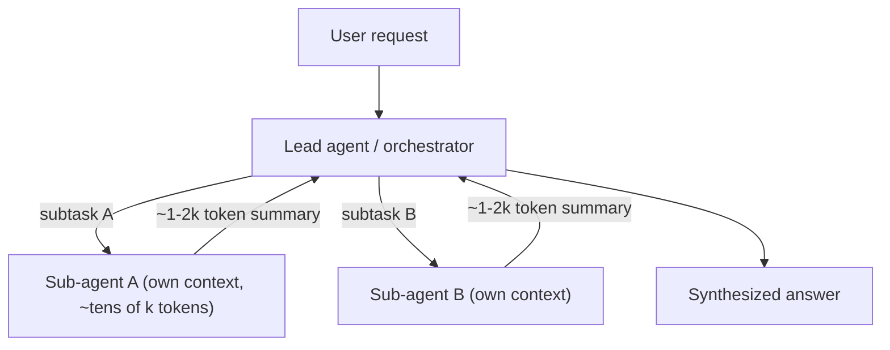

# Multi-Agent Systems and SubAgents

> [!success] 🟢 Junior Explanation
> **In plain words:** Several specialized agents (researcher, writer, reviewer) working together on one task.
>
> **Analogy:** A movie crew: director, camera operator, actors, editor — each does one job.
>
> **Why interviewers ask:** Interviewers test whether you know when NOT to use it.
>
> **Say it in one sentence:** "Multi-agent systems trade more cost and debugging complexity for specialization and parallelism; start with one agent first."
>
> 🎯 **Junior must know:** start single; roles; SubAgents keep context clean. · **Middle adds:** coordination patterns and the trade-off table.

## When `[OS]`
Task too big, system prompt too long, tool count unmanageable → **Multi-Agent System**: group of LLM-driven agents with roles working on a shared task.
> **Multi-Agent System = Specialized Agents + a Way to Communicate + a Way to Coordinate.**
Movie-crew analogy (director, cinematographer, actors, editor). Single agent = solo chef; MAS = full restaurant.

## Three pillars `[OS]`
1. **Specialization** — focused roles → small prompts, relevant tools, reliable behavior.
2. **Communication** — messages, shared memory, structured handoffs.
3. **Coordination** — who goes next, when done: orchestrator agent, fixed workflow, or routing rules.

## Roles `[OS]`
Orchestrator · Worker (researcher/writer/coder/analyst) · Router · Planner · Critic/Reviewer · Tool Specialist (e.g. DB agent that knows schema and writes good SQL).

## Example: customer support `[OS]`
```
Email -> Orchestrator -> Researcher (order, policy, history) -> notes
      -> Writer -> draft -> Critic (tone, accuracy, policy) -> approve | revise
      -> Final reply
```

## Coordination patterns `[OS]`
| Pattern | Shape | Note |
|---|---|---|
| Sequential | A→B→C→D | Simple, debuggable, slow if parallelizable |
| Parallel | fan-out → merge | Fast only if truly independent |
| Router | Router → A or B or C | Distinct request categories |
| Hierarchical | Orchestrator → workers → sub-workers | Like an org chart |
| Graph/Network | Anyone calls anyone | Max flexibility, hardest to debug |
Fixed (Sequential/Parallel) ↔ fully dynamic (Graph).

`[SDH]` **Orchestrator-worker**: central orchestrator LLM decomposes query, delegates to Coder/Search agents, synthesizes → more accurate than a monolithic model.

## SubAgents `[OS]`
Smaller specialized agent under a main agent (manager ↔ team members). Why:
1. **Context overload** — each SubAgent has **fresh context**, returns only a short result.
2. **Focus** — fewer tools → better decisions.
3. **Reusability** — web-search SubAgent reused by research/news/shopping agents.
4. **Parallel work**.
SubAgents can call SubAgents (tree) — powerful, but avoid deep costly chains.

## Trade-offs `[OS]`
| | Single | Multi |
|---|---|---|
| Complexity | Low | High |
| Prompt | One, long | Many, focused |
| Tools/agent | All | Split |
| Parallelism | Parallel tool calls in a turn | Natural |
| Debugging | Easier | Harder |
| Latency | Lower for simple | Higher w/ handoffs, lower w/ parallelism |
| Cost | Lower | Higher |
| Complex-task quality | Degrades as tools grow | Scales with specialization |
| Failure | As a unit | Partial / cascading |
Mistakes: agents chatting without progress, error propagation, runaway critic loops.

> [!tip] Rule `[OS]`
> **Start with a single agent.** Move to multi-agent only when it clearly can't do the job; add the **fewest** agents that solve it.

Cross-vendor agents → [[MCP, A2A and Agent Skills|A2A]]. Frameworks: LangGraph, AutoGen.

## 🌐 Deeper Context `[WEB]`

| Finding | Why it matters |
|---|---|
| Anthropic: a sub-agent may use **tens of thousands of tokens** exploring, but returns a condensed summary of **~1,000–2,000 tokens** to the lead agent | Concrete numbers for "SubAgents keep the main context clean" |
| **Orchestrator-workers vs parallelization**: in parallelization *you* predefine the subtasks; in orchestrator-workers the **orchestrator decides them from the input** | Exact distinction interviewers like |
| Parallelization has two flavors: **sectioning** (different subtasks at once, e.g. a separate guardrail model screening input) and **voting** (same task N times, e.g. several prompts reviewing code for vulnerabilities) | Gives you two concrete multi-agent designs |
| Autonomous multi-step systems have **compounding errors** and higher cost → sandbox + guardrails + stopping conditions | Name the main risk |



**Sources:** [Anthropic: Effective context engineering](https://www.anthropic.com/engineering/effective-context-engineering-for-ai-agents) · [Anthropic: Building effective agents](https://www.anthropic.com/engineering/building-effective-agents)


> [!question] Recall
> 1. Three pillars; six roles.
> 2. Four reasons for SubAgents.
> 3. Design a multi-agent research assistant; pick a coordination pattern and justify.

Related: [[Planning and Task Decomposition]] · [[AI Orchestration vs Agents - Loop and Graph Engineering]]
